# Tidewise

An open-source "PC manager" for Linux, for people switching from Windows or macOS.
It cleans junk, shows what uses disk space, lists and removes apps from every source,
and shows live performance and processes, in plain language.

**Status:** early development, nothing released yet. See `CHANGELOG.md` for what exists. Build it
yourself with `cargo build --release -p tidewise-app`, then run `./target/release/tidewise`
(`--demo` shows sample data). Actions that need administrator access are not available yet.

## Screenshots

These are drawn with `--screenshot <screen>` from the built-in sample data (no real files or apps).

| | |
| --- | --- |
| 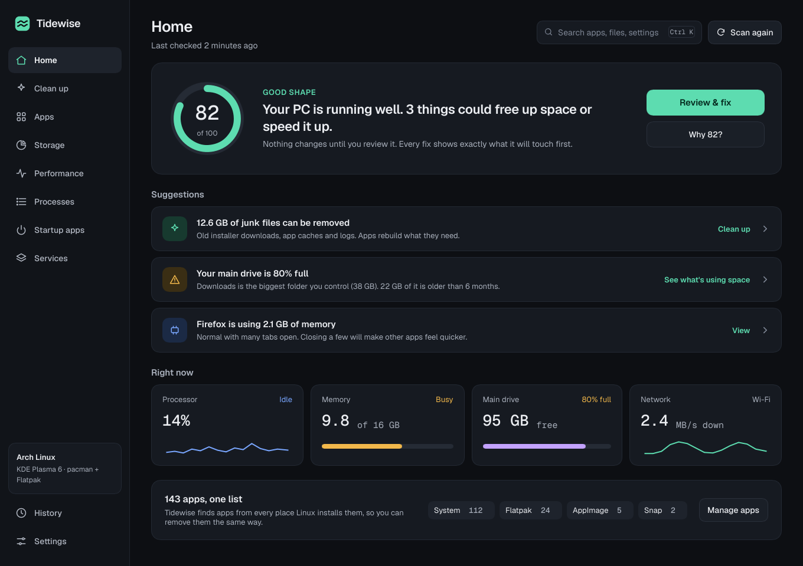 | 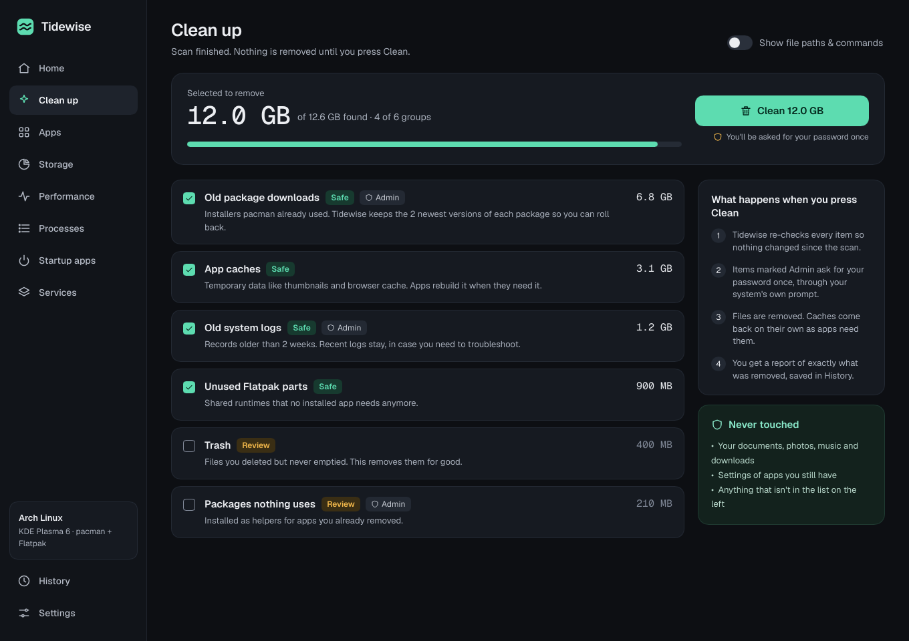 |
| 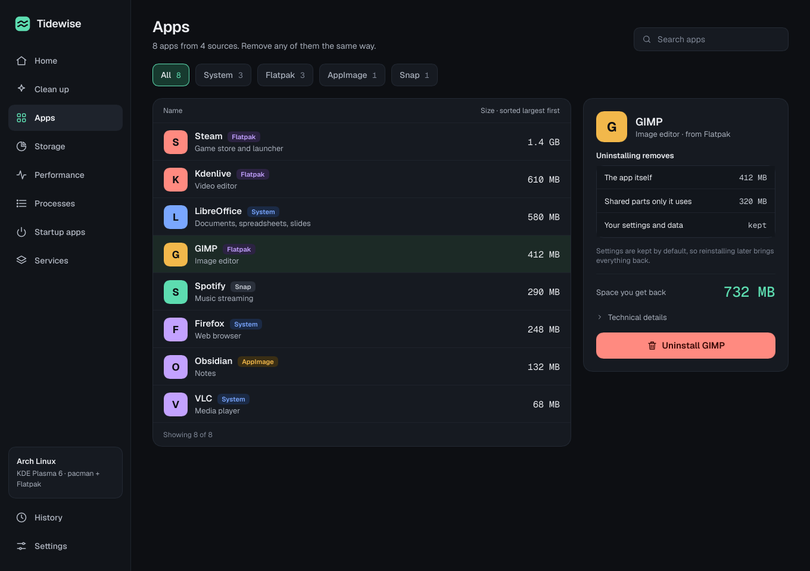 | 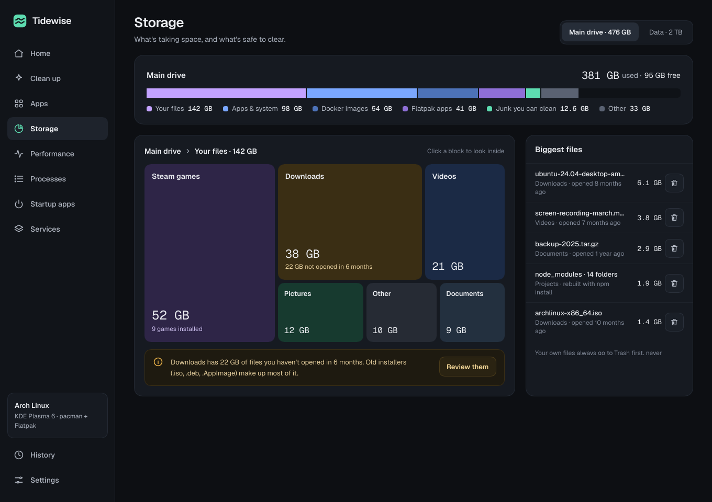 |
| 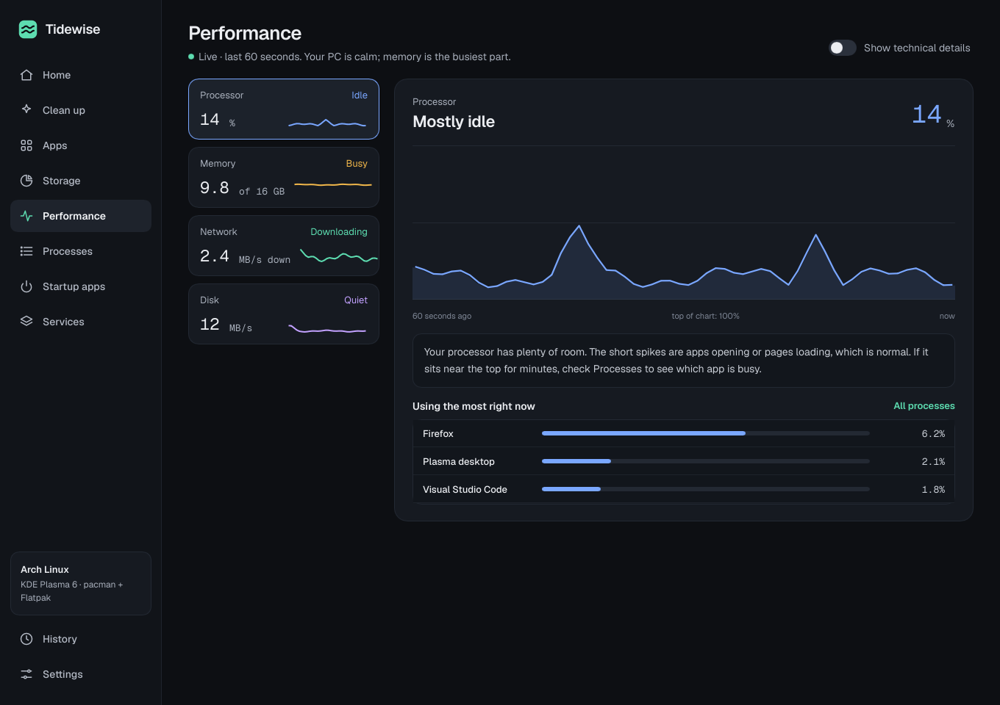 | 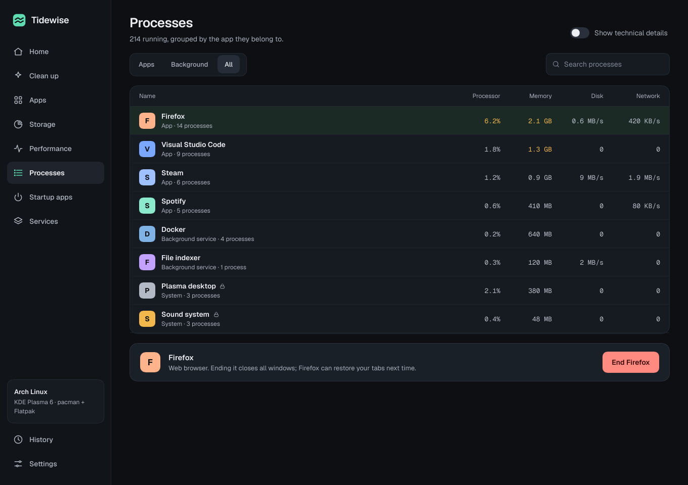 |
| 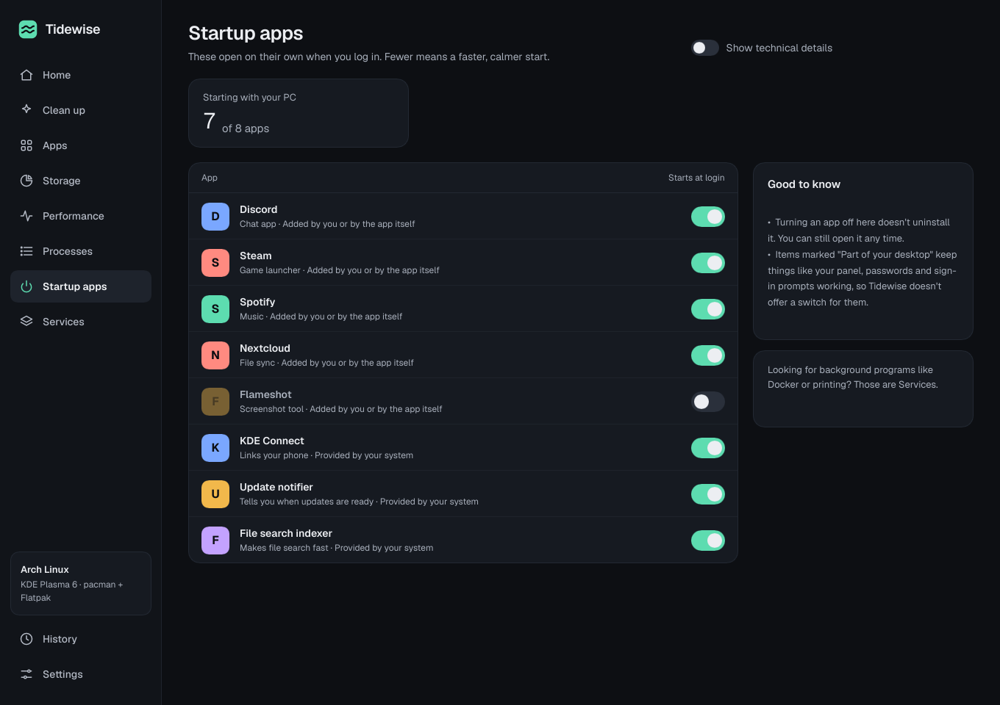 | 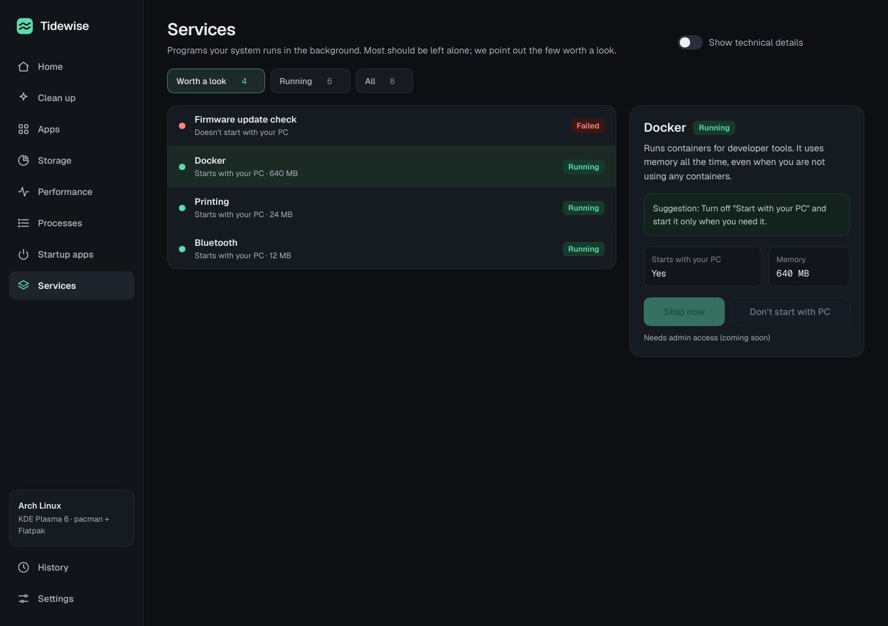 |
| 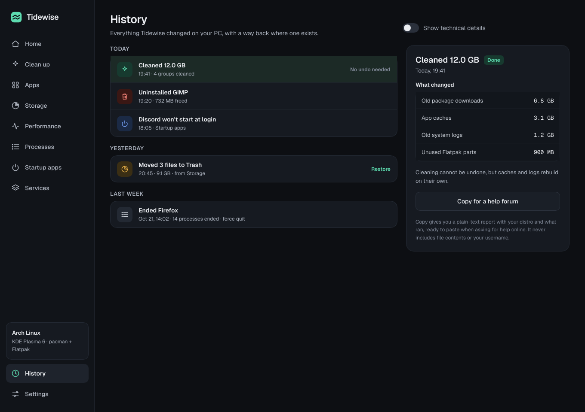 | 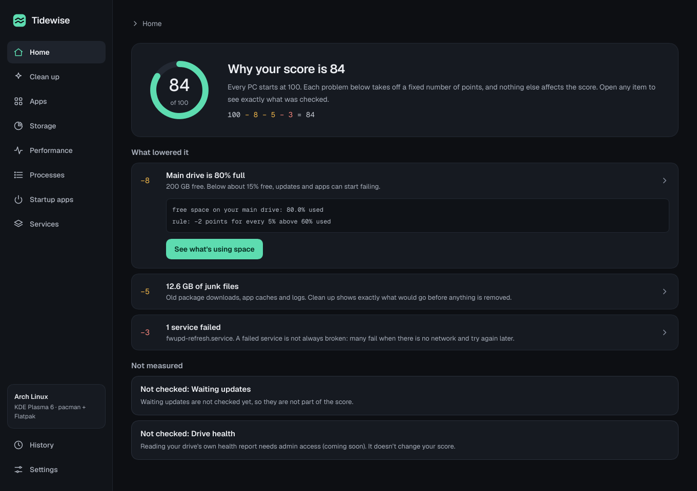 |
| 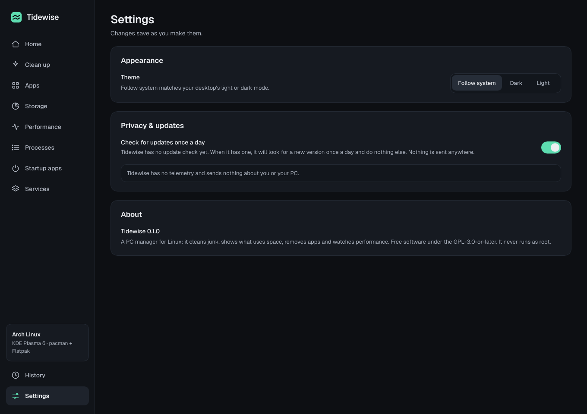 | |

Licence: GPL-3.0-or-later. See `LICENSE`.
