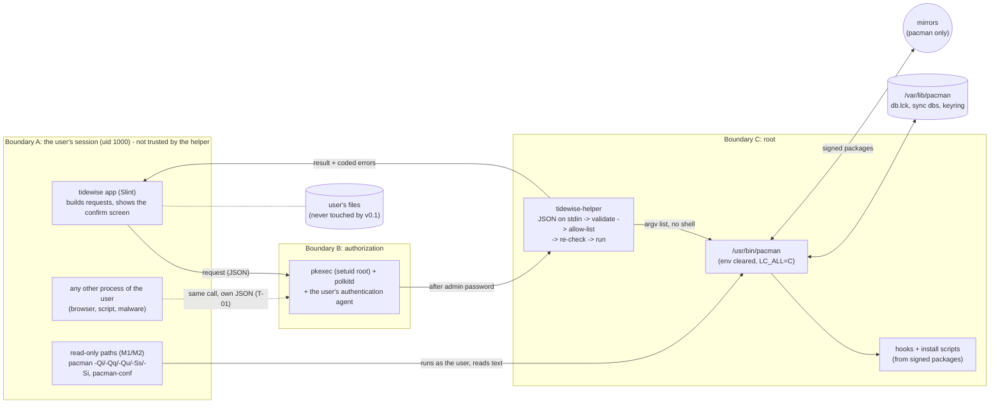

# Threat model v1 (STRIDE)

Status: **v1, 13 Nov 2026** (WBS 5.1); **updated 14 Nov 2026 for 5.2** (protocol crate: rows T-02, T-04 to T-07, T-09 to T-11, T-15, open questions 8, 11, 12); **updated 15 Nov 2026 for 5.3b** (the jobs: rows T-04 to T-15, T-17, T-18 updated, T-22 and T-23 added; open question 11 answered, 15 and 16 added); **updated 14 Nov 2026 for 5.3a** (helper gate: rows T-01, T-02, T-07, T-08, T-14, T-15; open questions 6 and 7 answered, 13 added; one correction to T-08). Written before any privileged code exists, so every M3 task starts from this
list. Update it whenever a milestone adds a privileged action, a file write, a parser of outside data or a network call
(ENGINEERING.md §2).

How to read it: section 1 draws the system, 2 names what we protect, 3 compares the two ways to reach root
(**decided 13 Nov 2026: pkexec + checked summary, see `docs/decisions/0005-helper-invocation.md`**), 4 is the threat table, 5 says what we do *not* defend, 6 lists what I could not verify,
7 lists sources. `[n]` is a source in section 7. "Planned" means the defence is designed but no code or test exists yet.

## 0. Base assumption (read this first)

**A1. The helper trusts nothing about its caller.** The polkit policy only decides *who may become root*; it does not
say *who is calling*. Any process running as the user can run `pkexec /usr/lib/tidewise/tidewise-helper` with a JSON
request of its own, not just the Tidewise app. So the app is not a security boundary, and the helper must treat every
request as hostile: full validation, allow-list, re-check of the confirmed list, every time, no matter who asks.
The caller's identity (`PKEXEC_UID` [1], parent process, argv) is only used for logging, never to relax a check.
This is threat T-01.

## 1. System and trust boundaries

Three privilege levels, and two lines you can cross only by being authorized:

- **Boundary A -> B** is where untrusted input enters. The only data that crosses it is the request JSON (stdin) and
  whatever the helper prints back.
- **Boundary B** decides "may this user become root now?". It does not see the request (T-02).
- **Boundary C** is the only place with root. Inside it the helper turns a validated request into a fixed `pacman`
  command line.
- **Read-only paths** (already built, M1/M2) cross no privilege boundary: the app runs `pacman` as the user and parses
  its text output. The input is *outside data* (package names and descriptions come from repository maintainers), so
  the parsers are treated as untrusted-input code (T-21).

## 2. Assets

| Asset | Why it matters | Who may touch it |
|---|---|---|
| **Root on the machine** | Everything else follows from it | Only the helper, only via the allow-list |
| **Package database and keyring** (`/var/lib/pacman`, `db.lck`, `/etc/pacman.d/gnupg`) | A corrupt or tampered db breaks the system; a half-finished upgrade can leave it unbootable | pacman only |
| **The user's files** (home directory) | Cannot be recreated | v0.1 helper never reads or writes them; later cleanup goes to Trash (rule 7) |
| **System config and installed binaries** (`/etc/pacman.conf`, `/usr/bin/pacman`, hooks) | Code run as root | Root only; not ours to defend (section 5) |
| **Integrity of what the confirm screen shows** | The user's consent is only worth something if it is about the real change | Helper re-checks the list (T-09) |
| **Tidewise's own installed files** (helper binary, polkit policy) | A writable helper is a free root shell | Root only (T-03) |
| **The audit trail** (journal, `pacman.log`) | "What did root do, and for whom?" | Append-only for us (T-14) |

## 3. How the app reaches the helper: pkexec vs a D-Bus service

Decision: **decided 13 Nov 2026, see `docs/decisions/0005-helper-invocation.md`**: pkexec with a human-readable summary
in argv that the helper checks (3.2); D-Bus is the fallback. The analysis below is kept as the reasoning behind it.
Both options end in the same helper logic and the same allow-list; they differ in how the process gets root and in what
the user is shown before saying yes.

### 3.1 The main point: what can the password dialog show? (threat T-02)

The danger: a malicious process calls the helper at the very moment the user expects Tidewise's prompt. The user sees
a password dialog, assumes it is theirs, and approves a *different* request.

- **pkexec.** The dialog text is the `<message>` of the polkit action. pkexec offers only these variables for it:
  `$(program)`, `$(command_line)`, `$(user)`, `$(user.gecos)`, `$(user.display)` [1]. The request travels on **stdin**,
  which polkit never sees. So every request, ours or an attacker's, produces the *same* dialog. The one thing that
  varies is `$(command_line)` (the argv), and pkexec's own man page says of it: "do not use this for any security
  checks, it is not secure" [1], because the caller chooses it freely.
- **D-Bus service.** The service (root) calls polkit's `CheckAuthorization(subject, action_id, details, flags, ...)`
  [3]. `details` is a string dictionary describing the action; a non-empty `polkit.message` key in it overrides the
  message shown to the user and may "include references to other keys that are expanded" [3]. Keys starting with
  `polkit.` are accepted only from a caller that is itself sufficiently privileged (e.g. uid 0) [3], and the service is
  root. So the *service* can write "Install vlc and 3 more packages (212 MB)" from the request **it** validated, and
  the attacker cannot change that text. The dialog tells the truth about the request that will actually run.
  (Whether the policy file's own `<message>` can also reference detail keys: I believe so but did not verify it. The
  `polkit.message` route above is the documented one.)
- **Evidence (13 Nov 2026, the human's KDE agent):** `pkexec /usr/bin/true install dbeaver jre-openjdk`, cancelled at
  the dialog: the agent **showed the full argv in the dialog title** [14]. That used the stock `exec` action; our own
  action must be re-tested in 5.4 (a custom message may hide argv).
- **What I could not verify:** how GNOME's agent renders these strings; truncation of long summaries, multi-line and
  markup; and what PackageKit's dialog shows. Needs a test on a real desktop.

### 3.2 A middle way for pkexec (my idea, untested)

Make argv carry a short human summary, and make the helper refuse unless it matches:

`pkexec /usr/lib/tidewise/tidewise-helper --summary "install vlc +3 (212 MB)"` with the policy message containing
`$(command_line)`. After authentication the helper recomputes the summary **from the validated JSON** and exits with
"summary mismatch" if the argv text differs. Then a lying caller does not get a harmful action; it only wastes one
approval. The dialog is truthful whenever the action succeeds. Costs: the summary is visible in `ps`; the summary
format becomes part of the protocol; whether agents show `$(command_line)` clearly is unverified (above).

### 3.3 Comparison

| | **pkexec, one process per job** | **D-Bus system service + polkit** |
|---|---|---|
| Root code running when idle | None. Root exists only during a transaction | A daemon (activated on demand by D-Bus/systemd, may exit when idle). More moving parts |
| Attack surface | pkexec is a **setuid-root** binary we do not control, plus polkitd | polkitd + the D-Bus daemon + our service parsing D-Bus messages; no setuid binary of ours, but the service must authenticate callers by bus name correctly |
| Dialog shows the request (T-02) | **No**, only program path / argv [1]. With 3.2: a checked summary | **Yes**, the service passes `details` [3] |
| Password prompts | One per `pkexec` call. Use `auth_admin` (not `_keep`) so a retained authorization can't be reused by another process [1] | Same policy choices. Service can also rate-limit before asking polkit (helps T-16) |
| Complexity / new dependencies | Smallest: a binary, a `.policy` file. No new crate for transport | Larger: a D-Bus crate (e.g. `zbus`), a service file, a D-Bus policy file, a systemd unit; dependency review needed |
| Caller identity | `PKEXEC_UID` (set by pkexec [1]); still only "some process of this user" | Bus name -> pid/uid via the bus; still only "some process of this user" (T-01 remains) |
| Known history | **PwnKit CVE-2021-4034**: memory corruption in pkexec's argument handling, present since pkexec was created in 2009, local root for any user, disclosed 25 Jan 2022 [4]. **CVE-2011-1485**: race in pkexec/polkitd about the caller's identity, polkit 0.96 [6] | **CVE-2021-3560**: polkit mishandled a D-Bus caller that disconnected mid-request and treated it as uid 0, giving an unprivileged user authorization (GHSL-2021-074) [5]. Affected-version ranges differ between sources (0.113-0.118 vs "seven years old"), so I give no exact range |
| Which parts are still trusted either way | polkit (policy + agent) | polkit (policy + agent) |

Two honest observations: (1) **Neither choice removes polkit from our trusted base**; both of the big historical bugs
above were in polkit code that both options use or sit next to. Arch ships patched polkit (128-1 on the machine I
checked); the exact fixed versions: I don't know. (2) The allow-list is what bounds the damage in both cases: a wrongly
approved request can only do what an allow-listed action does (e.g. install an official-repo package), never "run
anything as root".

### 3.4 Recommendation (not a decision)

**pkexec, one process per confirmed transaction, request as JSON on stdin, with the argv-summary check from 3.2.**
Why: no root process stays alive, it fits golden rules 1 and 6 as written, it adds no dependency, and the helper's
checks (the part that matters, A1) are identical in both designs. The cost is the weaker dialog; 3.2 narrows that gap,
and the allow-list bounds what is left.

What would flip me to D-Bus: if a manual test on your KDE (and GNOME, if you care) agent shows that `$(command_line)`
is truncated or unreadable, so the summary does not reach the user. Then T-02 can only be closed properly by the
service passing `details`. D-Bus would also change the wording of golden rule 1 ("started with `pkexec`").

**Decision: made (human, 13 Nov 2026): pkexec + checked summary; see `docs/decisions/0005-helper-invocation.md`.**
The KDE evidence above supports it; the 5.4 re-test with our own action can reopen it.

## 4. Threats

STRIDE letters: **S**poofing, **T**ampering, **R**epudiation, **I**nformation disclosure, **D**enial of service,
**E**levation of privilege. "Proof" names the planned test; IDs of WBS tasks I do not know are written as
"M3 helper task (ID to fill)". Test names marked *exists* are real tests in the repo today.

### 4.1 Your three additions first

| ID | STRIDE | Threat | Defence | Proof | Status |
|---|---|---|---|---|---|
| **T-01** | S, E | **Any process in the user's session can run `pkexec tidewise-helper` with its own JSON**, not just our app. Also covers a compromised app. | Base assumption A1: the helper trusts nothing about its caller. Every request gets the full pipeline: size cap -> strict JSON -> allow-list of actions -> name validation -> re-check of the confirmed list. `PKEXEC_UID` is for the log only. Policy requires admin authentication on every call (`auth_admin`, no `_keep`, `allow_any`/`allow_inactive` = `no`) so no retained authorization can be ridden [1][2] | Container test: run the helper directly (no app) with each row of the hostile-input table (T-04..T-07) and with a valid request from a different uid; assert the same checks fire. Unit test: no code path reads `PKEXEC_UID` to allow anything. **Helper side (5.3a), *exists*:** the helper refuses unless the effective uid is 0 (`root_is_uid_zero`, `an_ordinary_user_is_not_root`, `the_effective_id_counts_not_the_real_one`, `garbage_is_not_root`); `PKEXEC_UID` becomes a number or `unknown` and goes only into the log (`anything_that_is_not_a_plain_number_is_unknown`, `a_hostile_pkexec_uid_is_logged_as_unknown_in_both_entries`, `the_callers_identity_never_changes_the_answer` for none, 0, 1000, `x` and 4294967295); the real binary started as an ordinary user refuses with exit 2 (`as_an_ordinary_user_it_refuses_with_one_sentence_on_stderr_and_exit_2`, `the_not_root_check_comes_before_the_argument_check`); as root in the container every request-side row runs with no app involved (`hostile_requests_get_their_codes_and_nothing_from_them_reaches_the_journal`, `a_hostile_environment_is_ignored_and_the_caller_is_logged_as_unknown`). **Known limit (review R-01, confirmed 14 Nov 2026):** the root check reads `/proc/self/status`, so a user-namespace "root" (`unshare -r`) passes it. Harmless in 5.3a (nothing privileged happens); real privilege comes only from pkexec/polkit, never from this check. Accepted by the human on 14 Nov 2026 (open question 14). **Not covered yet:** the real pkexec path with polkit (not in the container), 5.4 and 5.5 | gate: done (5.3a); pkexec path: planned (5.4, 5.5) |
| **T-02** | S, E | **Authorization confusion.** A malicious process starts a helper request at the moment the user expects Tidewise's prompt; with pkexec the dialog cannot show the request (stdin is invisible to polkit), so the user approves the wrong one. | See section 3. If pkexec: summary in argv, helper recomputes it from the validated JSON and refuses on mismatch; `auth_admin` every time; the allow-list bounds what a wrongly approved request can do. If D-Bus: service passes `details`/`polkit.message` built from its own validated request [3]. Residual: user fatigue (T-16) and a fake password dialog drawn by malware (section 5) | Unit test: argv summary != summary derived from JSON -> refused (planned with the helper, 5.3). **Protocol side done (5.2):** `summary()` in `crates/helper-protocol`, one fixed function, printable ASCII, at most 200 bytes, targets then chosen providers (when all fit) then the count; tests *exist*: `the_sample_requests_read_like_this`, `a_single_target_is_cut_exactly_at_the_cap`, `and_n_more_counts_the_targets_that_did_not_fit`, `chosen_providers_are_listed_when_all_of_them_fit_and_counted_when_not`, `requests_that_differ_in_what_the_user_sees_read_differently`, `whatever_the_request_holds_the_text_is_printable_ascii_and_capped`; fuzz target `request`. Known limit: when the target list is cut, requests differing only past the cut read the same (the confirmed list, T-09, is what is re-checked). **Follow-up done (5.3a):** when the chosen providers do not all fit, the text now says `with N providers` instead of dropping them; tests *exist*: `chosen_providers_are_listed_when_all_of_them_fit_and_counted_when_not`, `providers_are_all_or_nothing_and_the_count_says_how_many`, `providers_are_counted_when_the_targets_were_cut`, `with_providers_the_text_is_still_cut_to_the_cap_and_keeps_the_provider_count`, `a_huge_provider_list_is_counted_in_a_short_text`. **Helper side (5.3a), *exists*:** `decide()` recomputes `summary()` from the validated request and compares the bytes: `a_summary_that_is_wrong_in_any_way_is_a_mismatch` (13 wrong texts), `a_summary_that_is_not_text_is_a_mismatch`, `a_bad_request_gets_the_same_answer_whatever_argv_says` (validation first, so argv cannot be used to probe), `the_log_gets_the_recomputed_summary_never_the_argv_text`; container: `a_wrong_summary_is_refused_and_the_argv_text_is_not_logged`. Dialog: the human's KDE agent showed the full argv in the title for the stock action (13 Nov 2026, [14]); **re-test with our own polkit action in 5.4**, and on GNOME if wanted, recorded in progress.md as a bent rule | protocol: done (5.2); helper compare: done (5.3a); dialog re-test pending (5.4) |
| **T-03** | T, E | **Tampering with installed files:** the helper binary, the polkit policy, any config or library the helper loads. A user-writable helper is a free root shell. | The package installs everything as `root:root`, directories `0755`, files not group/other-writable, under `/usr/lib/tidewise/` and `/usr/share/polkit-1/actions/`; nothing under `$HOME`, `/tmp` or `/opt`. The helper reads **no** config from user-controlled places (no env, no home). No RPATH/RUNPATH in the binary (`namcap` flags insecure RPATH/RUNPATH [9]); `cargo` builds without `-C rpath`. The policy's `exec.path` annotation is the absolute helper path [1] | **WBS 5.5**: `namcap` on the built package (`insecure-rpath` / `insecure-runpath` clean) + a permission test that walks the package file list and every parent directory and asserts owner root and no group/other write bit; plus `readelf -d` check for RPATH/RUNPATH | planned |

### 4.2 Input to the helper and to pacman

| ID | STRIDE | Threat | Defence | Proof | Status |
|---|---|---|---|---|---|
| T-04 | T, E | **Option injection into pacman.** Any option that moves pacman's root, config, hooks, keys or checks turns the helper into a root shell. All of these exist in pacman 7.1's man page [7]: `--root/-r`, `--dbpath/-b`, `--config`, `--hookdir`, `--gpgdir`, `--cachedir`, `--sysroot`, `--logfile`, `--overwrite`, `-d/-dd/--nodeps`, `--assume-installed`, `--noconfirm`, `--noscriptlet`, `--dbonly`, `--disable-sandbox`, `--print-format` | The request has **no free-form option field**. The helper builds argv from fixed templates (one per allow-listed action; the helper itself adds `--noconfirm` only as golden rule 10 allows: a verified transaction, never a caller's choice); the only caller-supplied values are validated `repo/name` pairs placed after `--`. A test lists every option above and shows no request can produce it. Never a shell (rule 3), absolute `/usr/bin/pacman` | Unit tests on the argv builder (one per forbidden option, plus "every argv equals template + names"); hostile names are unit-tested (5.3b: `hostile_package_names_are_refused_in_every_command`); no container test passes such a name to real pacman. Read-only side, *exists*: `option_lookalikes_stay_search_words_after_double_dash`, `args_are_si_then_double_dash_then_repo_slash_name`, `command_is_absolute_pacman_with_arg_list_and_c_locale`. **Protocol side (5.2), *exists*:** the request types have no field for any option, path or URL, and every struct refuses unknown fields: `an_unknown_field_is_refused_at_every_level`, `flags_paths_and_urls_have_no_field_to_live_in` (noconfirm, overwrite, nodeps, root, config, dbpath, hookdir, print_format, file, url, sysupgrade, refresh at two levels), `actions_that_do_not_exist_are_refused`. The argv builder itself is 5.3 **Helper side (5.3b), *exists*:** `pacman_args::args` is the only place a command line is built (ten shapes: `-Qu`, `-Sy`, `-S` and `-Su` with `--print --print-format`, `-S` and `-Su` with `--noconfirm --ask 66`, `-D --asdeps`, `-Q`): `the_exact_argument_list_of_every_command`, `before_the_double_dash_there_is_only_fixed_text` (no caller value can sit there), `no_command_can_carry_a_dangerous_option` (every option of the list above, plus `-U`, `-R`, `--needed`, `--asexplicit`, `-w`), `y_is_only_in_the_sync_and_never_with_an_upgrade_or_a_install`, `noconfirm_and_ask_belong_to_real_transactions_only`, `print_belongs_to_the_dry_runs_only`, `hostile_package_names_are_refused_in_every_command` (15 names), `hostile_repository_names_are_refused_in_every_command`, `one_bad_name_among_good_ones_refuses_the_whole_command`; the runner builds a line only through it (`a_bad_command_is_refused_before_anything_is_created_or_run`); pacman by absolute path (`the_real_runner_uses_pacman_by_absolute_path_and_the_real_limits`), no shell. **New fixed flag, decided with the human (decision 0006, row T-23):** `--ask 66` on the two real transactions. | read-only: done; protocol: done (5.2); argv builder: done (5.3b) |
| T-05 | T, E | **`-U`, local file paths, URLs.** `pacman -U` installs an arbitrary file or URL as root. | The protocol has **no path or URL field**; the helper only ever runs `-S` (sync) forms with repo package names, never `-U`. Names with `/`, `:`, `.` first etc. are refused by the allow-list (T-06) | Unit test: argv never contains `-U`/`--upgrade`; request with `file:///x`, `/tmp/a.pkg.tar.zst`, `http://..` as names is refused. **Protocol side (5.2), *exists*:** `hostile_names_are_refused_as_names` (paths, `file://`, `http://`, `../x`, `*`), `flags_paths_and_urls_have_no_field_to_live_in` (`file`, `url`) **Helper side (5.3b), *exists*:** no template contains `-U`, a path or a URL: `no_command_can_carry_a_dangerous_option`, and names are `repo/name` after `--` (`hostile_package_names_are_refused_in_every_command` includes `/tmp/a.pkg.tar.zst` and `file:///x`). | protocol: done (5.2); argv: done (5.3b) |
| T-06 | T, E | **Hostile names:** leading `-`, NUL, `../`, whitespace, shell characters, unicode look-alikes (Cyrillic "a", full-width characters), empty string, 10 000 names, one 1 MB name | Allow-list (not block-list) from `man PKGBUILD`: ASCII letters, digits and `@ . _ + -`, not starting with `-` or `.`; repo names likewise (no `/`, not `local`, no control chars). Refuse the whole request on the first bad name; never "clean" a name. Cap on name length and on the number of names per request | *exists*: `accepts_real_package_names`, `rejects_everything_else` (includes `café`), `rejects_repo_names_pacman_or_we_refuse`, `bad_package_names_are_refused`, `one_bad_ref_among_good_ones_refuses_everything`. Helper: same table plus NUL, 10 000 names, look-alikes, over-length. **Protocol side (5.2), *exists*:** one copy of the rules in `tidewise-names`; the helper's repo rule is ASCII only and at most 64 bytes (`helper_accepts_plain_ascii_repo_names`, `helper_refuses_everything_that_is_not_plain_ascii_or_is_reserved`); `hostile_package_names_are_refused_everywhere_a_name_can_go`, `hostile_repo_names_are_refused_everywhere_a_repo_can_go`, `bad_versions_are_refused`, `too_many_of_anything_is_refused` (100 targets, 100 provider answers, 5 000 confirmed lines), `duplicates_are_refused`, `hostile_names_are_refused_as_names` (26 rows through `parse_request`, including a 1 MB name). Refuse, never clean: the first problem fails the whole request | read-only: done; protocol: done (5.2) |
| T-07 | D, T | **Huge or deeply nested JSON**, trailing garbage, duplicate keys, unknown fields | Read stdin with a hard byte cap before parsing; parse into typed structs with unknown fields denied; exactly one JSON value, nothing after it; bounded nesting (serde_json has a default recursion limit; I believe 128, to be confirmed by a test, not assumed) | Hostile-input tests (oversize, 10 000 levels, trailing data, NUL in strings, `-1`/huge numbers) + a `cargo fuzz` target for the request parser (ENGINEERING.md §2). **Protocol side (5.2), *exists*:** `a_request_over_the_byte_cap_is_refused_before_parsing` (2 MiB, checked before parsing), `anything_after_the_value_is_malformed`, `a_repeated_or_unknown_key_is_malformed`, `another_protocol_version_is_a_version_mismatch`, `a_version_that_is_not_a_plain_number_is_malformed`, `deep_nesting_is_refused_and_does_not_overflow_the_stack`, `broken_json_is_refused`, `a_request_over_two_mebibytes_is_refused_before_it_is_read`; fuzz target `request` (run result in progress.md, 5.2). **Correction:** serde_json has no 128-level limit here, see open question 8. **Helper side (5.3a), *exists*:** `read_capped` reads at most cap + 1 bytes with `Read::take`: `a_request_exactly_at_the_cap_is_read_whole`, `one_byte_over_the_cap_is_kept_so_the_parser_can_say_too_large`, `ten_mebibytes_are_cut_at_the_cap_plus_one`, `an_endless_stream_is_never_read_past_the_cap_plus_one`, `a_read_error_is_read_failed_even_after_some_data`; `decide` goes through the protocol's door first (`requests_that_fail_are_refused_with_their_code`); as root in the container, eight hostile rows including 2 MiB + 1 (`hostile_requests_get_their_codes_and_nothing_from_them_reaches_the_journal`). **Residual, recorded for 5.3b:** a caller that never closes stdin and sends nothing keeps the helper waiting in `read_capped`. Harmless in 5.3a (nothing is held); in 5.3b the whole request must be read and validated before any lock is taken, any sync is done or pacman is started **5.3b:** the whole request is read and validated before the work folder is made, before the lock is looked at, before a sync or pacman (`refusals_never_make_a_runner_and_have_one_finished_entry` in `run.rs`; container `a_refusal_never_creates_the_work_folder_or_starts_pacman`), so a caller that never closes stdin holds nothing. | protocol: done (5.2); helper: done (5.3a); nothing is held while waiting for stdin (5.3b) |

### 4.3 Process environment

| ID | STRIDE | Threat | Defence | Proof | Status |
|---|---|---|---|---|---|
| T-08 | E, T | **Inherited environment:** env vars, `PATH`, `LD_PRELOAD`/`LD_LIBRARY_PATH`, working directory, umask, open file descriptors, signals | pkexec already starts the program with "a minimal known and safe environment" [1] and in the target user's (root's) home directory unless `--keep-cwd` is used [1]; the helper does not rely on that: clear the environment for every child (`env_clear` + `LC_ALL=C`), absolute paths only (no `PATH` lookup), `chdir("/")`, set `umask 022`, stdin of children = `/dev/null`, check there are no unexpected open fds. **Signals:** after the transaction starts, a dying app or `SIGHUP`/`SIGINT` must not kill pacman half-way (T-17). `#![forbid(unsafe_code)]` rules out closing descriptors in-process, so the helper **checks** `/proc/self/fd` and refuses to start if anything beyond 0, 1, 2 and its own directory listing is open (decided 14 Nov 2026, 5.3a; open question 6). **LD_PRELOAD and LD_LIBRARY_PATH are not defended by the helper** (see Proof) | Container test with a fake pacman that dumps its env, cwd, umask, fds and signal mask; helper started with hostile env (`LD_PRELOAD`, `PATH=/tmp/evil`, `IFS`, `PACMAN_*`, inherited fd 5). Read-only side, *exists*: `command_is_absolute_pacman_with_arg_list_and_c_locale`. **Helper start (5.3a), *exists*:** the checks run in this order, and the first that fails decides: effective uid 0, descriptors, `chdir(\"/\")`, argv (`the_checks_run_in_the_documented_order`, `an_extra_open_file_still_gets_the_not_root_message`). Root comes first, changed 15 Nov 2026 after CI: a GitHub runner hands the test process extra descriptors, and the helper, started as a normal user, said \"unexpected open files\" instead of the useful \"must be started as root\". Nothing acts before all four pass, so what the helper allows is unchanged. Descriptors (`only_the_standard_descriptors_are_fine`, `our_own_listing_descriptor_is_fine`, `an_extra_descriptor_is_refused_by_number`, `a_target_that_only_looks_like_the_listing_is_refused`, `the_real_listing_has_the_standard_descriptors_and_its_own_listing_descriptor`; container `an_inherited_file_descriptor_is_refused_to_start`, which leaks a descriptor with `flock(1)`, no shell); working directory `chdir("/")` in `main`; the environment is read for `PKEXEC_UID` only (`a_hostile_environment_changes_nothing`; container `a_hostile_environment_is_ignored_and_the_caller_is_logged_as_unknown` with `PKEXEC_UID` holding a new line, `PATH`, `IFS`, `PACMAN_ROOT`, `LC_ALL`, `HOME`). Sources: pkexec (polkit tag 128, `src/programs/pkexec.c`) calls `fdwalk_close_on_exec (3)` under the comment "set close_on_exec on all file descriptors except stdin, stdout, stderr"; its list of kept environment variables (read from tag 126, not re-read for 128) is `SHELL`, `LANG`, `LINGUAS`, `LANGUAGE`, `LC_*`, `TERM`, `COLORTERM`, and `DISPLAY`/`XAUTHORITY` only with `allow_gui`, so `LD_*` is not on it. Rust's std reopens a closed 0, 1 or 2 as `/dev/null` before `main` (checked 14 Nov 2026 by closing 0 and 1 before starting the helper: it still saw all three open; for 2 only the exit code was visible), so "a standard descriptor is missing" cannot happen in the real binary and is tested on injected input only. **Correction (5.3a):** the helper cannot defend against `LD_PRELOAD` or `LD_LIBRARY_PATH`: the dynamic loader acts before `main` (a missing preload object printed a loader error on stderr before any of our code ran). pkexec removes them, not us; to be re-checked with the real pkexec in 5.4. **Helper start and children (5.3b), *exists*:** `umask(022)` first thing in `main` through `rustix::process::umask` (the human's decision, 14 and 15 Nov 2026; pacman does not fix the umask: measured, the downloaded package file was 600 under umask 077 and 666 under 000): `the_umask_becomes_022_whatever_the_caller_had`; container `whatever_umask_the_helper_is_started_with_the_files_come_out_as_with_022` (package file, installed file, database entry); pacman gets `env_clear` plus exactly `PATH=/usr/bin` and `LC_ALL=C` (`pacman_gets_exactly_path_and_lc_all`, `the_child_gets_exactly_the_fixed_environment`; container `an_install_script_sees_exactly_path_and_lc_all_and_a_command_from_path_works`, with hostile variables passed to the helper and the script running in `/`); pacman's stdin is null (`stdin_is_null_so_a_program_that_reads_it_sees_the_end_at_once`); pacman leads its own process group (`the_child_leads_its_own_process_group`, mutation-checked in the container). `rustix` 1.1.6 (features `std`, `fs`, `process`; its `umask` is gated by `fs`) is a direct dependency of the root binary; with bitflags and linux-raw-sys, all already in Cargo.lock. Signals: row T-17. | helper: done (5.3a, 5.3b); signals sent to the helper itself: row T-17 |

### 4.4 Races, locks, concurrency

| ID | STRIDE | Threat | Defence | Proof | Status |
|---|---|---|---|---|---|
| T-09 | T | **TOCTOU between review and run.** The user confirms list L; before the helper acts, the sync databases or installed packages change, so the real change is L'. | The confirm request carries the exact list L the user saw. The helper redoes the dry-run (`pacman -S --print ...`) itself and refuses if the result differs from L. Residual window: between the helper's re-check and pacman's own resolution (pacman re-resolves). We cannot close it by taking `db.lck` ourselves (T-10), so it is accepted and small. Targets are passed explicitly; nothing is expanded by glob | Container test: change the sync db (second repo state) between "review" and "run"; helper must refuse. Container test: list differs by one package -> refuse. **Protocol side (5.2), *exists*:** every install and update request carries the confirmed list (`transaction`: repo, name, version per line) and `validate` requires every target and chosen provider to be in it from the same repository (`targets_and_choices_must_be_in_the_confirmed_list_from_the_same_repo`); the re-check is 5.3. **Side effect of a refusal: open question 12** **Helper side (5.3b), *exists*:** the dry run `--print` must equal the confirmed list as a sorted multiset (the order of resolution is not a difference): flows `a_dry_run_that_differs_is_a_changed_transaction_and_nothing_real_runs`, `the_same_lines_in_another_order_are_the_same_transaction`, `a_target_that_is_gone_from_the_repositories_is_a_changed_transaction`, `an_update_whose_dry_run_differs_after_the_sync_is_a_changed_transaction`; container `a_list_that_is_not_what_pacman_says_is_a_changed_transaction_and_nothing_changes` and `a_repository_that_changed_after_the_list_was_made_is_a_changed_transaction` (the real TOCTOU: the repository gets 2.0 after the list for 1.0 was made), each with an identical snapshot of the system. **Post-check (the human's addition):** after every real run `pacman -Q` of each confirmed item; the count not installed at the confirmed version is a `Notice` (`a_declined_replacement_in_an_update_is_a_notice_not_an_error`, `items_that_are_not_installed_at_the_confirmed_version_are_counted_in_a_notice`; container `a_pending_replacement_is_declined_and_reported_as_a_notice_not_an_error`, `a_conflict_aborts_with_pacmans_words_installs_nothing_and_the_notice_counts_the_list`). Measured (pacman 7.1.0): `--print` neither notices a conflict (the real run aborts) nor lists the removal that a replacement causes (row T-23). The residual window is unchanged: between the helper's dry run and pacman's own resolution. | protocol: done (5.2); helper re-check and post-check: done (5.3b) |
| T-10 | D, T | **Lock file** `/var/lib/pacman/db.lck`: deleting it while another pacman runs corrupts the database | Golden rule 9: never delete, create, or "fix" the lock. If pacman reports it, the helper returns the coded error `DatabaseLocked` and the app explains "another package manager is running, try again". Never a retry loop that sleeps forever | Container test: hold a real lock, run the helper, assert coded error and that the file's inode and mtime are unchanged. Test that the source contains no removal of `db.lck`. Protocol side (5.2): the coded error `DatabaseLocked` and its fixed text exist (`a_locked_database_says_to_wait_and_try_again`) **Helper side (5.3b), *exists*:** the helper looks at `db.lck` (`symlink_metadata`) before anything else: `a_held_lock_ends_the_job_before_any_command_runs` (all three jobs; no command runs), `a_locked_database_stops_the_sync_and_nothing_else_runs`, and it classifies pacman's three real lock messages as a backstop for a lock taken in between (`the_real_lock_messages_are_recognised`, `only_a_line_that_starts_with_the_message_counts`, `a_lock_taken_in_the_meantime_is_database_locked_without_pacmans_advice`); pacman's own advice to remove the lock is never shown. Container: `a_held_lock_is_database_locked_the_lock_is_untouched_and_pacman_does_not_run` (inode and mtime unchanged, `pacman.log` unchanged, identical snapshot); and the source guard `only_the_listed_places_touch_files_and_the_lock_is_only_looked_at` with `nothing_but_a_look_ever_names_the_lock` (mutation-checked: adding a removal fails both). A stale lock left by a killed pacman (measured: SIGTERM and SIGPIPE leave one) is reported as DatabaseLocked from then on; the helper never removes it (M4 explains it). | protocol: done (5.2); helper: done (5.3b) |
| T-11 | T, E | **Partial upgrade** (rule 4): `-Sy` then `-S`, or installing against a stale db | (As built in 5.3b:) the install flow uses `-S <names>` against the current db (no `-y`) and refuses while updates are pending; an update runs `-Sy` once, as its own command, directly followed by the full `-Su [<names>]` with no second sync; `-y` appears nowhere else. The app decides which one with `install_decision`; the helper re-checks pending updates and refuses `-S` when the system is behind (T-09 style) | App side, *exists*: `nothing_pending_allows_the_install`, `one_pending_update_means_the_system_must_be_updated`, `only_ignored_updates_still_allow_the_install_and_are_counted`, `the_real_sample_blocks_with_eight_updates`. Helper: unit test "no argv contains `-y` except in `-Syu`"; container test: stale db + `-S` request is refused. Protocol side (5.2): the only actions are install (`-S`), update system (`-Syu`) and both (`-Syu <names>`); no refresh field exists (`flags_paths_and_urls_have_no_field_to_live_in`: `refresh`, `sysupgrade`); the coded error `SystemOutOfDate` exists **Helper side (5.3b), *exists*:** `-Qu` before a plain install, ignored updates do not block: flows `a_pending_update_blocks_a_plain_install_and_nothing_else_runs`, `updates_held_back_by_ignorepkg_do_not_block_an_install`, `an_unreadable_update_list_is_a_failure_and_nothing_else_runs`; `-Sy` only in the update flows, exactly once, with no second sync: `a_system_update_syncs_once_compares_then_updates_without_another_sync`, `a_plain_install_never_syncs_and_never_uses_the_update_commands`, and the template test `y_is_only_in_the_sync_and_never_with_an_upgrade_or_a_install`; container `a_pending_update_blocks_a_plain_install_and_nothing_changes` (identical snapshot) and `a_system_update_updates_the_package_and_syncs_exactly_once` (counted in `pacman.log`). Residual: a helper killed between `-Sy` and `-Su` leaves the lists newer than the packages (open question 12). | app: done; protocol: done (5.2); helper: done (5.3b) |
| T-12 | D, T | **Two helpers at once** (two apps, a double-click, an attacker, or pamac/yay in a terminal) | pacman's own `db.lck` serialises writers; the second helper gets `DatabaseLocked` (T-10) and does not retry silently. Dry-runs are read-only and may overlap. The helper creates **no lock file of its own**, so there is nothing to go stale. Cost: a second prompt for the second request | Container test: start two helpers on the real pacman; exactly one runs, the other returns `DatabaseLocked`, db consistent afterwards **Helper side (5.3b), *exists*:** container `a_second_helper_while_the_first_installs_is_database_locked_and_leaves_the_first_alone`: the second helper ends with DatabaseLocked, installs nothing, and does not touch the first one's output files (the leftover cleanup skips files of live processes: `leftovers_of_dead_helpers_are_removed_and_nothing_else`, container `only_the_helpers_own_leftovers_of_dead_processes_are_removed`); the first finishes normally. The helper creates no lock file of its own. | done (5.3b) |

### 4.5 What runs as root underneath

| ID | STRIDE | Threat | Defence | Proof | Status |
|---|---|---|---|---|---|
| T-13 | E | **pacman hooks and install scripts** run arbitrary commands as root (`Exec =` in `.hook` files from `/usr/share/libalpm/hooks` and `/etc/pacman.d/hooks` [8]; scriptlets inside packages) | Same trust as running `pacman -S` in a terminal: packages are signature-checked by pacman. We never pass `--hookdir` (T-04) and never skip scripts (`--noscriptlet` is refused, as it breaks packages). Hook directories and `pacman.conf` are root-owned system config (section 5). The hooks run under the helper's cleared environment and `chdir /` | Container test: install a package that ships a hook which dumps its env/cwd; assert both clean. Honest limit: a malicious package from the official repos is **out of scope** (section 5) **5.3b, *exists*:** pacman, and so every install script, runs with exactly `PATH=/usr/bin` and `LC_ALL=C` (plus what pacman and the shell add), in `/`, with umask 0022 (libalpm sets it for scripts): container `an_install_script_sees_exactly_path_and_lc_all_and_a_command_from_path_works`. Measured: with no PATH at all the shell supplies its own default, so PATH is not strictly needed; it is set so the environment is fixed and readable. Hooks from `/usr/share/libalpm/hooks` were not exercised beyond pacman's own `ConditionNeedsUpdate` hook. | accepted risk; the scriptlet environment is tested (5.3b) |
| T-14 | R | **Repudiation:** "what did root do, and on whose request?" | pacman already writes `/var/log/pacman.log` (default `LogFile` [8]). The helper additionally logs to the **journal** one line per request: time, action, validated targets, `PKEXEC_UID` [1] (informational), outcome. It logs validated values only, with newlines and control characters stripped (no log injection), never the raw JSON | Container test with a fake journal sink: one line per request, with the right fields, none for rejected-before-parse input beyond a fixed "rejected" line; injection test with `\n` in a name. **Helper side (5.3a), *exists*:** one datagram per request that got past the start checks, written **before** the result line is printed (5.3b: `the_accepted_entry_comes_before_the_runner_and_the_finished_entry_before_the_final_line`; 5.3a wrote one entry per request, an accepted job now has two). Fields: `SYSLOG_IDENTIFIER`, `PRIORITY` (6 for accepted and for a finish with ok, 4 for every refusal or failure), `TIDEWISE_CALLER_UID` (a number or `unknown`), `TIDEWISE_OUTCOME` (a fixed code), `TIDEWISE_SUMMARY` (the **recomputed** summary, only for a request that passed validation) and `MESSAGE`; the exact text is pinned by `the_exact_text_of_the_accepted_entry`, `the_exact_text_of_a_successful_finish`, `a_refusal_is_a_warning_and_an_unknown_caller_says_unknown`, `a_request_that_did_not_pass_validation_has_no_summary_line`. Injection: `every_line_is_a_plain_key_equals_value_and_nothing_hides_in_a_value` (new line, NUL, ESC, `MESSAGE=`, `PRIORITY=0` and a direction mark still give six lines, one MESSAGE and one PRIORITY), `a_non_ascii_character_becomes_one_question_mark`, `the_raw_request_and_the_argv_text_never_reach_the_entry`; container: a fake journald checks the fields and that text from argv, names and the request never appears (`a_clean_install_runs_and_leaves_one_package_two_journal_entries_and_a_tidy_work_folder`, `a_wrong_summary_is_refused_and_the_argv_text_is_not_logged`, `hostile_requests_get_their_codes_and_nothing_from_them_reaches_the_journal`). **Deviations from the plan above:** a refusal to start (descriptors, not root, argv) writes **no** entry, because it happens before the helper knows it is root and a hand-started run by an ordinary user should not add entries to the audit trail under the helper's name; every request that got past those checks, a malformed one included, gets exactly one entry (without a summary). **Residual:** a failed send (no journal, or a stuck journald: two second write timeout) is silent and changes neither the outcome nor the exit code (`without_a_journal_a_refusal_ends_the_same_way_and_says_so`, `without_a_journal_the_job_still_runs_and_the_result_says_the_entry_could_not_be_written`); decided (open question 13): the helper does not refuse; pacman.log still records every package change, and in 5.3b the `Finished` event says the audit entry could not be written (fixed text, no details) **5.3b, *exists*:** two entries per accepted job (`TIDEWISE_STAGE=accepted`, written before any pacman command, and `finished` with `ok` or the error code): `the_exact_text_of_the_accepted_entry`, `the_exact_text_of_a_successful_finish`; `run` tests `the_accepted_entry_comes_before_the_runner_and_the_finished_entry_before_the_final_line`, `a_journal_that_cannot_be_written_adds_one_notice_and_changes_nothing_else`, `only_the_second_entry_failing_also_gives_the_notice` (the decided behaviour: a journal that is down never stops a job, and exactly one `audit_entry_not_written` notice comes before the final line); container `a_clean_install_runs_and_leaves_one_package_two_journal_entries_and_a_tidy_work_folder`, `without_a_journal_the_job_still_runs_and_the_result_says_the_entry_could_not_be_written`, `a_hangup_that_kills_the_helper_mid_install_does_not_stop_pacman` (only the accepted entry exists when the helper is killed). | helper: done (5.3a, 5.3b) |
| T-15 | I | **Error messages leaking paths or content** the user couldn't read (the helper is root) | The helper takes no path, so errors can't be steered to files of the attacker's choosing. Results are coded errors with fixed plain-language texts; pacman's raw stderr is returned only for failures of allow-listed actions, capped in length and stripped of control characters, and the app shows it only under "Technical details" | Unit test: every error variant has a fixed text; test with a stderr full of control characters and 1 MB. **Protocol side (5.2), *exists*:** `every_error_has_a_fixed_plain_text`, `the_text_does_not_depend_on_what_the_request_or_pacman_said`, `an_error_line_holds_no_path_or_text_from_the_request`, `no_refusal_repeats_what_was_sent`; the only free text is `Details`: `details_lose_control_characters_and_invisible_marks`, `details_are_cut_at_the_cap_on_a_character_boundary`, `a_megabyte_of_details_is_cut_not_copied`, `details_read_back_from_a_line_are_cleaned_again`. A new line is kept in `Details` (readability under Technical details); every other control character is removed. **Helper side (5.3a), *exists*:** a refusal to start prints one fixed sentence per cause on stderr and never repeats argv, the environment or stdin (`the_refusal_sentences_are_fixed_plain_and_different`, `a_refusal_never_repeats_what_the_caller_sent`); a result line carries a code only (`nothing_from_the_request_reaches_the_verdict_text`, `errors_never_contain_the_input`). pacman's own stderr arrives with 5.3b **5.3b, *exists*:** `PacmanFailed` carries pacman's own stderr (cleaned and capped by `Details`) or one of our fixed sentences (could not start pacman, work folder unusable, took too long, dry run unreadable, ...); a held lock is the fixed DatabaseLocked text, never pacman's advice: `failure_texts_are_ours_or_pacmans_stderr_never_the_requests`, `a_conflict_aborts_with_pacmans_words_and_the_post_check_counts_the_list`; container `a_conflict_aborts_with_pacmans_words_installs_nothing_and_the_notice_counts_the_list`. The parsers of pacman's output are strict and total, tested on real saved output (`tests/fixtures/helper-jobs`) and fuzzed (targets `output` and `progress`). | protocol: done (5.2); helper: done (5.3a, 5.3b) |
| T-18 | E | **Protected packages** (rule 8): `base`, kernels, bootloader, desktop session, audio, network, `pacman`, `systemd` removed through the helper | Refused **in the helper** (a protected-set check on removal requests), not only in the UI. Mechanism designed in M3; the removal action itself arrives in M5 | Unit tests in the helper per protected family; container test removing `pacman` is refused **5.3b, *exists*:** no removal by construction: the protocol has no remove action; a conflict defaults to no and aborts (container `a_conflict_aborts_under_noconfirm_and_installs_nothing_but_the_dry_run_does_not_notice`); a replacement, which pacman answers yes and which REMOVES the old package, is declined by `--ask 66` (container `a_replacement_is_declined_by_ask_66_and_happens_without_it`); flag 4 would remove the conflicting package and is never used. The protected-set check for a remove action stays planned (M5). | planned (M5 action); no removals by construction (5.3b) |
| T-19 | S, E | **Polkit action defined too loosely** (`allow_any=yes`, `_keep`, `exec.allow_gui`) | Policy: `allow_any=no`, `allow_inactive=no`, `allow_active=auth_admin`; `exec.path` = absolute helper path; no `exec.allow_gui` [1][2]. On Arch the default admin rule makes members of `wheel` administrators [10][11]; we don't change that | **WBS 5.5**: a test that parses the `.policy` XML and asserts these values; `pkaction --verbose --action-id ...` in the container | planned |

### 4.6 Denial of service

| ID | STRIDE | Threat | Defence | Proof | Status |
|---|---|---|---|---|---|
| T-16 | D, S | **Prompt spam:** a process fires `pkexec` in a loop, burying the user in password dialogs; fatigue makes a wrong approval likelier (feeds T-02) | The prompt appears *before* the helper runs, so a pkexec-launched helper cannot rate-limit it. What we do: `auth_admin` every time, and the dialog is the user's to cancel. A D-Bus service could rate-limit before asking polkit: a point for D-Bus. How polkit/agents queue concurrent requests: I don't know | Manual test: loop `pkexec` in a terminal and observe the agent; record in progress.md | open; depends on section 3 |
| T-17 | D | **Long or hanging runs:** a stuck download holds `db.lck` for hours; killing pacman half-way can corrupt the db | No timeout that kills pacman during the install phase (an interrupted transaction is worse than a slow one). Timeouts only on dry-runs and reads. Output captured with a size cap. The UI shows progress and says "this can't be stopped safely once started". pacman runs in its own process group and writes to files, so it finishes when the app disappears or a hangup reaches the helper's group (the helper itself cannot ignore signals without `unsafe`: see the residual in the Proof column) | Container test: kill the app/caller mid-run -> pacman still finishes, db consistent; test with a fake pacman that prints 1 GB **5.3b, *exists*:** reads and dry runs are killed after 120 s, a real transaction never (`reads_and_dry_runs_have_a_time_limit_and_real_transactions_never_do`, `a_read_that_runs_too_long_is_killed`, `a_run_without_a_limit_is_left_to_finish`); output is kept up to 4 MiB and 64 KiB (`output_past_the_cap_is_dropped_and_said_so`). **How pacman survives its caller (measured, `pacman_prompts.rs`):** a reader of pacman's stdout that goes away kills it with SIGPIPE and leaves `db.lck` (`a_reader_that_goes_away_kills_pacman_with_sigpipe_and_leaves_the_lock`), so its output goes to files in the work folder, never to pipes; SIGHUP in the middle of a commit stops pacman after one package with exit status 0, a half transaction that looks like success (`sighup_in_the_middle_of_a_commit_stops_pacman_after_one_package_and_still_exits_0`); SIGTERM kills it and leaves the lock (`sigterm_in_the_middle_of_a_commit_kills_pacman_and_leaves_the_lock`); so pacman runs in its own process group (`CommandExt::process_group(0)`). Container: `a_caller_that_goes_away_in_the_middle_of_an_install_does_not_stop_it`, `a_hangup_that_kills_the_helper_mid_install_does_not_stop_pacman` (mutation-checked: without the process group pacman does not finish). **Residual:** SIGHUP, SIGINT or SIGTERM sent to the helper itself kill the helper (std cannot ignore signals without `unsafe`): pacman still finishes and releases its lock, but the `-D --asdeps` step does not run (the provider stays "explicitly installed", asserted in the hangup test) and, in an update, a kill between `-Sy` and `-Su` leaves the lists newer than the packages (question 12). The accepted journal entry records that a job began. Hardening with a signal crate is open question 16. | helper: done (5.3b); signals sent to the helper itself: open (question 16) |

### 4.7 Later actions and the read-only side

| ID | STRIDE | Threat | Defence | Proof | Status |
|---|---|---|---|---|---|
| T-20 | T, E | **Symlinks and paths in cleaner actions** (M6): a user-writable cache directory replaced by a symlink to `/etc` | Not in M3: the helper takes no paths. When M6 adds cleaning, it works on fixed directories, refuses symlinks, never follows them, and user files go to Trash (rule 7) | Privilege test "refuses symlinked cache paths" (ENGINEERING.md §2) in M6 | later (M6) |
| T-21 | T, D | **Malicious or malformed pacman output** reaches the app's parsers: control characters, invalid UTF-8, huge descriptions, wrong record counts, a record for a package we didn't ask for (the descriptions come from repository maintainers) | Parsers are total: they return `ParseError`, never panic; names validated by the same allow-list (T-06); records not asked for, duplicated, or in the wrong repo are refused; non-UTF-8 becomes a replacement character in text but is rejected in names. Fuzz targets `qi qq ss si qu` | *exists*: `invalid_utf8_in_a_name_is_still_rejected`, `invalid_utf8_becomes_replacement_char`, `a_record_that_was_not_asked_for_is_refused`, `a_record_printed_twice_is_refused`, `the_right_name_in_the_wrong_repo_is_refused`, `unparseable_text_is_wrapped_parse_error`. Fuzz: 10-minute runs clean for qi, qq, ss, si (progress.md 3.6, 4.3, 4.4); `qu` target exists (4.5): see progress.md for its run | done (see note on `qu`) |
| T-22 | T, E, D | **The work folder and the output files** (`/run/tidewise-helper/`): a root program writes files there; a planted symlink or a wrong folder could redirect or expose them, and leftovers could pile up | Created if missing with mode 0700; if it exists it must be a real directory (not a symlink), owned by root, with mode exactly 0700, else the job is refused and nothing is repaired or followed. Files are created with `create_new` (`O_CREAT\|O_EXCL`: an existing name, a symlink too, is refused), mode 0600, named from the process id and a counter (no caller-chosen name). At the start of a job the helper removes only regular files named exactly `tidewise-helper-<pid>-<n>.out` or `.err` whose process is dead (a helper running at the same time keeps its files); at the end of a run its own two files are removed. `/run` is root-owned, so only root could have made or changed the folder. Honest limit: a hostile package that prints gigabytes fills a tmpfs (a malicious package from the official repositories is out of scope, section 5) | `workdir.rs`: a missing folder is created 0700, a symlink (dangling or not) and a file in the way are refused, seven wrong modes are refused and not repaired, another owner, a missing parent, an existing name or planted symlink is never reused or followed, no half pair, the leftover rules (11 look-alikes, a directory and a symlink left alone, 2 000 leftovers); runner cleanup after success, failure and timeout; container `a_work_folder_that_is_not_what_it_should_be_refuses_the_job_and_runs_nothing`, `only_the_helpers_own_leftovers_of_dead_processes_are_removed`, `a_clean_install_runs_and_leaves_one_package_two_journal_entries_and_a_tidy_work_folder`; the source guard `only_the_listed_places_touch_files_and_the_lock_is_only_looked_at` | done (5.3b) |
| T-23 | T, E | **`--noconfirm` answers every question for us:** pacman's defaults (replace: yes, ignored explicit target: yes, import a PGP key: yes) could remove or trust something the user never saw | Rule 10 allows `--noconfirm` only for a verified transaction; on top, every real transaction carries `--ask 66`: the default of "replace this package?" (2) and of "import this PGP key?" (64) is inverted to no (`alpm_question_type_t`, `/usr/include/alpm.h:975-990`; pacman's `cb_question` inverts the default of every question whose bit is set, `src/pacman/callback.c`). A conflict already defaults to no. Decision `docs/decisions/0006-pacman-noconfirm-ask.md`. A declined replacement stays pending and the post-check notice reports it. **Flag 64 could not be run offline** (libalpm looks the key up on the network before it asks); it rests on reading the source and fails closed (open question 15) | container `a_replacement_is_declined_by_ask_66_and_happens_without_it`, `a_conflict_aborts_under_noconfirm_and_installs_nothing_but_the_dry_run_does_not_notice`, `an_explicitly_named_ignored_package_is_installed_and_flag_1_would_decline_it`; mutation check: `--ask 0` fails `a_pending_replacement_is_declined_and_reported_as_a_notice_not_an_error`; template tests `noconfirm_and_ask_belong_to_real_transactions_only` | done for flags 1, 2 and 4 (run); 64: source only |

## 5. Out of scope (stated plainly)

- **AUR** (rule 12; out of v1.0). Building and installing AUR packages runs unreviewed code; it needs its own model.
- **A malicious mirror, beyond pacman's signature checks.** We rely on pacman verifying signatures with the keyring;
  we add nothing and do not claim more. A compromised signing key or a malicious package inside the official
  repositories is outside what Tidewise can defend (it would equally hit a terminal `pacman -S`).
- **An attacker who already has root.** They can do everything the helper can, without it.
- **A fully compromised user session** (keylogger, window overlay, fake password dialog, a debugger attached to the
  app). What Tidewise limits is what a merely *running* hostile process gets (T-01, T-02), not what a fully
  controlling one gets.
- **Root-owned system configuration and binaries:** `/etc/pacman.conf` (including `XferCommand`, `Include`),
  `/etc/pacman.d/hooks`, `/usr/bin/pacman`, polkit's own rules. If those are writable by an attacker, root is lost
  already.
- **Kernel, hardware, firmware, and the Arch build infrastructure.**
- **Other distros**, and Flatpak/Snap (not in v1.0).
- **Privacy/telemetry:** none exists (rule 11); not a threat modelled here.

## 6. Open questions and "I don't know"

1. ~~**Decision: pkexec vs D-Bus** (section 3).~~ **Answered 13 Nov 2026:** pkexec + checked summary, D-Bus as
   fallback (`docs/decisions/0005-helper-invocation.md`).
2. **How agents render `$(command_line)`** or `polkit.message`. KDE (stock `exec` action): full argv in the dialog
   title, tested by the human 13 Nov 2026 [14]. **Still open:** our own action (re-test in 5.4), GNOME, long summaries.
3. **What PackageKit's dialog shows.** The searches did not settle it. A KDE bug report mentions PackageKit's own
   polkit actions (e.g. `org.freedesktop.packagekit.package-remove`) [12], nothing about dialog contents.
4. **Fixed versions of polkit** for CVE-2021-4034 and CVE-2021-3560 on Arch: I didn't verify. The machine I looked at
   has polkit 128-1.
5. ~~**Running pacman non-interactively without `--noconfirm`.**~~ **Answered 13 Nov 2026 (human, option A):** golden
   rule 10 now allows `--noconfirm` only for a transaction the helper has verified: providers named explicitly, a
   `--print` dry run equal to the confirmed list, no removals. Never `--overwrite` or `-d`/`-dd` with user-chosen
   input. The helper tests for this (T-04, T-09) are written against that wording.
6. ~~**Closing inherited file descriptors under `#![forbid(unsafe_code)]`**~~ **Answered 14 Nov 2026 (5.3a):** no safe
   std call closes descriptors, so the helper checks `/proc/self/fd` and refuses to start (exit 2) if anything other
   than 0, 1, 2 and its own directory listing is open; no dependency. It is a second line of defence: pkexec already
   marks every descriptor from 3 up close-on-exec before it starts the program (source 16). Tests in T-08.
7. ~~**Writing to the journal** without adding a dependency~~ **Answered 14 Nov 2026 (5.3a):** journald's native
   protocol is one datagram of `KEY=value\n` lines to `/run/systemd/journal/socket`; std's `UnixDatagram` is enough
   (source 17). Every value is printable ASCII, so the binary encoding that new lines would need is never used. stderr
   was never an option: pkexec's stderr goes to the caller, not the journal. Tests in T-14.
8. ~~**serde_json's nesting limit** is believed to be 128.~~ **Answered 14 Nov 2026 (5.2): the belief was wrong.** Measured with serde_json 1.0.154: a deep value under an unknown key is skipped in a loop, with no stack use and no limit (about 150 ms at the 1 million levels a 2 MiB request can hold); the typed parse never recurses beyond the request's own shape. What protects us is the byte cap (2 MiB, before parsing) plus the shape, not a depth limit. Pinned by `serde_json_does_not_stop_at_128_levels_but_skips_deep_values_without_recursion`. The T-07 text above that says "bounded nesting" means this.
9. **Whether `$(key)` substitution works in the policy file's `<message>`** for keys supplied in `details`.
10. **WBS IDs** for the helper tasks (protocol, validation, polkit policy, logging): I haven't read the sheet; the
    "Proof" column uses names, and only 5.5 and 5.7 are cited by ID because you gave them.
11. **Chosen providers become "explicitly installed" (requirement for 5.3, recorded 14 Nov 2026).** When the user picks a
    provider (`java-runtime` -> `jre-openjdk`) and the helper passes it to `pacman -S` as a target, pacman records it
    as explicitly installed, so it would later look like something the user chose and never show as an orphan. The
    helper must follow `pacman -S` with `pacman -D --asdeps <chosen providers>` **in the same helper run** (one
    password prompt, golden rule 6), and a container test must show `pacman -Qi` printing "Install Reason :
    Installed as a dependency" for them (and "Explicitly installed" for the real targets). `-D --asdeps` is a new
    pacman invocation in the helper's allow-list: needs the human's explicit OK in 5.3 (golden rule 2), and a new row
    in the T-04 template list. The protocol already carries what it needs (`providers`, separate from `targets`).
    **Answered 15 Nov 2026 (5.3b):** after a successful install the helper runs `pacman -D --asdeps -- <chosen providers>` in the same run (one password prompt); container tests show `-Qi` "Installed as a dependency for another package" for the provider and "Explicitly installed" for the target (`a_chosen_provider_is_installed_as_a_dependency_and_the_target_is_not`, `asdeps_marks_only_what_it_is_given`). If the helper is killed in between, the provider stays explicit (row T-17).
12. **A refused update leaves the real lists refreshed (recorded 14 Nov 2026, for M4).** The helper's dry run for
    an update (as built in 5.3b: `-Sy` once, then `-Su --print`) first syncs the **real** package lists. If the helper then refuses with
    `TransactionChanged` (T-09), nothing was installed, but the lists are now newer than the installed packages
    ("lists newer than packages": partial-upgrade-prone if the user then installs something with a plain `-S`).
    Today's mitigation is wording: the fixed text of `TransactionChanged` tells the user nothing was changed and to
    finish with a full system update (`a_changed_transaction_tells_the_user_to_finish_with_a_full_update`). It is
    tied to the **private-copy decision**: running the dry run against a private copy of the sync databases would
    leave the real lists alone until the user confirms. **Deferred to M4 by the human on 13 Nov 2026 (4.5, option A):
    M4 decides the private-copy refresh as its own decision record (a `checkupdates`-style private DB folder with
    `fakeroot`, `$XDG_CACHE_HOME` not `/tmp`, the download counted as network use under rule 11); see the "Next"
    line of the 4.5 entry in `docs/progress.md` and the WBS 4.5 notes. It must be settled before the update flow is
    built.** Also decides whether `SystemOutOfDate` (T-11) can ever be
    shown after a refused update.

13. ~~**Should the helper refuse to act when its journal entry cannot be written?**~~ **Decided 14 Nov 2026 (human):
    no, it does not refuse.** `pacman.log` still records every package change, so the audit trail is not lost, and
    refusing would let a stuck journald block updates (T-16 style). Instead, in 5.3b the `Finished` event must say that
    the audit entry could not be written, with a fixed text and no details. That needs a protocol change (a new field
    or error kind), which 5.3b's plan must ask for (golden rule 2 spirit; the human approves protocol changes). In
    5.3a a failed send is silent and changes nothing.
14. ~~**The root check accepts a user-namespace "root"**~~ **Accepted 14 Nov 2026 (human, review R-01): rely on pkexec;
    no `/proc/self/uid_map` check.** Under `unshare -r` the effective uid is 0 inside the namespace, so the check
    passes. That "root" has only the caller's own powers on the host: nothing escalates, and pacman would fail on
    permissions. An identity-map check would also refuse inside our rootless Podman tests, where the container's root
    is a mapped user. The uid check is a guard against running the helper by hand, not a security boundary; real
    privilege comes only from pkexec/polkit.

15. **Flag 64 of `--ask 66` has not been run (recorded 15 Nov 2026, 5.3b).** libalpm looks a PGP key up over the network before it asks whether to import it, so no offline test reaches the question. It rests on `alpm.h` (`IMPORT_KEY = 1<<6`, the answer field at the same offset as `any.answer`) and on `cb_question` inverting the default of every question whose bit is set. It fails closed. It could be proven with a local keyserver and a package signed with a key that is not in the keyring; not done.
16. **Signals sent to the helper itself (recorded 15 Nov 2026, 5.3b).** pacman survives them (own process group, output in files) but the helper does not: its later steps (`-D --asdeps`, and in an update a `-Su` after the `-Sy`) are skipped. A signal crate that blocks or ignores SIGHUP, SIGINT and SIGTERM would close it, at the price of a dependency of the root binary and a blocked signal mask that pacman would inherit. Left open; the human decides.

17. **Nothing detects a removal during a job (review R-01, recorded 15 Nov 2026, 5.3b).** "No removals" rests on `--ask 66` and on a conflict defaulting to no; the post-check counts only listed packages that are missing, so a package removed some other way would still end `ok`. A cheap tripwire exists (the progress parser already recognises `removing <name>...`; a script can print such a line, so it would be a tripwire, not proof), but it needs a new `Notice` kind or a fixed error text: a protocol change, so it is the human's decision.
18. **An explicitly requested target can be a downgrade (review R-04, 15 Nov 2026).** `--print-format '%r/%n %v'` shows the repository version only. If the installed version is newer than the repository's (a testing or local build), `pacman -S repo/name` installs the older one and the post-check calls it correct. Not run (it needs a write); plausible from how pacman behaves. A fix would compare the installed version before the real run.
19. **Small residuals (review R-05, R-06, R-09, R-11, 15 Nov 2026).** (a) A caller that keeps stdout open but stops reading blocks the helper inside an event write once the pipe buffer is full; pacman finishes, but the helper's later steps and its final journal entry wait (same class as the stdin residual of T-07, on the output side; a bounded queue to a writer thread would fix it). (b) A job that ends `ok` after a declined replacement is logged as `ok`; the notice count is only on stdout. (c) The work files are unbounded on the tmpfs and only the head of stderr is kept (a long run of warnings before the `error:` line can hide it). (d) `pacman_args::args` re-checks names against the allow-lists but not their length (the protocol validation, which runs first, does).

## 7. Sources

1. `pkexec(1)`, polkit. Read from the installed man page on this machine (polkit 128-1) and
   <https://polkit.pages.freedesktop.org/polkit/pkexec.1.html>. Used for: dialog shows the program's full path;
   variables `program`, `command_line` ("do not use this for any security checks, it is not secure"), `user*`;
   minimal environment; `PKEXEC_UID`; "pkexec does no validation of the ARGUMENTS"; retained authorizations are a
   hazard; `exec.path` and `exec.allow_gui` annotations; exit codes 126/127.
2. `polkit(8)`, <https://polkit.pages.freedesktop.org/polkit/polkit.8.html>. Used for: `allow_any`, `allow_inactive`,
   `allow_active`, `auth_admin_keep` ("kept for a brief period"), the `<message>` element.
3. polkit D-Bus API, `org.freedesktop.PolicyKit1.Authority`,
   <https://polkit.pages.freedesktop.org/polkit/eggdbus-interface-org.freedesktop.PolicyKit1.Authority.html>.
   Used for: `CheckAuthorization(subject, action_id, details, flags, cancellation_id)`; `details` dictionary;
   `polkit.message`, `polkit.gettext_domain`, `polkit.icon_name`; `$(key)` expansion; `polkit.` keys only from a
   sufficiently privileged caller.
4. Qualys, "pwnkit: Local Privilege Escalation in polkit's pkexec (CVE-2021-4034)", 25 Jan 2022,
   <https://www.qualys.com/2022/01/25/cve-2021-4034/pwnkit.txt>. Used for: out-of-bounds write via argument/environment
   handling, vulnerable since pkexec's creation in May 2009, any unprivileged user to root, mitigation `chmod 0755`.
5. GitHub Security Lab, GHSL-2021-074 / CVE-2021-3560, <https://securitylab.github.com/advisories/GHSL-2021-074-polkit>
   and <https://github.blog/security/vulnerability-research/privilege-escalation-polkit-root-on-linux-with-bug/>.
   Used for: authentication bypass for an unprivileged D-Bus caller via `polkit_system_bus_name_get_creds_sync`.
   Affected-version statements differ between secondary sources; not repeated here as fact.
6. CVE-2011-1485 (polkit 0.96 pkexec race), <https://ubuntu.com/security/CVE-2011-1485>. The `/proc` detail of the
   race is my inference from a patch title ("stat race"); not verified.
7. `pacman(8)`, pacman 7.1.0 / libalpm 16.0.1, the installed man page on this machine. Used for the option list in T-04.
8. `pacman.conf(5)` and `alpm-hooks(5)`, same installation. Used for `HookDir` (default `/etc/pacman.d/hooks`), the
   system hook directory `/usr/share/libalpm/hooks`, `LogFile` (`/var/log/pacman.log` via `pacman-conf LogFile`),
   `XferCommand`, hook `Exec =`.
9. namcap, Arch Wiki / bug tracker: `insecure-rpath` check, <https://bugs.archlinux.org/task/14049>; manual
   <https://man.archlinux.org/man/namcap.1>; an `insecure-runpath` rule was added later (arch-projects patch). I did
   not run namcap yet; to be done in 5.5.
10. Arch Wiki, Polkit, <https://wiki.archlinux.org/title/Polkit>. Only a fragment reached me (wheel members are
    administrators by default); the local file in 11 is the primary evidence.
11. `/usr/share/polkit-1/rules.d/50-default.rules` on this machine: `polkit.addAdminRule(... ["unix-group:wheel"])`.
12. KDE bug 442383, <https://bugs.kde.org/show_bug.cgi?id=442383>. Weak source; only for the existence of PackageKit
    polkit actions.
13. In-repo evidence: `crates/pacman/src/run.rs` (absolute `/usr/bin/pacman`, `env_clear`, `LC_ALL=C`, null stdin,
    `--` before terms), `crates/pacman/src/partial.rs`, `crates/names/src/lib.rs` (moved from `crates/pacman/src/name.rs` in 5.2), `fuzz/`, `docs/progress.md`.
14. The human's own test, 13 Nov 2026, KDE Plasma authentication agent: `pkexec /usr/bin/true install dbeaver
    jre-openjdk`, cancelled at the dialog; the dialog title showed the full argv. First-hand report, not reproduced
    by me; stock `org.freedesktop.policykit.exec` action only. Recorded in `docs/decisions/0005-helper-invocation.md`.
15. In-repo evidence for the 5.2 protocol rows: `crates/names`, `crates/helper-protocol` (`src/{request,validate,parse,
    summary,event}.rs`, `tests/hostile_input.rs`), `tests/fixtures/helper-protocol/`, `fuzz/fuzz_targets/request.rs`.
    The serde_json depth measurement of open question 8 was done with a throwaway probe (deleted); its result is
    pinned in a test.
16. polkit `src/programs/pkexec.c`, <https://github.com/polkit-org/polkit>, read 14 Nov 2026: tag 128 for
    `fdwalk_close_on_exec (3)` and its comment ("set close_on_exec on all file descriptors except stdin, stdout,
    stderr") and for the `argc<1` exit 127; tag 126 for `environment_variables_to_save` and `PKEXEC_UID` set from
    `getuid ()`. Tag 128's variable list was not re-read.
17. systemd, "Native Journal Protocol", <https://systemd.io/JOURNAL_NATIVE_PROTOCOL/>, read 14 Nov 2026: the socket
    `/run/systemd/journal/socket` (`AF_UNIX`/`SOCK_DGRAM`); `KEY=value\n`; a value with a new line must use the binary
    form; keys may not be empty or hold control or non-ASCII characters; keys starting with `_` sent by a client are
    ignored; a datagram size limit with an `EMSGSIZE`/memfd fallback and no number given.
18. `proc_pid_status(5)`, <https://man7.org/linux/man-pages/man5/proc_pid_status.5.html>, read 14 Nov 2026: "Uid, Gid:
    Real, effective, saved set, and filesystem UIDs (GIDs)."
19. In-repo evidence for the 5.3a rows: `crates/helper/src/{fds,uid,args,input,gate,journal,run}.rs`,
    `crates/helper/tests/not_root.rs`, `tests/container/tests/helper.rs` (run with `tests/container/run.sh`).
20. `/usr/include/alpm.h` (pacman 7.1.0.r9 as installed): `alpm_question_type_t` at lines 975-990 (the question bits 1, 2, 4, 8, 16, 32, 64), `alpm_question_import_key_t` at 1069-1078, the union `alpm_question_t` at 1086-1091.
21. pacman `src/pacman/callback.c` and `src/pacman/sighandler.c` (and libalpm `lib/libalpm/util.c`), 7.1.0, read 15 Nov 2026 in Debian's copy of 7.1.0-3 (<https://sources.debian.org/src/pacman-package-manager/7.1.0-3/>), because Arch's GitLab blocks bots; line numbers were not available from the reading tool. Used for: `cb_question` (the `--print` answers and the `noask`/`ask` inversion), the soft SIGINT/SIGHUP handler and the absence of SIGTERM and SIGPIPE handlers, `umask(0022)` in `_alpm_unpack` and `_alpm_run_chroot`, `umask(0000)` in `_alpm_makepath_mode`, `execv` with the inherited environment for scripts.
22. `rustix` 1.1.6, `src/process/umask.rs:19` (`pub fn umask`, gated by the `fs` feature) and `Cargo.toml` (licence `Apache-2.0 WITH LLVM-exception OR Apache-2.0 OR MIT`).
23. In-repo evidence for the 5.3b rows: `crates/helper/src/{pacman_args,env,output,progress,workdir,runner,flows}.rs`, `crates/helper/tests/file_changes.rs`, `tests/fixtures/helper-jobs/` (real saved pacman output), `tests/container/tests/{pacman_prompts,helper_jobs,helper}.rs`, `fuzz/fuzz_targets/{output,progress}.rs`.
