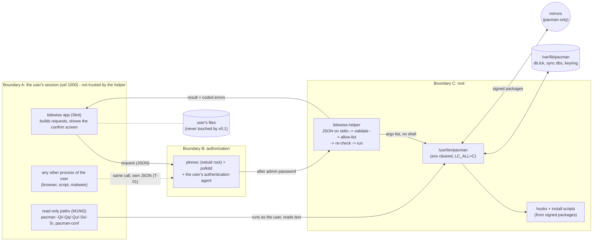

# Threat model v1 (STRIDE)

Status: **v1, 13 Nov 2026** (WBS 5.1); **updated 18 Nov 2026 for 6.10b** (the update flow syncs and compares a private copy of the package lists: decision 0007; rows T-03, T-09, T-11, T-17, T-20 updated and T-24 added; questions 12 and 33 answered, the app side of 12 stays open; new limits: a kill in the middle of a real sync and the EXDEV rename cannot be shown offline); **updated 17 Nov 2026 for the 5.6 follow-up** (the KDE hand test of a hostile `argv[1]`: question 21 answered, row T-02, question 32 new, source 27 extended; the summary-characters and 200-byte tests); **updated 16 Nov 2026 for 5.6** (the hostile table through the real pkexec to the installed helper, as root in the container: rows T-01, T-02, T-04 to T-08, T-14, T-15; the environment and descriptors pkexec hands over, measured; question 21 measured in part, question 31 new); **updated 16 Nov 2026 for 5.5** (the package: row T-03 now done, question 23 closed, questions 28 to 30 new); **updated 16 Nov 2026 for 5.4b** (the argv[0] check, the real pkexec in the container, the rustix ban: rows T-02, T-03, T-20; questions 21 (part), 22, 24, 25, 26, 27 answered); **updated 16 Nov 2026 for 5.4** (the polkit policy, the helper's one deletion point and the clippy ban: rows T-01, T-02, T-03, T-20; open questions 2 and 9 answered, 21 to 25 new); **updated 14 Nov 2026 for 5.2** (protocol crate: rows T-02, T-04 to T-07, T-09 to T-11, T-15, open questions 8, 11, 12); **updated 16 Nov 2026 for 5.3c** (the removal tripwire: rows T-04, T-09, T-14, T-18; questions 16 and 17 answered, 18 and 19 updated); **updated 15 Nov 2026 for 5.3b** (the jobs: rows T-04 to T-15, T-17, T-18 updated, T-22 and T-23 added; open question 11 answered, 15 and 16 added); **updated 14 Nov 2026 for 5.3a** (helper gate: rows T-01, T-02, T-07, T-08, T-14, T-15; open questions 6 and 7 answered, 13 added; one correction to T-08). Written before any privileged code exists, so every M3 task starts from this
list. Update it whenever a milestone adds a privileged action, a file write, a parser of outside data or a network call
(ENGINEERING.md §2).

How to read it: section 1 draws the system, 2 names what we protect, 3 compares the two ways to reach root
(**decided 13 Nov 2026: pkexec + checked summary, see `docs/decisions/0005-helper-invocation.md`**), 4 is the threat table, 5 says what we do *not* defend, 6 lists what I could not verify,
7 lists sources. `[n]` is a source in section 7. "Planned" means the defence is designed but no code or test exists yet.

## 0. Base assumption (read this first)

**A1. The helper trusts nothing about its caller.** The polkit policy only decides *who may become root*; it does not
say *who is calling*. Any process running as the user can run `pkexec /usr/lib/tidewise/tidewise-helper` with a JSON
request of its own, not just the Tidewise app. So the app is not a security boundary, and the helper must treat every
request as hostile: full validation, allow-list, re-check of the confirmed list, every time, no matter who asks.
The caller's identity (`PKEXEC_UID` [1], parent process, argv) is only used for logging, never to relax a check.
This is threat T-01. **The helper's stdin and stdout are the caller's too** (6.10a, review 5.8 R-04): it reads stdin
with a deadline and writes stdout through a bounded queue, so a caller that never writes or never reads cannot hold an
authorised job (T-07, T-17, question 34).

## 1. System and trust boundaries

Three privilege levels, and two lines you can cross only by being authorized:

- **Boundary A -> B** is where untrusted input enters. The only data that crosses it is the request JSON (stdin) and
  whatever the helper prints back.
- **Boundary B** decides "may this user become root now?". It does not see the request (T-02).
- **Boundary C** is the only place with root. Inside it the helper turns a validated request into a fixed `pacman`
  command line.
- **Read-only paths** (already built, M1/M2) cross no privilege boundary: the app runs `pacman` as the user and parses
  its text output. The input is *outside data* (package names and descriptions come from repository maintainers), so
  the parsers are treated as untrusted-input code (T-21).

## 2. Assets

| Asset | Why it matters | Who may touch it |
|---|---|---|
| **Root on the machine** | Everything else follows from it | Only the helper, only via the allow-list |
| **Package database and keyring** (`/var/lib/pacman`, `db.lck`, `/etc/pacman.d/gnupg`) | A corrupt or tampered db breaks the system; a half-finished upgrade can leave it unbootable | pacman only |
| **The user's files** (home directory) | Cannot be recreated | v0.1 helper never reads or writes them; later cleanup goes to Trash (rule 7) |
| **System config and installed binaries** (`/etc/pacman.conf`, `/usr/bin/pacman`, hooks) | Code run as root | Root only; not ours to defend (section 5) |
| **Integrity of what the confirm screen shows** | The user's consent is only worth something if it is about the real change | Helper re-checks the list (T-09) |
| **Tidewise's own installed files** (helper binary, polkit policy) | A writable helper is a free root shell | Root only (T-03) |
| **The audit trail** (journal, `pacman.log`) | "What did root do, and for whom?" | Append-only for us (T-14) |

## 3. How the app reaches the helper: pkexec vs a D-Bus service

Decision: **decided 13 Nov 2026, see `docs/decisions/0005-helper-invocation.md`**: pkexec with a human-readable summary
in argv that the helper checks (3.2); D-Bus is the fallback. The analysis below is kept as the reasoning behind it.
Both options end in the same helper logic and the same allow-list; they differ in how the process gets root and in what
the user is shown before saying yes.

### 3.1 The main point: what can the password dialog show? (threat T-02)

The danger: a malicious process calls the helper at the very moment the user expects Tidewise's prompt. The user sees
a password dialog, assumes it is theirs, and approves a *different* request.

- **pkexec.** The dialog text is the `<message>` of the polkit action. pkexec offers only these variables for it:
  `$(program)`, `$(command_line)`, `$(user)`, `$(user.gecos)`, `$(user.display)` [1]. The request travels on **stdin**,
  which polkit never sees. So every request, ours or an attacker's, produces the *same* dialog. The one thing that
  varies is `$(command_line)` (the argv), and pkexec's own man page says of it: "do not use this for any security
  checks, it is not secure" [1], because the caller chooses it freely.
- **D-Bus service.** The service (root) calls polkit's `CheckAuthorization(subject, action_id, details, flags, ...)`
  [3]. `details` is a string dictionary describing the action; a non-empty `polkit.message` key in it overrides the
  message shown to the user and may "include references to other keys that are expanded" [3]. Keys starting with
  `polkit.` are accepted only from a caller that is itself sufficiently privileged (e.g. uid 0) [3], and the service is
  root. So the *service* can write "Install vlc and 3 more packages (212 MB)" from the request **it** validated, and
  the attacker cannot change that text. The dialog tells the truth about the request that will actually run.
  (Whether the policy file's own `<message>` can also reference detail keys: I believe so but did not verify it. The
  `polkit.message` route above is the documented one.)
- **Evidence (13 Nov 2026, the human's KDE agent):** `pkexec /usr/bin/true install dbeaver jre-openjdk`, cancelled at
  the dialog: the agent **showed the full argv in the dialog title** [14]. That used the stock `exec` action; our own
  action must be re-tested in 5.4 (a custom message may hide argv).
- **What I could not verify:** how GNOME's agent renders these strings; truncation of long summaries, multi-line and
  markup; and what PackageKit's dialog shows. Needs a test on a real desktop.

### 3.2 A middle way for pkexec (my idea, untested)

Make argv carry a short human summary, and make the helper refuse unless it matches:

`pkexec /usr/lib/tidewise/tidewise-helper --summary "install vlc +3 (212 MB)"` with the policy message containing
`$(command_line)`. After authentication the helper recomputes the summary **from the validated JSON** and exits with
"summary mismatch" if the argv text differs. Then a lying caller does not get a harmful action; it only wastes one
approval (for an update it syncs a private copy of the package lists and compares there, and a refusal leaves the real lists as they were: decision 0007, questions 12 and 33 answered). The dialog is truthful whenever the action succeeds. Costs: the summary is visible in `ps`; the summary
format becomes part of the protocol; whether agents show `$(command_line)` clearly is unverified (above).

### 3.3 Comparison

| | **pkexec, one process per job** | **D-Bus system service + polkit** |
|---|---|---|
| Root code running when idle | None. Root exists only during a transaction | A daemon (activated on demand by D-Bus/systemd, may exit when idle). More moving parts |
| Attack surface | pkexec is a **setuid-root** binary we do not control, plus polkitd | polkitd + the D-Bus daemon + our service parsing D-Bus messages; no setuid binary of ours, but the service must authenticate callers by bus name correctly |
| Dialog shows the request (T-02) | **No**, only program path / argv [1]. With 3.2: a checked summary | **Yes**, the service passes `details` [3] |
| Password prompts | One per `pkexec` call. Use `auth_admin` (not `_keep`) so a retained authorization can't be reused by another process [1] | Same policy choices. Service can also rate-limit before asking polkit (helps T-16) |
| Complexity / new dependencies | Smallest: a binary, a `.policy` file. No new crate for transport | Larger: a D-Bus crate (e.g. `zbus`), a service file, a D-Bus policy file, a systemd unit; dependency review needed |
| Caller identity | `PKEXEC_UID` (set by pkexec [1]); still only "some process of this user" | Bus name -> pid/uid via the bus; still only "some process of this user" (T-01 remains) |
| Known history | **PwnKit CVE-2021-4034**: memory corruption in pkexec's argument handling, present since pkexec was created in 2009, local root for any user, disclosed 25 Jan 2022 [4]. **CVE-2011-1485**: race in pkexec/polkitd about the caller's identity, polkit 0.96 [6] | **CVE-2021-3560**: polkit mishandled a D-Bus caller that disconnected mid-request and treated it as uid 0, giving an unprivileged user authorization (GHSL-2021-074) [5]. Affected-version ranges differ between sources (0.113-0.118 vs "seven years old"), so I give no exact range |
| Which parts are still trusted either way | polkit (policy + agent) | polkit (policy + agent) |

Two honest observations: (1) **Neither choice removes polkit from our trusted base**; both of the big historical bugs
above were in polkit code that both options use or sit next to. Arch ships patched polkit (128-1 on the machine I
checked); the exact fixed versions: I don't know. (2) The allow-list is what bounds the damage in both cases: a wrongly
approved request can only do what an allow-listed action does (e.g. install an official-repo package), never "run
anything as root".

### 3.4 Recommendation (not a decision)

**pkexec, one process per confirmed transaction, request as JSON on stdin, with the argv-summary check from 3.2.**
Why: no root process stays alive, it fits golden rules 1 and 6 as written, it adds no dependency, and the helper's
checks (the part that matters, A1) are identical in both designs. The cost is the weaker dialog; 3.2 narrows that gap,
and the allow-list bounds what is left.

What would flip me to D-Bus: if a manual test on your KDE (and GNOME, if you care) agent shows that `$(command_line)`
is truncated or unreadable, so the summary does not reach the user. Then T-02 can only be closed properly by the
service passing `details`. D-Bus would also change the wording of golden rule 1 ("started with `pkexec`").

**Decision: made (human, 13 Nov 2026): pkexec + checked summary; see `docs/decisions/0005-helper-invocation.md`.**
The KDE evidence above supports it; the 5.4 re-test with our own action can reopen it.

## 4. Threats

STRIDE letters: **S**poofing, **T**ampering, **R**epudiation, **I**nformation disclosure, **D**enial of service,
**E**levation of privilege. "Proof" names the planned test; IDs of WBS tasks I do not know are written as
"M3 helper task (ID to fill)". Test names marked *exists* are real tests in the repo today.

### 4.1 Your three additions first

| ID | STRIDE | Threat | Defence | Proof | Status |
|---|---|---|---|---|---|
| **T-01** | S, E | **Any process in the user's session can run `pkexec tidewise-helper` with its own JSON**, not just our app. Also covers a compromised app. | Base assumption A1: the helper trusts nothing about its caller. Every request gets the full pipeline: size cap -> strict JSON -> allow-list of actions -> name validation -> re-check of the confirmed list. `PKEXEC_UID` is for the log only. Policy requires admin authentication on every call (`auth_admin`, no `_keep`, `allow_any`/`allow_inactive` = `no`) so no retained authorization can be ridden [1][2] | Container test: run the helper directly (no app) with each row of the hostile-input table (T-04..T-07) and with a valid request from a different uid; assert the same checks fire. Unit test: no code path reads `PKEXEC_UID` to allow anything. **Helper side (5.3a), *exists*:** the helper refuses unless the effective uid is 0 (`root_is_uid_zero`, `an_ordinary_user_is_not_root`, `the_effective_id_counts_not_the_real_one`, `garbage_is_not_root`); `PKEXEC_UID` becomes a number or `unknown` and goes only into the log (`anything_that_is_not_a_plain_number_is_unknown`, `a_hostile_pkexec_uid_is_logged_as_unknown_in_both_entries`, `the_callers_identity_never_changes_the_answer` for none, 0, 1000, `x` and 4294967295); the real binary started as an ordinary user refuses with exit 2 (`as_an_ordinary_user_it_refuses_with_one_sentence_on_stderr_and_exit_2`, `the_not_root_check_comes_before_the_argument_check`); as root in the container every request-side row runs with no app involved (`hostile_requests_get_their_codes_and_nothing_from_them_reaches_the_journal`, `a_hostile_environment_is_ignored_and_the_caller_is_logged_as_unknown`). **Known limit (review R-01, confirmed 14 Nov 2026):** the root check reads `/proc/self/status`, so a user-namespace "root" (`unshare -r`) passes it. Harmless in 5.3a (nothing privileged happens); real privilege comes only from pkexec/polkit, never from this check. Accepted by the human on 14 Nov 2026 (open question 14). **Policy (5.4), *exists*:** `packaging/polkit/io.github.tidewise.helper.policy`, one action, `allow_any` `no`, `allow_inactive` `no`, `allow_active` `auth_admin`, no `_keep`, no `allow_gui`, no `exec.argv1`, no `imply` or `owner`, no translations, no `.rules` file anywhere in `packaging/`: `crates/helper/tests/polkit_policy.rs` (`the_polkit_folder_holds_exactly_the_one_policy_file`, `there_are_no_polkit_rules_files_anywhere_in_packaging`, `there_is_one_action_with_the_agreed_id`, `the_action_is_for_the_helpers_absolute_path_and_nothing_narrower`, `the_action_has_exactly_one_annotation_and_no_translations`, `the_defaults_are_no_no_and_auth_admin`, `no_authorization_is_ever_kept`, `the_dialog_message_shows_the_command_line`); container, real polkitd on a private bus: `the_policy_is_valid_against_polkits_dtd`, `a_broken_policy_fails_the_same_polkit_check`, `polkitd_lists_the_action_with_the_agreed_defaults`, `polkitd_does_not_list_an_action_that_is_not_installed` (mutation-checked with `auth_admin_keep`). **Not covered:** pkexec itself was run in no test (it is setuid and the container has `no-new-privileges`; a login needs an agent), so "pkexec picks our action for this path" is from the source (`find_action_for_path`, source 25), and `allow_active` is the file's text only (no logind session in the container); the real pkexec path end to end is 5.5 **Through real pkexec at the installed helper (5.6), *exists*:** `tests/container/tests/package_hostile.rs` `package_hostile_every_row_is_refused_and_changes_nothing` sends the whole hostile table (106 rows) through the real `pkexec` to `/usr/lib/tidewise/tidewise-helper` of the built package, with no app involved; every row gets its fixed refusal and, after each row, `pacman -Q`, the metadata (size, mode, times) under `/etc /usr /var/lib/pacman /var/cache/pacman /var/log /root /opt /srv /home /boot /tmp`, the lock file and the work folder are unchanged (nothing under `/run`, `/dev`, `/var/lib/polkit-1` or `/var/tmp` is watched, and a work folder made and removed inside one row would be missed: review R-05). **The caller in that test is root**, so pkexec makes no setuid transition and the kernel's AT_SECURE flag is off, and `PKEXEC_UID` is always 0 (pkexec sets it: a non-zero caller id, and the helper's handling of a hostile `PKEXEC_UID`, are covered by the unit tests, the `gate` fuzz target and VM checklist item 1, not by this table); "a valid request from another uid" and pkexec's own protection for an ordinary caller are **not covered** and go on the VM checklist (WBS 6.8, `docs/security/pentest-checklist.md`; question 31) | gate and table through pkexec: done (5.3a, 5.6) for a root caller; another uid: planned (6.8) |
| **T-02** | S, E | **Authorization confusion.** A malicious process starts a helper request at the moment the user expects Tidewise's prompt; with pkexec the dialog cannot show the request (stdin is invisible to polkit), so the user approves the wrong one. | See section 3. If pkexec: summary in argv, helper recomputes it from the validated JSON and refuses on mismatch; `auth_admin` every time; the allow-list bounds what a wrongly approved request can do. If D-Bus: service passes `details`/`polkit.message` built from its own validated request [3]. Residual: user fatigue (T-16) and a fake password dialog drawn by malware (section 5) | Unit test: argv summary != summary derived from JSON -> refused (planned with the helper, 5.3). **Protocol side done (5.2):** `summary()` in `crates/helper-protocol`, one fixed function, printable ASCII, at most 200 bytes, targets then chosen providers (when all fit) then the count; tests *exist*: `the_sample_requests_read_like_this`, `a_single_target_is_cut_exactly_at_the_cap`, `and_n_more_counts_the_targets_that_did_not_fit`, `chosen_providers_are_listed_when_all_of_them_fit_and_counted_when_not`, `requests_that_differ_in_what_the_user_sees_read_differently`, `whatever_the_request_holds_the_text_is_printable_ascii_and_capped`; fuzz target `request`. Known limit: when the target list is cut, requests differing only past the cut read the same (the confirmed list, T-09, is what is re-checked). **Follow-up done (5.3a):** when the chosen providers do not all fit, the text now says `with N providers` instead of dropping them; tests *exist*: `chosen_providers_are_listed_when_all_of_them_fit_and_counted_when_not`, `providers_are_all_or_nothing_and_the_count_says_how_many`, `providers_are_counted_when_the_targets_were_cut`, `with_providers_the_text_is_still_cut_to_the_cap_and_keeps_the_provider_count`, `a_huge_provider_list_is_counted_in_a_short_text`. **Helper side (5.3a), *exists*:** `decide()` recomputes `summary()` from the validated request and compares the bytes: `a_summary_that_is_wrong_in_any_way_is_a_mismatch` (13 wrong texts), `a_summary_that_is_not_text_is_a_mismatch`, `a_bad_request_gets_the_same_answer_whatever_argv_says` (validation first, so argv cannot be used to probe), `the_log_gets_the_recomputed_summary_never_the_argv_text`; container: `a_wrong_summary_is_refused_and_the_argv_text_is_not_logged`. **Dialog with our own action (5.4):** from the source (sources 25, 26): pkexec sets `polkit.message` only for the stock `org.freedesktop.policykit.exec` action, so for ours the dialog text is our `<message>`, in which polkitd replaces `$(key)` from the details pkexec sends. `command_line` is `argv` joined with spaces (the program first, as an absolute path), not cut, not escaped; `cmdline_short` is cut to 80 characters (38, ` ... `, 37), so the message uses `$(command_line)`. The replacement is one pass: a `$(user)` typed in argv stays literal. **Hand test, 15 Nov 2026 (the human, KDE Plasma agent, source 27),** with a TEST action of the same message that runs `/usr/bin/true`: the title read "Tidewise needs an administrator password to make this change: /usr/bin/true install extra/dbeaver (2 packages)", whole; a 192-byte summary was shown whole, wrapped over four lines, nothing cut; the details pane showed the description, the action id and the vendor. The quotes around the argument are not shown (the summary runs on from the path). **So decision 0005 stands.** Not tested by anyone: this action at its real path, GNOME's agent, a second password prompt (no `_keep`), a hostile argv. **Residual (review R-02, R-03, questions 21 and 22):** argv is chosen by any process of the user and polkit does not sanitise it, so a process can show a Tidewise-branded prompt with text of its own after the fixed sentence (newlines, length, markup if an agent renders it, "no password needed"); if the user authenticates the helper refuses (`SummaryMismatch`) and does nothing, so it is a spoofing and fatigue risk (T-16), not a privilege gain. The first word of `command_line` could be dressed up through a symlink to the helper, because pkexec gives the program `argv[0]` as typed (measured in the container and from source, question 21). **Closed in 5.4b (the human's decision, question 22):** the helper starts only when `argv[0]` is exactly `/usr/lib/tidewise/tidewise-helper`, byte for byte (`summary_arg`: the shape first, then the name), else `StartRefusal::WrongProgramPath` (exit 2, one fixed sentence, nothing from argv, one journal entry with the fixed code `wrong_program_path`: question 27). So for an accepted request the whole dialog is the fixed sentence, the fixed path and the recomputed summary. Tests: `args.rs` `the_program_name_must_be_exactly_the_helpers_path`, `the_exact_path_is_accepted`, `a_wrong_count_is_reported_as_a_count_error_even_with_a_wrong_name`; `run.rs` `a_wrong_program_path_is_refused_to_start_like_any_other_start_check`, `the_program_path_is_checked_last_and_after_the_count`, `a_wrong_program_path_is_never_repeated`; container, real pkexec as root: `polkit_a_symlink_to_the_helper_is_run_by_pkexec_and_refused_by_the_helper`, `polkit_a_real_pkexec_start_at_the_installed_path_runs_the_job`, `polkit_a_name_found_through_path_arrives_as_the_installed_path_and_is_accepted`, `polkit_pkexec_gives_the_program_the_name_it_was_typed_with` (mutation-checked: with the check off the symlinked start ran the job). **What it does not do:** it runs after polkit authenticated the user, so it cannot stop a prompt whose text a process dressed up through `argv[1]` (the summary), only a real transaction under one; `argv[0]` is no identity check (root can `exec -a` anything); the container tests run pkexec as root, so they do not show which action pkexec picked (from source only) or the dialog **Hostile `argv[1]` through real pkexec (5.6), *exists*:** eleven rows send a valid request with a hostile summary (`<b>`, `<a href>`, four lines, 200 lines, 20 KB, `$(user) $(program) $(command_line)`, a right-to-left override, bytes that are not UTF-8, empty, the true text plus a space, the true text in capitals): every one ends `summary_mismatch`, exit 1, one journal entry whose `TIDEWISE_SUMMARY` is the **recomputed** text, and the hostile text appears in no output. **Measured** (these eleven rows read `/proc/<pid>/cmdline` of the waiting helper and compare it byte for byte with what was sent): pkexec hands the program every one of these `argv[1]`, a non-UTF-8 one and an empty one included, unchanged, and prints two `GLib-CRITICAL ... g_variant_new_string(): requires valid UTF-8` lines on its own stderr; what the password dialog then shows is not known (question 21, hand test pending) **KDE hand test of a hostile `argv[1]`, 17 Nov 2026 (question 21, source 27):** the agent draws the message as **rich text** (bold and italic, `&amp;` decoded, a link that can be clicked), keeps new lines, **reverses** right-to-left text (`gnp.exe` shown as `exe.png`), and a message of 200 lines or 20 KB makes the dialog **taller than the screen, with the password field and the buttons off screen** (closed with Esc); `$(user) $(program) $(command_line)` stays literal (one pass of substitution); bytes that are not UTF-8 replace the **whole** command line, even `/usr/bin/true`, with `[Invalid UTF-8]` (pkexec still asks). So any process of the user can put misleading text, a clickable link or an oversized dialog inside our genuine, Tidewise-branded prompt; the helper refuses on a summary mismatch after the password, so nothing changes (a spoofing and fatigue risk, T-16, not a privilege gain). **Accepted by the human on 17 Nov 2026 (option A).** What is kept clean is the **genuine** dialog, and it is tested: `crates/helper-protocol/tests/hostile_input.rs` `the_names_allow_list_holds_no_markup_quote_substitution_or_control_character`, `the_summary_of_every_accepted_request_uses_only_safe_characters_and_fits_the_dialog` (a summary of an accepted request holds only letters, digits, `@ . _ + -` and the separators space, `/`, `(`, `)`, and is at most 200 bytes: no markup, link, new line or reversed text can come from a package name, and the length stays on screen), `a_request_with_markup_in_a_name_is_refused_so_its_summary_never_reaches_a_dialog` (markup in a name is refused, and `summary()` alone is shown not to be a sanitiser: validate first); fuzz target `request` asserts the same for whatever `parse_request` accepts. **The 200-byte cap is a security constant:** a 192-byte summary was shown whole on 15 Nov, while 200 lines and 20 KB pushed the buttons off the screen on 17 Nov, so `MAX_SUMMARY_BYTES` is pinned to 200 by that test and changing it means redoing the hand test. **For M4:** the app must call `summary()` only on a request that passed `validate` (the guarantee above is about validated requests; `summary()` keeps `<` in an unvalidated one) | protocol: done (5.2); helper compare and argv[0]: done (5.3a, 5.4b); dialog on KDE with our message: done by hand (5.4); a hostile `argv[1]` in the dialog on KDE: done by hand 17 Nov 2026, residual accepted (question 21, option A); GNOME: on the VM checklist (item 5) |
| **T-03** | T, E | **Tampering with installed files:** the helper binary, the polkit policy, any config or library the helper loads. A user-writable helper is a free root shell. | The package installs everything as `root:root`, directories and files not writable by group or others (as installed: directories 0755, the helper and the app 0755, the rest 0644), under `/usr/lib/tidewise/` and `/usr/share/polkit-1/actions/`; nothing under `$HOME`, `/tmp` or `/opt`. The helper reads **no** config from user-controlled places (no env, no home). No RPATH/RUNPATH in the binary (`namcap` flags insecure RPATH/RUNPATH [9]); `cargo` builds without `-C rpath`. The policy's `exec.path` annotation is the absolute helper path [1] | **WBS 5.5**: `namcap` on the built package (`insecure-rpath` / `insecure-runpath` clean) + a permission test that walks the package file list and every parent directory and asserts owner root and no group/other write bit; plus `readelf -d` check for RPATH/RUNPATH. **Policy side (5.4):** pkexec resolves the program with `realpath()` and compares it to `exec.path` exactly (source 25), so the package must install the helper at exactly `/usr/lib/tidewise/tidewise-helper`, not through a symlinked directory; 5.5 needs a test that the installed file's real path equals the annotation. A mismatch is not a hole: pkexec falls back to the stock `org.freedesktop.policykit.exec` action, which on this machine (polkit 128-1) is `auth_admin` for any, inactive and active (so no retained authorization, but remote and inactive sessions may try to authenticate, and the dialog is the stock one with the cut `cmdline_short`), and the helper re-checks everything anyway (question 23). Since 5.4b the helper also refuses unless `argv[0]` is exactly this path, and `polkit_policy.rs` `the_policy_names_exactly_the_path_the_helper_insists_on` ties the policy to the constant `HELPER_PATH`; so 5.5 must install at exactly `/usr/lib/tidewise/tidewise-helper` (a `/lib/...` or `/usr/local/...` spelling is refused by design), and a helper run from `target/` or `/opt` has no pkexec route (the container tests pass the name with `arg0`). The same package test must cover the policy file: root-owned, `/usr/share/polkit-1/actions/`, not group or other writable **Package side (5.5), *exists*:** `packaging/aur/PKGBUILD` (`package()` is only `install -Dm<mode>` lines: app 0755, helper 0755 at `/usr/lib/tidewise/tidewise-helper`, policy 0644, desktop entry 0644, LICENSE 0644; no `chmod`, `chown`, `cp`, `ln`, `mkdir`, `sudo`, `curl` or rpath/RUSTFLAGS anywhere) and `crates/helper/tests/packaging.rs` (23 tests; mutation checks on the real recipe, each caught: a setuid mode, another path, a `chmod` line, an rpath flag, `SKIP` next to a URL): `the_package_installs_exactly_these_files_with_these_modes` (the helper's destination is built from the constant `HELPER_PATH`), `no_file_is_installed_with_a_setuid_setgid_sticky_or_writable_mode`, `every_destination_is_under_usr_and_quoted`, `the_functions_run_no_command_that_changes_modes_owners_or_the_system`, `the_recipe_never_asks_for_an_rpath`, `the_packaged_policy_names_the_helpers_installed_path`. **The built package, in the container** (`tests/container/tests/package.rs`, makepkg as an ordinary user in a clean Arch, `pacman -U` as root, `--network=none`): `package_files_are_root_owned_with_the_exact_modes_and_nothing_is_writable_or_setuid` (exactly five files, all under `/usr`, owner root:root, exact modes, no setuid/setgid/sticky, nothing writable by group or others on any path **or any folder above it, up to `/`**, and `realpath` of the helper equals the annotation: question 23's package test), `package_no_elf_file_has_an_rpath_or_runpath` (`readelf -d` on every ELF file: none in either binary), `package_every_library_is_found_and_the_desktop_entry_is_valid`, `package_namcap_prints_only_the_accepted_lines` (namcap's insecure-rpath tags are clean; the accepted warnings are listed with reasons in the test), `package_polkitd_lists_our_action_from_the_policy_the_package_installed` (polkitd reads the file the package installed; `exec.path` equals the helper's path), `package_real_pkexec_runs_the_installed_helper_end_to_end`, `package_removal_leaves_nothing_the_package_owned_and_handles_the_work_folder`, and, from the review of 5.5, `package_has_no_install_script_and_declares_no_provides_replaces_conflicts_or_backup` (no `.INSTALL` root script, no `provides`, `replaces`, `conflict`, `backup`: R-02) and `package_every_library_name_in_the_binaries_exists_with_only_the_declared_depends` (R-01). Recipe side, also from the review: `the_recipe_has_only_the_shapes_these_tests_can_read` (12 top-level keys, each once, three functions: R-03), a checksum is `SKIP` or 64 hex digits (R-04), and `installed_binaries_are_the_ones_build_made` (build() records the sha256 of both binaries, package() checks them first, before any install, so a rebuild during `check()` stops packaging: R-05). Mutation checks by hand (the package repacked in a throwaway container): a setuid helper fails 2 tests, the helper behind a symlinked `/usr/lib/tidewise` fails 4, the unchanged package passed all 9 tests of that time; an added `.INSTALL` script and an added `provides` line each fail the scriptlet test. **Not covered:** the source is a local `git archive` tarball with the checksum `SKIP` until v0.1 (question 28, a release blocker); the package is not signed; the build runs `check()` as the builder user with network (crates.io) and nothing verifies the crates beyond `Cargo.lock` (`cargo deny` runs in CI, not in the package build) **6.10b:** the helper now also WRITES two things outside its work folder, both listed in the source guard and explained in T-24: the private list folder under `/run`, and the staged copies and one rename in `/var/lib/pacman/sync`; neither is a binary, a policy or a library. | policy file: done (5.4); install paths, permissions, rpath and the real-path check: done (5.5), for the local source (release blocker, question 28) |

### 4.2 Input to the helper and to pacman

| ID | STRIDE | Threat | Defence | Proof | Status |
|---|---|---|---|---|---|
| T-04 | T, E | **Option injection into pacman.** Any option that moves pacman's root, config, hooks, keys or checks turns the helper into a root shell. All of these exist in pacman 7.1's man page [7]: `--root/-r`, `--dbpath/-b`, `--config`, `--hookdir`, `--gpgdir`, `--cachedir`, `--sysroot`, `--logfile`, `--overwrite`, `-d/-dd/--nodeps`, `--assume-installed`, `--noconfirm`, `--noscriptlet`, `--dbonly`, `--disable-sandbox`, `--print-format` | The request has **no free-form option field**. The helper builds argv from fixed templates (one per allow-listed action; the helper itself adds `--noconfirm` only as golden rule 10 allows: a verified transaction, never a caller's choice); the only caller-supplied values are validated `repo/name` pairs placed after `--`. A test lists every option above and shows no request can produce it. Never a shell (rule 3), absolute `/usr/bin/pacman` | Unit tests on the argv builder (one per forbidden option, plus "every argv equals template + names"); hostile names are unit-tested (5.3b: `hostile_package_names_are_refused_in_every_command`); no container test passes such a name to real pacman. Read-only side, *exists*: `option_lookalikes_stay_search_words_after_double_dash`, `args_are_si_then_double_dash_then_repo_slash_name`, `command_is_absolute_pacman_with_arg_list_and_c_locale`. **Protocol side (5.2), *exists*:** the request types have no field for any option, path or URL, and every struct refuses unknown fields: `an_unknown_field_is_refused_at_every_level`, `flags_paths_and_urls_have_no_field_to_live_in` (noconfirm, overwrite, nodeps, root, config, dbpath, hookdir, print_format, file, url, sysupgrade, refresh at two levels), `actions_that_do_not_exist_are_refused`. The argv builder itself is 5.3 **Helper side (5.3b), *exists*:** `pacman_args::args` is the only place a command line is built (ten shapes: `-Qu`, `-Sy`, `-S` and `-Su` with `--print --print-format`, `-S` and `-Su` with `--noconfirm --ask 66`, `-D --asdeps`, `-Q`): `the_exact_argument_list_of_every_command`, `before_the_double_dash_there_is_only_fixed_text` (no caller value can sit there), `no_command_can_carry_a_dangerous_option` (every option of the list above, plus `-U`, `-R`, `--needed`, `--asexplicit`, `-w`), `y_only_ever_comes_with_the_private_dbpath_and_a_null_logfile` (over the table of every command: exactly one command has a `-y`, it is `PrivateSync`, and it carries `--dbpath /run/tidewise-helper-lists/` and `--logfile /dev/null` as adjacent pairs; `PacmanCommand::Sync` no longer exists, 6.10b) and `the_two_dangerous_looking_options_exist_only_with_their_fixed_values`, `noconfirm_and_ask_belong_to_real_transactions_only`, `print_belongs_to_the_dry_runs_only`, `hostile_package_names_are_refused_in_every_command` (15 names), `hostile_repository_names_are_refused_in_every_command`, `one_bad_name_among_good_ones_refuses_the_whole_command`; the runner builds a line only through it (`a_bad_command_is_refused_before_anything_is_created_or_run`); pacman by absolute path (`the_real_runner_uses_pacman_by_absolute_path_and_the_real_limits`), no shell. **New fixed flag, decided with the human (decision 0006, row T-23):** `--ask 66` on the two real transactions. **Changed in 5.3c (the human approved it with the plan):** the one read whose argument list carried names from the request (`-Q -- <names>`) is gone; the helper reads the whole installed list with `-Q` (fixed argv, no `--`, no names) before and after the real run (`the_exact_argument_list_of_every_command`, `every_package_goes_after_the_double_dash`, `before_the_double_dash_there_is_only_fixed_text`). **Through real pkexec (5.6), *exists*:** the names `--force`, `-dd`, `--root=/x`, `--`, `-`, `-x`, `.x` and the paths, URLs and look-alikes of T-05 and T-06 as a package name, and five hostile repository names, are refused with `invalid` through pkexec at the installed helper, the same unknown-field rows (`noconfirm`, `overwrite`) with `malformed`; nothing changes (`tests/container/tests/package_hostile.rs` `package_hostile_every_row_is_refused_and_changes_nothing`) | read-only: done; protocol: done (5.2); argv builder: done (5.3b) |
| T-05 | T, E | **`-U`, local file paths, URLs.** `pacman -U` installs an arbitrary file or URL as root. | The protocol has **no path or URL field**; the helper only ever runs `-S` (sync) forms with repo package names, never `-U`. Names with `/`, `:`, `.` first etc. are refused by the allow-list (T-06) | Unit test: argv never contains `-U`/`--upgrade`; request with `file:///x`, `/tmp/a.pkg.tar.zst`, `http://..` as names is refused. **Protocol side (5.2), *exists*:** `hostile_names_are_refused_as_names` (paths, `file://`, `http://`, `../x`, `*`), `flags_paths_and_urls_have_no_field_to_live_in` (`file`, `url`) **Helper side (5.3b), *exists*:** no template contains `-U`, a path or a URL: `no_command_can_carry_a_dangerous_option`, and names are `repo/name` after `--` (`hostile_package_names_are_refused_in_every_command` includes `/tmp/a.pkg.tar.zst` and `file:///x`). **Through real pkexec (5.6), *exists*:** `/etc/passwd`, `/tmp/a.pkg.tar.zst`, `file:///x`, `http://x`, `../x` as names: `invalid` (`tests/container/tests/package_hostile.rs` `package_hostile_every_row_is_refused_and_changes_nothing`) | protocol: done (5.2); argv: done (5.3b) |
| T-06 | T, E | **Hostile names:** leading `-`, NUL, `../`, whitespace, shell characters, unicode look-alikes (Cyrillic "a", full-width characters), empty string, 10 000 names, one 1 MB name | Allow-list (not block-list) from `man PKGBUILD`: ASCII letters, digits and `@ . _ + -`, not starting with `-` or `.`; repo names likewise (no `/`, not `local`, no control chars). Refuse the whole request on the first bad name; never "clean" a name. Cap on name length and on the number of names per request | *exists*: `accepts_real_package_names`, `rejects_everything_else` (includes `café`), `rejects_repo_names_pacman_or_we_refuse`, `bad_package_names_are_refused`, `one_bad_ref_among_good_ones_refuses_everything`. Helper: same table plus NUL, 10 000 names, look-alikes, over-length. **Protocol side (5.2), *exists*:** one copy of the rules in `tidewise-names`; the helper's repo rule is ASCII only and at most 64 bytes (`helper_accepts_plain_ascii_repo_names`, `helper_refuses_everything_that_is_not_plain_ascii_or_is_reserved`); `hostile_package_names_are_refused_everywhere_a_name_can_go`, `hostile_repo_names_are_refused_everywhere_a_repo_can_go`, `bad_versions_are_refused`, `too_many_of_anything_is_refused` (100 targets, 100 provider answers, 5 000 confirmed lines), `duplicates_are_refused`, `hostile_names_are_refused_as_names` (26 rows through `parse_request`, including a 1 MB name). Refuse, never clean: the first problem fails the whole request **Through real pkexec (5.6), *exists*:** 26 hostile package names (NUL, new line, space, `;`, `$(x)`, backtick, escape sequence, right-to-left override, Cyrillic and full-width look-alikes, accent, empty, 1 000 000 bytes), five repository names and two versions: each `invalid` with the exact field and reason, 10 000 targets `too_many`; and a bad name in a confirmed line, as a chosen provider and in the targets of an update-and-install, and a bad version in an update: `invalid` with that field; two requests that are bad **and** carry a wrong or an empty summary get the request's answer, not `summary_mismatch` (validation first: argv cannot be used to probe) (`tests/container/tests/package_hostile.rs` `package_hostile_every_row_is_refused_and_changes_nothing`) | read-only: done; protocol: done (5.2) |
| T-07 | D, T | **Huge or deeply nested JSON**, trailing garbage, duplicate keys, unknown fields | Read stdin with a hard byte cap before parsing; parse into typed structs with unknown fields denied; exactly one JSON value, nothing after it; bounded nesting (serde_json has a default recursion limit; I believe 128, to be confirmed by a test, not assumed) | Hostile-input tests (oversize, 10 000 levels, trailing data, NUL in strings, `-1`/huge numbers) + a `cargo fuzz` target for the request parser (ENGINEERING.md §2). **Protocol side (5.2), *exists*:** `a_request_over_the_byte_cap_is_refused_before_parsing` (2 MiB, checked before parsing), `anything_after_the_value_is_malformed`, `a_repeated_or_unknown_key_is_malformed`, `another_protocol_version_is_a_version_mismatch`, `a_version_that_is_not_a_plain_number_is_malformed`, `deep_nesting_is_refused_and_does_not_overflow_the_stack`, `broken_json_is_refused`, `a_request_over_two_mebibytes_is_refused_before_it_is_read`; fuzz target `request` (run result in progress.md, 5.2). **Correction:** serde_json has no 128-level limit here, see open question 8. **Helper side (5.3a), *exists*:** `read_capped` reads at most cap + 1 bytes with `Read::take`: `a_request_exactly_at_the_cap_is_read_whole`, `one_byte_over_the_cap_is_kept_so_the_parser_can_say_too_large`, `ten_mebibytes_are_cut_at_the_cap_plus_one`, `an_endless_stream_is_never_read_past_the_cap_plus_one`, `a_read_error_is_read_failed_even_after_some_data`; `decide` goes through the protocol's door first (`requests_that_fail_are_refused_with_their_code`); as root in the container, eight hostile rows including 2 MiB + 1 (`hostile_requests_get_their_codes_and_nothing_from_them_reaches_the_journal`). **Residual, recorded for 5.3b:** a caller that never closes stdin and sends nothing keeps the helper waiting in `read_capped`. Harmless in 5.3a (nothing is held); in 5.3b the whole request must be read and validated before any lock is taken, any sync is done or pacman is started **5.3b:** the whole request is read and validated before the work folder is made, before the lock is looked at, before a sync or pacman (`refusals_never_make_a_runner_and_have_one_finished_entry` in `run.rs`; container `a_refusal_never_creates_the_work_folder_or_starts_pacman`), so a caller that never closes stdin holds nothing. **Through real pkexec (5.6), *exists*:** 17 malformed requests (empty, whitespace, `{`, not UTF-8, a trailing letter or NUL, two requests, a comment, a byte order mark, a repeated key, unknown fields, an action that does not exist, a removal, a version that is a string or `-1`), three protocol versions (`0`, `2`, `4294967295`: `version_mismatch`), 10 000 levels of nesting in three places, and 2 MiB + 1 (a valid request padded, spaces) and 8 MiB of zeros: `too_large`; the test writes stdin from a thread and accepts a broken pipe where the helper stops reading, and the 8 MiB row **requires** the write to fail with a broken pipe (a helper that drained all of stdin would not break it; mutation check: reading without the cap fails that row) (`tests/container/tests/package_hostile.rs` `package_hostile_every_row_is_refused_and_changes_nothing`)**Stdin deadline (6.10a, review 5.8 R-04, question 34), *exists*:** the whole request must arrive within `STDIN_DEADLINE` = 10 s (`input::read_within`: the read happens in a thread that owns stdin and a channel sender and nothing else; after a timeout the thread is left alone and a late answer is thrown away). A stdin that stays open and silent is refused as `Malformed`, one result line, one journal entry, no runner (`a_silent_stdin_is_refused_as_malformed_after_the_deadline` in `run.rs`, `a_reader_that_stays_silent_times_out` in `input.rs`; container `a_silent_stdin_gives_up_after_the_deadline`: it waited about 10 s, not less, printed one `malformed` line, wrote one entry, and `pacman.log` did not change; before the fix, on the code of `7bbd210`, the helper never gave up). The deadline is for the **whole** request, not for each read, so a caller that drips bytes is bounded too; a request that arrives slowly in pieces inside it is accepted (`a_request_that_arrives_in_pieces_within_the_deadline_is_accepted`; container `a_request_larger_than_the_pipe_buffer_written_in_chunks_is_accepted_within_the_deadline`: 192 KiB in 16 KiB pieces 100 ms apart). A request can no longer be released hours after the user approved the dialog: pkexec asks for the password before it starts the helper, so the helper's 10 s begin right after the approval. The app must write the request from a thread and close stdin (`crates/helper-protocol/src/lib.rs`, "Talking to the helper"). The journal send can still block up to 2 s (5.3a R-06, the other half of that item; unchanged) | protocol: done (5.2); helper: done (5.3a); nothing is held while waiting for stdin (5.3b); stdin deadline: done (6.10a) |

### 4.3 Process environment

| ID | STRIDE | Threat | Defence | Proof | Status |
|---|---|---|---|---|---|
| T-08 | E, T | **Inherited environment:** env vars, `PATH`, `LD_PRELOAD`/`LD_LIBRARY_PATH`, working directory, umask, open file descriptors, signals | pkexec already starts the program with "a minimal known and safe environment" [1] and in the target user's (root's) home directory unless `--keep-cwd` is used [1]; the helper does not rely on that: clear the environment for every child (`env_clear` + `LC_ALL=C`), absolute paths only (no `PATH` lookup), `chdir("/")`, set `umask 022`, stdin of children = `/dev/null`, check there are no unexpected open fds. **Signals:** after the transaction starts, a dying app or `SIGHUP`/`SIGINT` must not kill pacman half-way (T-17). `#![forbid(unsafe_code)]` rules out closing descriptors in-process, so the helper **checks** `/proc/self/fd` and refuses to start if anything beyond 0, 1, 2 and its own directory listing is open (decided 14 Nov 2026, 5.3a; open question 6). **LD_PRELOAD and LD_LIBRARY_PATH are not defended by the helper** (see Proof) | Container test with a fake pacman that dumps its env, cwd, umask, fds and signal mask; helper started with hostile env (`LD_PRELOAD`, `PATH=/tmp/evil`, `IFS`, `PACMAN_*`, inherited fd 5). Read-only side, *exists*: `command_is_absolute_pacman_with_arg_list_and_c_locale`. **Helper start (5.3a), *exists*:** the checks run in this order, and the first that fails decides: effective uid 0, descriptors, `chdir(\"/\")`, argv (`the_checks_run_in_the_documented_order`, `an_extra_open_file_still_gets_the_not_root_message`). Root comes first, changed 15 Nov 2026 after CI: a GitHub runner hands the test process extra descriptors, and the helper, started as a normal user, said \"unexpected open files\" instead of the useful \"must be started as root\". Nothing acts before all four pass, so what the helper allows is unchanged. Descriptors (`only_the_standard_descriptors_are_fine`, `our_own_listing_descriptor_is_fine`, `an_extra_descriptor_is_refused_by_number`, `a_target_that_only_looks_like_the_listing_is_refused`, `the_real_listing_has_the_standard_descriptors_and_its_own_listing_descriptor`; container `an_inherited_file_descriptor_is_refused_to_start`, which leaks a descriptor with `flock(1)`, no shell); working directory `chdir("/")` in `main`; the environment is read for `PKEXEC_UID` only (`a_hostile_environment_changes_nothing`; container `a_hostile_environment_is_ignored_and_the_caller_is_logged_as_unknown` with `PKEXEC_UID` holding a new line, `PATH`, `IFS`, `PACMAN_ROOT`, `LC_ALL`, `HOME`). Sources: pkexec (polkit tag 128, `src/programs/pkexec.c`) calls `fdwalk_close_on_exec (3)` under the comment "set close_on_exec on all file descriptors except stdin, stdout, stderr"; its list of kept environment variables (read from tag 126, not re-read for 128) is `SHELL`, `LANG`, `LINGUAS`, `LANGUAGE`, `LC_*`, `TERM`, `COLORTERM`, and `DISPLAY`/`XAUTHORITY` only with `allow_gui`, so `LD_*` is not on it. Rust's std reopens a closed 0, 1 or 2 as `/dev/null` before `main` (checked 14 Nov 2026 by closing 0 and 1 before starting the helper: it still saw all three open; for 2 only the exit code was visible), so "a standard descriptor is missing" cannot happen in the real binary and is tested on injected input only. **Correction (5.3a):** the helper cannot defend against `LD_PRELOAD` or `LD_LIBRARY_PATH`: the dynamic loader acts before `main` (a missing preload object printed a loader error on stderr before any of our code ran). pkexec removes them, not us; to be re-checked with the real pkexec in 5.4. **Helper start and children (5.3b), *exists*:** `umask(022)` first thing in `main` through `rustix::process::umask` (the human's decision, 14 and 15 Nov 2026; pacman does not fix the umask: measured, the downloaded package file was 600 under umask 077 and 666 under 000): `the_umask_becomes_022_whatever_the_caller_had`; container `whatever_umask_the_helper_is_started_with_the_files_come_out_as_with_022` (package file, installed file, database entry); pacman gets `env_clear` plus exactly `PATH=/usr/bin` and `LC_ALL=C` (`pacman_gets_exactly_path_and_lc_all`, `the_child_gets_exactly_the_fixed_environment`; container `an_install_script_sees_exactly_path_and_lc_all_and_a_command_from_path_works`, with hostile variables passed to the helper and the script running in `/`); pacman's stdin is null (`stdin_is_null_so_a_program_that_reads_it_sees_the_end_at_once`); pacman leads its own process group (`the_child_leads_its_own_process_group`, mutation-checked in the container). `rustix` 1.1.6 (features `std`, `fs`, `process`; its `umask` is gated by `fs`) is a direct dependency of the root binary; with bitflags and linux-raw-sys, all already in Cargo.lock. Signals: row T-17. **Through real pkexec at the installed helper (5.6), *exists*, measured with polkit 128 and the caller root:** `/proc/<pid>/environ` of the helper, read while it waits for stdin, holds only pkexec's own `HOME=/root`, `LOGNAME`, `PATH=/usr/sbin:/usr/bin:/sbin:/bin:/root/bin`, `PKEXEC_UID=0` (a forged `77`, or `0` followed by a new line and `MESSAGE=pwned`, is overwritten), `SUDO_GID`, `SUDO_UID`, `USER=root`, plus the variables pkexec keeps after checking their values (`LANG`, `LC_*`, `TERM`, `COLORTERM`, `SHELL`); `LD_PRELOAD`, `LD_LIBRARY_PATH`, `PATH=/tmp/evil`, `IFS`, `HOME=/tmp/evil`, `PACMAN_ROOT` and an unknown `FOO` do **not** arrive, and the helper has no open descriptor beyond 0, 1, 2 (its own `/proc/self/fd` listing aside) even when `flock(1)` leaked one into pkexec. pkexec itself **refuses** a suspicious kept value with exit 127 and, on stderr, "The value for environment variable LC_ALL contains suspicious content" (or the `SHELL` / `/etc/shells` sentence) plus "This incident has been reported.": `LC_ALL=../x`, `LC_ALL=a..b`, `LANG=a/b`, `LANGUAGE=../x`, `TERM=%n`, `COLORTERM=%s`, `SHELL=/tmp/evil`; the helper never starts, so there is **no** journal entry (`tests/container/tests/package_hostile.rs` `package_hostile_every_row_is_refused_and_changes_nothing`). **What this does not prove:** the test runs as root, so there is no setuid transition and AT_SECURE is off; pkexec's own dynamic loader therefore honours `LD_PRELOAD` and `LD_LIBRARY_PATH`. The test proves what reaches the helper, not pkexec's protection for an ordinary caller: that is on the VM checklist (WBS 6.8, question 31). **These rows measure pkexec, not the helper (review R-01):** the helper's own descriptor check is proven only by the direct-start container test `an_inherited_file_descriptor_is_refused_to_start` (pkexec closes the descriptor first, so with the helper's check switched off the leaked-descriptor row still passes: mutation check 5.6), its child environment and its umask only by the 5.3b job tests (the container's umask is already 022, so reading it here would prove nothing); what the table does show of the helper's own start is `chdir("/")` (pkexec starts it in `/root`; every inspect row reads `/proc/<pid>/cwd`, and with the call removed all 25 rows fail). A leaked descriptor that pkexec does not close cannot be made through pkexec, and that the descriptor reached pkexec at all is a measurement of the spike, not re-asserted by the row. **Inherited signal dispositions and resource limits (5.8, R-01, R-03):** both survive `pkexec`. *SIGCHLD ignored:* the helper refuses to start (`child_signal_ignored`; see question 16; container `package_pkexec_with_sigchld_ignored_is_refused_and_changes_nothing`, which fails with `pacman_failed: the helper could not read pacman's output` on the code before the fix). *Resource limits:* `main` resets them first thing with `rustix::process::setrlimit` (`env::limit_plan`: file size, CPU time, address space and data segment unlimited; core dumps 0; open files 1024 soft, 524288 hard; stack 8 MiB soft, hard open), and a reset that cannot lift one of the four unlimited limits refuses to start (`cannot_reset_limits`). Proofs: `the_helper_sets_exactly_these_limits`, `a_limit_that_should_be_unlimited_but_is_not_is_short_of_the_plan` (`env.rs`), `limits_the_caller_lowered_are_reset_to_the_planned_values`, `a_hard_limit_that_cannot_be_raised_is_an_error_not_a_silent_success` (`tests/limits.rs`, `tests/limits_short.rs`), the start-order tests in `run.rs`, and container `package_limits_the_caller_set_do_not_reach_pacman_through_pkexec` (prlimit through real pkexec; an install script of a real pacman run reads `/proc/self/limits`; before the fix it saw `Max file size 1048576 unlimited`). **What is not covered, stated plainly:** cgroup limits (a memory cap or CPU quota on the caller's service or scope) cannot be reset from inside a process; `oom_score_adj` also survives pkexec: the helper writes 0 at start, reads it back and refuses above 200 (`cannot_reset_oom_score`; question 37 a, with the measurement and the proofs; the lowering by a real root is a VM checklist item); `RLIMIT_NPROC` is not enforced for real uid 0 or CAP_SYS_RESOURCE (`setrlimit(2)`, question 37 b), so it is not in the plan | helper: done (5.3a, 5.3b); inherited SIGCHLD, limits and `oom_score_adj`: done (5.8); cgroup limits: documented (question 37 c); signals sent to the helper itself: row T-17 |

### 4.4 Races, locks, concurrency

| ID | STRIDE | Threat | Defence | Proof | Status |
|---|---|---|---|---|---|
| T-09 | T | **TOCTOU between review and run.** The user confirms list L; before the helper acts, the sync databases or installed packages change, so the real change is L'. | The confirm request carries the exact list L the user saw. The helper redoes the dry-run (`pacman -S --print ...`) itself and refuses if the result differs from L. Residual window: between the helper's re-check and pacman's own resolution (pacman re-resolves). We cannot close it by taking `db.lck` ourselves (T-10), so it is accepted and small. Targets are passed explicitly; nothing is expanded by glob | Container test: change the sync db (second repo state) between "review" and "run"; helper must refuse. Container test: list differs by one package -> refuse. **Protocol side (5.2), *exists*:** every install and update request carries the confirmed list (`transaction`: repo, name, version per line) and `validate` requires every target and chosen provider to be in it from the same repository (`targets_and_choices_must_be_in_the_confirmed_list_from_the_same_repo`); the re-check is 5.3. **Side effect of a refusal: none (6.10b, question 12 answered)** **Helper side (5.3b), *exists*:** the dry run `--print` must equal the confirmed list as a sorted multiset (the order of resolution is not a difference): flows `a_dry_run_that_differs_is_a_changed_transaction_and_nothing_real_runs`, `the_same_lines_in_another_order_are_the_same_transaction`, `a_target_that_is_gone_from_the_repositories_is_a_changed_transaction`, `an_update_whose_private_dry_run_differs_is_a_changed_transaction_and_moves_nothing`; container `a_list_that_is_not_what_pacman_says_is_a_changed_transaction_and_nothing_changes` and `a_repository_that_changed_after_the_list_was_made_is_a_changed_transaction` (the real TOCTOU: the repository gets 2.0 after the list for 1.0 was made), each with an identical snapshot of the system. **Post-check (the human's addition):** after every real run `pacman -Q` of each confirmed item; the count not installed at the confirmed version is a `Notice` (`a_declined_replacement_in_an_update_is_a_notice_not_an_error`, `items_that_are_not_installed_at_the_confirmed_version_are_counted_in_a_notice`; container `a_pending_replacement_is_declined_and_reported_as_a_notice_not_an_error`, `a_conflict_aborts_with_pacmans_words_installs_nothing_and_the_notice_counts_the_list`). Measured (pacman 7.1.0): `--print` neither notices a conflict (the real run aborts) nor lists the removal that a replacement causes (row T-23). The residual window is unchanged: between the helper's dry run and pacman's own resolution. **5.3c:** the post-check no longer asks `pacman -Q -- <every confirmed name>`: it reads the `pacman -Q` list taken right after the real run (`count_not_installed` on the full list, same results: `items_that_are_not_installed_at_the_confirmed_version_are_counted_in_a_notice`) and, from the list taken right before it, also tells what disappeared (row T-18). **The window, measured by reading (5.8, R-17):** between the dry run and the real run the helper reads `pacman -Q` (a read with a 120 s limit), so the window is bounded by that read, not by milliseconds. Another root process (PackageKit, a cron job) that refreshes the sync database inside it changes what the real run installs; the helper only reports it afterwards (`PackagesNotInstalled`, journal `ok_with_notices`). Moving the `-Q` read before the dry run would shrink it to one process start; not done (it changes pinned behaviour: `a_clean_install_runs_the_five_commands_in_order_and_ends_ok`). **A refusal has no side effect (6.10b, decision 0007, review 5.8 R-02), *exists*:** the update syncs a PRIVATE copy of the lists (`--dbpath /run/tidewise-helper-lists/ --logfile /dev/null`) and the dry run on that copy must equal the confirmed list before anything is moved into the real `sync/`; then the same check runs again on the real lists after the move (another root process may have changed them in between). Unit: `a_refused_update_does_not_leave_the_real_lists_refreshed` (both flows that sync: update and update + install; no command that ran refreshes the real lists, no move happened), `a_dry_run_that_differs_on_the_real_lists_after_the_move_is_reported_as_moved`; container `a_changed_update_list_leaves_the_real_sync_databases_untouched` (sha256 of every real `sync/*` file and `pacman.log` before and after a `transaction_changed`, with the repository newer than the real lists; red first on the code of 5.8: the real `tidewise-test.db` changed). A helper that refuses after the move says `TIDEWISE_LISTS=moved` in its finished entry. **Residual, unchanged in kind:** a root process that refreshes the real lists between the helper's second dry run and pacman's own resolution (T-11) | protocol: done (5.2); helper re-check and post-check: done (5.3b, 5.3c); window bounded, documented (5.8); a refusal changes nothing: done (6.10b) |
| T-10 | D, T | **Lock file** `/var/lib/pacman/db.lck`: deleting it while another pacman runs corrupts the database | Golden rule 9: never delete, create, or "fix" the lock. If pacman reports it, the helper returns the coded error `DatabaseLocked` and the app explains "another package manager is running, try again". Never a retry loop that sleeps forever | Container test: hold a real lock, run the helper, assert coded error and that the file's inode and mtime are unchanged. Test that the source contains no removal of `db.lck`. Protocol side (5.2): the coded error `DatabaseLocked` and its fixed text exist (`a_locked_database_says_to_wait_and_try_again`) **Helper side (5.3b), *exists*:** the helper looks at `db.lck` (`symlink_metadata`) before anything else: `a_held_lock_ends_the_job_before_any_command_runs` (all three jobs; no command runs), `a_locked_database_stops_the_private_sync_and_nothing_else_runs`, and it classifies pacman's three real lock messages as a backstop for a lock taken in between (`the_real_lock_messages_are_recognised`, `only_a_line_that_starts_with_the_message_counts`, `a_lock_taken_in_the_meantime_is_database_locked_without_pacmans_advice`); pacman's own advice to remove the lock is never shown. Container: `a_held_lock_is_database_locked_the_lock_is_untouched_and_pacman_does_not_run` (inode and mtime unchanged, `pacman.log` unchanged, identical snapshot); and the source guard `only_the_listed_places_touch_files_and_the_lock_is_only_looked_at` with `nothing_but_a_look_ever_names_the_lock` (mutation-checked: adding a removal fails both). A stale lock left by a killed pacman (measured: SIGTERM and SIGPIPE leave one) is reported as DatabaseLocked from then on; the helper never removes it (M4 explains it). | protocol: done (5.2); helper: done (5.3b) |
| T-11 | T, E | **Partial upgrade** (rule 4): `-Sy` then `-S`, or installing against a stale db | (As built in 5.3b:) the install flow uses `-S <names>` against the current db (no `-y`) and refuses while updates are pending; an update runs `-Sy` once, as its own command, directly followed by the full `-Su [<names>]` with no second sync; `-y` appears nowhere else. The app decides which one with `install_decision`; the helper re-checks pending updates and refuses `-S` when the system is behind (T-09 style) | App side, *exists*: `nothing_pending_allows_the_install`, `one_pending_update_means_the_system_must_be_updated`, `only_ignored_updates_still_allow_the_install_and_are_counted`, `the_real_sample_blocks_with_eight_updates`. Helper: unit test "no argv contains `-y` except in `-Syu`"; container test: stale db + `-S` request is refused. Protocol side (5.2): the only actions are install (`-S`), update system (`-Syu`) and both (`-Syu <names>`); no refresh field exists (`flags_paths_and_urls_have_no_field_to_live_in`: `refresh`, `sysupgrade`); the coded error `SystemOutOfDate` exists **Helper side (5.3b), *exists*:** `-Qu` before a plain install, ignored updates do not block: flows `a_pending_update_blocks_a_plain_install_and_nothing_else_runs`, `updates_held_back_by_ignorepkg_do_not_block_an_install`, `an_unreadable_update_list_is_a_failure_and_nothing_else_runs`; `-Sy` only in the update flows and only on the private copy, exactly once (6.10b): `a_system_update_syncs_a_private_copy_compares_moves_it_in_and_compares_again_before_updating`, `a_plain_install_never_syncs_and_never_uses_the_update_commands`, and the template test `y_only_ever_comes_with_the_private_dbpath_and_a_null_logfile`; container `a_pending_update_blocks_a_plain_install_and_nothing_changes` (identical snapshot) and `a_system_update_updates_the_package_through_a_private_copy_and_never_syncs_the_real_lists` (6.10b: zero sync lines in `pacman.log`, the real list is the private one byte for byte, root:root 0644). **No command can refresh the real lists any more (6.10b):** the only `-y` is on the private copy, and the real lists change only by the move, after the private dry run equals the confirmed list (T-24). **Residual (question 12, kill points in T-17):** a helper killed after the move and before `-Su` leaves the lists newer than the packages, as a kill after pacman's own `-Sy` would; no update flow that has to refresh the lists can avoid it. | app: done; protocol: done (5.2); helper: done (5.3b) |
| T-12 | D, T | **Two helpers at once** (two apps, a double-click, an attacker, or pamac/yay in a terminal) | pacman's own `db.lck` serialises writers; the second helper gets `DatabaseLocked` (T-10) and does not retry silently. Dry-runs are read-only and may overlap. The helper creates **no lock file of its own**, so there is nothing to go stale. Cost: a second prompt for the second request | Container test: start two helpers on the real pacman; exactly one runs, the other returns `DatabaseLocked`, db consistent afterwards **Helper side (5.3b), *exists*:** container `a_second_helper_while_the_first_installs_is_database_locked_and_leaves_the_first_alone`: the second helper ends with DatabaseLocked, installs nothing, and does not touch the first one's output files (the leftover cleanup skips files of live processes: `leftovers_of_dead_helpers_are_removed_and_nothing_else`, container `only_the_helpers_own_leftovers_of_dead_processes_are_removed`); the first finishes normally. The helper creates no lock file of its own. | done (5.3b) |

### 4.5 What runs as root underneath

| ID | STRIDE | Threat | Defence | Proof | Status |
|---|---|---|---|---|---|
| T-13 | E | **pacman hooks and install scripts** run arbitrary commands as root (`Exec =` in `.hook` files from `/usr/share/libalpm/hooks` and `/etc/pacman.d/hooks` [8]; scriptlets inside packages) | Same trust as running `pacman -S` in a terminal: packages are signature-checked by pacman. We never pass `--hookdir` (T-04) and never skip scripts (`--noscriptlet` is refused, as it breaks packages). Hook directories and `pacman.conf` are root-owned system config (section 5). The hooks run under the helper's cleared environment and `chdir /` | Container test: install a package that ships a hook which dumps its env/cwd; assert both clean. Honest limit: a malicious package from the official repos is **out of scope** (section 5) **5.3b, *exists*:** pacman, and so every install script, runs with exactly `PATH=/usr/bin` and `LC_ALL=C` (plus what pacman and the shell add), in `/`, with umask 0022 (libalpm sets it for scripts): container `an_install_script_sees_exactly_path_and_lc_all_and_a_command_from_path_works`. Measured: with no PATH at all the shell supplies its own default, so PATH is not strictly needed; it is set so the environment is fixed and readable. Hooks from `/usr/share/libalpm/hooks` were not exercised beyond pacman's own `ConditionNeedsUpdate` hook. | accepted risk; the scriptlet environment is tested (5.3b) |
| T-14 | R | **Repudiation:** "what did root do, and on whose request?" | pacman already writes `/var/log/pacman.log` (default `LogFile` [8]). The helper additionally logs to the **journal** one line per request: time, action, validated targets, `PKEXEC_UID` [1] (informational), outcome. It logs validated values only, with newlines and control characters stripped (no log injection), never the raw JSON. **Reading the trail (5.8, R-12):** the journal socket is world-writable by design, so any local user can send an entry with our identifier and any `TIDEWISE_*` field; journald adds the trusted `_UID`, `_PID` and `_EXE`, so the only trustworthy query is `journalctl _EXE=/usr/lib/tidewise/tidewise-helper -t tidewise-helper`, and any future history screen must filter the same way. Nothing in the helper can prevent a forged entry; the VM checklist sends one as an ordinary user and checks `_UID` | Container test with a fake journal sink: one line per request, with the right fields, none for rejected-before-parse input beyond a fixed "rejected" line; injection test with `\n` in a name. **Helper side (5.3a), *exists*:** one datagram per request that got past the start checks, written **before** the result line is printed (5.3b: `the_accepted_entry_comes_before_the_runner_and_the_finished_entry_before_the_final_line`; 5.3a wrote one entry per request, an accepted job now has two). Fields: `SYSLOG_IDENTIFIER`, `PRIORITY` (6 for an accepted entry and for a clean finish with ok; 4 for an ok with notes, for every refusal and for every failure), `TIDEWISE_CALLER_UID` (a number or `unknown`), `TIDEWISE_OUTCOME` (a fixed code), `TIDEWISE_SUMMARY` (the **recomputed** summary, only for a request that passed validation) and `MESSAGE`; the exact text is pinned by `the_exact_text_of_the_accepted_entry`, `the_exact_text_of_a_successful_finish`, `a_refusal_is_a_warning_and_an_unknown_caller_says_unknown`, `a_request_that_did_not_pass_validation_has_no_summary_line`. Injection: `every_line_is_a_plain_key_equals_value_and_nothing_hides_in_a_value` (new line, NUL, ESC, `MESSAGE=`, `PRIORITY=0` and a direction mark still give six lines, one MESSAGE and one PRIORITY), `a_non_ascii_character_becomes_one_question_mark`, `the_raw_request_and_the_argv_text_never_reach_the_entry`; container: a fake journald checks the fields and that text from argv, names and the request never appears (`a_clean_install_runs_and_leaves_one_package_two_journal_entries_and_a_tidy_work_folder`, `a_wrong_summary_is_refused_and_the_argv_text_is_not_logged`, `hostile_requests_get_their_codes_and_nothing_from_them_reaches_the_journal`). **Deviations from the plan above:** a refusal to start **before the root check** (the user cannot be checked, not root) writes **no** entry, because a hand-started run by an ordinary user should not add entries to the audit trail under the helper's name; every request that got past the start checks, a malformed one included, gets exactly one entry (without a summary). **Changed in 5.4b (question 27): a refusal after the root check now writes one entry too, see below.** **Residual:** a failed send (no journal, or a stuck journald: two second write timeout) is silent and changes neither the outcome nor the exit code (`without_a_journal_a_refusal_ends_the_same_way_and_says_so`, `without_a_journal_the_job_still_runs_and_the_result_says_the_entry_could_not_be_written`); decided (open question 13): the helper does not refuse; pacman.log still records every package change, and in 5.3b the `Finished` event says the audit entry could not be written (fixed text, no details) **5.3b, *exists*:** two entries per accepted job (`TIDEWISE_STAGE=accepted`, written before any pacman command, and `finished` with `ok` or the error code): `the_exact_text_of_the_accepted_entry`, `the_exact_text_of_a_successful_finish`; `run` tests `the_accepted_entry_comes_before_the_runner_and_the_finished_entry_before_the_final_line`, `a_journal_that_cannot_be_written_adds_one_notice_and_changes_nothing_else`, `only_the_second_entry_failing_also_gives_the_notice` (the decided behaviour: a journal that is down never stops a job, and exactly one `audit_entry_not_written` notice comes before the final line); container `a_clean_install_runs_and_leaves_one_package_two_journal_entries_and_a_tidy_work_folder`, `without_a_journal_the_job_still_runs_and_the_result_says_the_entry_could_not_be_written`, `a_hangup_that_kills_the_helper_mid_install_does_not_stop_pacman` (only the accepted entry exists when the helper is killed). **5.3c, *exists*:** a finished entry carries what the notices said. A clean ok is unchanged (`a_clean_ok_is_exactly_what_it_was_and_has_no_notes_fields`, `a_clean_job_logs_a_plain_ok_with_no_notes`); an ok that came with something to read is `TIDEWISE_OUTCOME=ok_with_notices`, `PRIORITY=4`, with `TIDEWISE_NOT_INSTALLED=N`, `TIDEWISE_REMOVED=N` and `TIDEWISE_REMOVAL_CHECK=skipped` when they apply and "ok with notices (A not installed, B removed[, removal check skipped])" in the message (`an_ok_with_packages_not_installed_says_ok_with_notices_and_is_a_warning`, `an_ok_with_removed_packages_says_how_many`, `a_check_that_did_not_run_is_never_logged_like_a_clean_pass`, `all_three_notes_come_in_a_fixed_order`, `an_error_keeps_its_own_code_and_gets_the_notes_as_fields`); a refusal has none (`a_refusal_has_no_notes`). On an error outcome a missing `TIDEWISE_REMOVAL_CHECK` is ambiguous (the check ran, or no real run started; review R-08); on an `ok` it is exact: no field means both lists were read. Container: `a_pending_replacement_is_declined_and_reported_as_a_notice_not_an_error`, `a_package_that_disappears_during_the_run_is_reported_as_removed`, `a_removal_check_that_cannot_read_the_list_is_logged_as_skipped_never_as_a_clean_ok` (mutation-checked). **5.4b, *exists* (question 27, the human's decision of 16 Nov 2026):** a start refusal that comes after the root check (the descriptors cannot be checked, an unexpected descriptor, the working directory, the argument count, the program name) writes one entry: `PRIORITY=4`, `TIDEWISE_CALLER_UID` (a number or `unknown`), `TIDEWISE_STAGE=start_refused`, `TIDEWISE_OUTCOME` with a fixed code (`cannot_check_fds`, `unexpected_fd`, `cannot_change_directory`, `bad_arguments`, `wrong_program_path`) and `MESSAGE` "uid N: refused to start: CODE"; no summary and no argv text: `Stage::StartRefused` holds a `&'static str`, so no runtime text can enter. The two refusals before the root check stay silent. It is written before the stderr sentence, and a failed write changes nothing. Tests: `journal.rs` `a_start_refusal_is_a_warning_with_a_fixed_code_the_caller_and_no_summary`, `a_start_refusal_with_an_unknown_caller_says_unknown`; `run.rs` `every_start_check_refuses_with_its_own_sentence_before_stdin_is_read` and `the_checks_run_in_the_documented_order` (through `refused()`: one entry with the code, the priority and the caller for the five, none for the two silent ones), `a_start_refusal_entry_never_holds_argv_text_or_a_hostile_caller_id`, `a_journal_that_cannot_be_written_changes_nothing_for_a_refused_start`, `the_start_refusal_codes_are_fixed_snake_case_words_and_different`; container, fake journald: `polkit_a_symlinked_start_leaves_one_journal_entry_without_its_name` (real pkexec; the entry holds nothing the caller typed; mutation-checked), `the_wrong_number_of_arguments_is_refused_to_start_with_exit_2`, `an_inherited_file_descriptor_is_refused_to_start`, `a_full_or_gone_stderr_does_not_panic_the_refusal_to_start_is_still_exit_2`, `nothing_on_the_system_changes_when_every_request_is_refused` (6 finished plus 2 start_refused). Mutation-checked: journaling before the root check too failed three unit tests, an entry without the caller failed four. Only root can reach a post-root refusal, so an ordinary user cannot add entries by starting the helper by hand **Through real pkexec (5.6), *exists*:** for every refusal row the journal holds exactly one entry and its whole text is compared (`SYSLOG_IDENTIFIER`, `PRIORITY=4`, `TIDEWISE_CALLER_UID=0`, stage, fixed outcome code, `TIDEWISE_SUMMARY` only for a mismatch and then the recomputed one, `MESSAGE`); a forged `PKEXEC_UID` never reaches it; a row where pkexec refuses leaves none. Mutation check: logging the argv text as the summary failed all 11 argv rows and all 13 environment rows (`tests/container/tests/package_hostile.rs` `package_hostile_every_row_is_refused_and_changes_nothing`) | helper: done (5.3a, 5.3b, 5.3c, 5.4b) |
| T-15 | I | **Error messages leaking paths or content** the user couldn't read (the helper is root) | The helper takes no path, so errors can't be steered to files of the attacker's choosing. Results are coded errors with fixed plain-language texts; pacman's raw stderr is returned only for failures of allow-listed actions, capped in length and stripped of control characters, and the app shows it only under "Technical details" | Unit test: every error variant has a fixed text; test with a stderr full of control characters and 1 MB. **Protocol side (5.2), *exists*:** `every_error_has_a_fixed_plain_text`, `the_text_does_not_depend_on_what_the_request_or_pacman_said`, `an_error_line_holds_no_path_or_text_from_the_request`, `no_refusal_repeats_what_was_sent`; the only free text is `Details`: `details_lose_control_characters_and_invisible_marks`, `details_are_cut_at_the_cap_on_a_character_boundary`, `a_megabyte_of_details_is_cut_not_copied`, `details_read_back_from_a_line_are_cleaned_again`. A new line is kept in `Details` (readability under Technical details); every other control character is removed. **Helper side (5.3a), *exists*:** a refusal to start prints one fixed sentence per cause on stderr and never repeats argv, the environment or stdin (`the_refusal_sentences_are_fixed_plain_and_different`, `a_refusal_never_repeats_what_the_caller_sent`); a result line carries a code only (`nothing_from_the_request_reaches_the_verdict_text`, `errors_never_contain_the_input`). pacman's own stderr arrives with 5.3b **5.3b, *exists*:** `PacmanFailed` carries pacman's own stderr (cleaned and capped by `Details`) or one of our fixed sentences (could not start pacman, work folder unusable, took too long, dry run unreadable, ...); a held lock is the fixed DatabaseLocked text, never pacman's advice: `failure_texts_are_ours_or_pacmans_stderr_never_the_requests`, `a_conflict_aborts_with_pacmans_words_and_the_post_check_counts_the_list`; container `a_conflict_aborts_with_pacmans_words_installs_nothing_and_the_notice_counts_the_list`. The parsers of pacman's output are strict and total, tested on real saved output (`tests/fixtures/helper-jobs`) and fuzzed (targets `output` and `progress`). **Through real pkexec (5.6), *exists*:** every refusal row has exactly one stdout line (a code, or the fixed `invalid` field and reason) and an empty stderr, or the one fixed sentence of a start refusal; the hostile text is searched for in stdout, stderr and the journal entry of its row and never found (`tests/container/tests/package_hostile.rs` `package_hostile_every_row_is_refused_and_changes_nothing`) | protocol: done (5.2); helper: done (5.3a, 5.3b) |
| T-18 | E | **Protected packages** (rule 8): `base`, kernels, bootloader, desktop session, audio, network, `pacman`, `systemd` removed through the helper | Refused **in the helper** (a protected-set check on removal requests), not only in the UI. Mechanism designed in M3; the removal action itself arrives in M5 | Unit tests in the helper per protected family; container test removing `pacman` is refused **5.3b, *exists*:** no removal by construction: the protocol has no remove action; a conflict defaults to no and aborts (container `a_conflict_aborts_under_noconfirm_and_installs_nothing_but_the_dry_run_does_not_notice`); a replacement, which pacman answers yes and which REMOVES the old package, is declined by `--ask 66` (container `a_replacement_is_declined_by_ask_66_and_happens_without_it`); flag 4 would remove the conflicting package and is never used. The protected-set check for a remove action stays planned (M5). **5.3c, *exists* (the tripwire, review R-01):** the helper reads `pacman -Q` right before and right after the real run; a name in the first list and not in the second is a removal, reported as `Notice::PackagesRemoved(n)` (count only) before the final line and in the journal (`a_package_that_disappears_during_the_run_is_reported_and_counted`, `a_failed_real_run_is_still_checked_for_removals`; container `a_package_that_disappears_during_the_run_is_reported_as_removed`, where an install script deletes another package's database entry). It is a tripwire, not proof: a script can also forge a missing line, and a removal that leaves `pacman -Q` unchanged cannot be seen. A list counts as read only if `pacman -Q` exited 0, was not cut off, did not time out, has no `error:` line on stderr and holds at least one package (R-02: libalpm skips a damaged entry with a message and still exits 0: `a_list_with_an_error_line_or_no_packages_is_not_a_clean_list`); a failed read of pacman's output file counts as cut (R-03: `a_read_error_while_capturing_marks_the_output_as_cut`); an I/O error after pacman started is Skipped, not NotRun (R-04: `a_real_run_that_failed_to_be_watched_skips_the_check_instead_of_not_running_it`). (With no names it exits 1 only on an error and still prints what it could read, and a cut list would look like removals: `a_list_that_failed_with_exit_1_is_not_a_partial_answer_to_trust`.) **What the check cannot see:** a package removed and installed again under the same name (versions are not compared; a downgrade is Q18); anything a hostile scriptlet does as root, such as editing `/var/lib/pacman/local` to forge or hide an entry; a removal by another process between the two reads (no lock is taken by `-Q`, so it is blamed on this job); files deleted that are not whole packages; declined replacements, which never reach the check because nothing is removed. **When a list cannot be read the check is skipped, the result stays ok, and the journal says `TIDEWISE_REMOVAL_CHECK=skipped` with `PRIORITY=4`** (`a_list_that_cannot_be_read_skips_the_check_and_says_so_without_changing_the_outcome`, container with real pacman: an install script that removes `ALPM_DB_VERSION`), so a check that did not run is never logged like a clean pass; when the second list is unreadable the "not installed" count is not reported either. | planned (M5 action); no removals by construction, and a removal tripwire (5.3c) |
| T-19 | S, E | **Polkit action defined too loosely** (`allow_any=yes`, `_keep`, `exec.allow_gui`) | Policy: `allow_any=no`, `allow_inactive=no`, `allow_active=auth_admin`; `exec.path` = absolute helper path; no `exec.allow_gui` [1][2]. On Arch the default admin rule makes members of `wheel` administrators [10][11]; we don't change that | **WBS 5.5**: a test that parses the `.policy` XML and asserts these values; `pkaction --verbose --action-id ...` in the container **5.4/5.5, *exists*:** `the_defaults_are_no_no_and_auth_admin`, `no_authorization_is_ever_kept`, `there_is_one_action_with_the_agreed_id`, `there_are_no_polkit_rules_files_anywhere_in_packaging` (`crates/helper/tests/polkit_policy.rs`); container `polkitd_lists_the_action_with_the_agreed_defaults`, `the_policy_is_valid_against_polkits_dtd` (`polkit.rs`) | done (5.4, 5.5; status corrected in 5.8) |

### 4.6 Denial of service

| ID | STRIDE | Threat | Defence | Proof | Status |
|---|---|---|---|---|---|
| T-16 | D, S | **Prompt spam:** a process fires `pkexec` in a loop, burying the user in password dialogs; fatigue makes a wrong approval likelier (feeds T-02) | The prompt appears *before* the helper runs, so a pkexec-launched helper cannot rate-limit it. What we do: `auth_admin` every time, and the dialog is the user's to cancel. A D-Bus service could rate-limit before asking polkit: a point for D-Bus. How polkit/agents queue concurrent requests: I don't know | Manual test: loop `pkexec` in a terminal and observe the agent; record in progress.md | open: **no test** (5.8 map). Section 3 is decided (pkexec), so this stands on the manual checklist (item 6) and question 32 |
| T-17 | D | **Long or hanging runs:** a stuck download holds `db.lck` for hours; killing pacman half-way can corrupt the db | No timeout that kills pacman during the install phase (an interrupted transaction is worse than a slow one). Timeouts only on dry-runs and reads. Output captured with a size cap. The UI shows progress and says "this can't be stopped safely once started". pacman runs in its own process group and writes to files, so it finishes when the app disappears or a hangup reaches the helper's group (the helper itself cannot ignore signals without `unsafe`: see the residual in the Proof column) | Container test: kill the app/caller mid-run -> pacman still finishes, db consistent; test with a fake pacman that prints 1 GB (5.8: what exists is the 4 MiB cap test below, which proves the same cap without a 1 GB file) **5.3b, *exists*:** reads and dry runs are killed after 120 s, a real transaction never (`reads_and_dry_runs_have_a_time_limit_and_real_transactions_never_do`, `a_read_that_runs_too_long_is_killed`, `a_run_without_a_limit_is_left_to_finish`); output is kept up to 4 MiB and 64 KiB (`output_past_the_cap_is_dropped_and_said_so`). **How pacman survives its caller (measured, `pacman_prompts.rs`):** a reader of pacman's stdout that goes away kills it with SIGPIPE and leaves `db.lck` (`a_reader_that_goes_away_kills_pacman_with_sigpipe_and_leaves_the_lock`), so its output goes to files in the work folder, never to pipes; SIGHUP in the middle of a commit stops pacman after one package with exit status 0, a half transaction that looks like success (`sighup_in_the_middle_of_a_commit_stops_pacman_after_one_package_and_still_exits_0`); SIGTERM kills it and leaves the lock (`sigterm_in_the_middle_of_a_commit_kills_pacman_and_leaves_the_lock`); so pacman runs in its own process group (`CommandExt::process_group(0)`). Container: `a_caller_that_goes_away_in_the_middle_of_an_install_does_not_stop_it`, `a_hangup_that_kills_the_helper_mid_install_does_not_stop_pacman` (mutation-checked: without the process group pacman does not finish). **Residual:** SIGHUP, SIGINT or SIGTERM sent to the helper itself kill the helper (std cannot ignore signals without `unsafe`): pacman still finishes and releases its lock, but the `-D --asdeps` step does not run (the provider stays "explicitly installed", asserted in the hangup test) and, in an update, a kill after the move and before `-Su` leaves the lists newer than the packages (question 12; the kill points of the private copy are in the next paragraph). The accepted journal entry records that a job began. Hardening with a signal crate is open question 16. **The caller's stdout (6.10a, review 5.8 R-04, question 34), *exists*:** a stdout pipe that nobody reads no longer blocks the loop that watches pacman. The helper never writes to stdout itself: `writer.rs` is a queue (1024 lines and 1 MiB) and a thread that is the only writer. Progress lines use `offer`, which never waits and drops and counts a line that finds no room (`offer_never_waits_for_a_reader_that_does_not_read`: 100 000 offers to a stuck writer in under 2 s; `a_stdout_that_never_takes_a_line_does_not_stop_the_job`; `lines_that_do_not_fit_are_dropped_and_counted_and_the_result_is_unchanged`); notices and the final line use `deliver`, which waits for room inside **one budget of 5 s in all** (`FINAL_WRITE_DEADLINE`), then `finish` waits inside the same budget for the queue to be written (`deliver_waits_for_room_and_succeeds_when_the_reader_resumes_in_time`, `deliver_gives_up_when_the_reader_never_resumes_and_the_budget_is_shared`, `a_full_queue_still_delivers_the_final_outcome_when_the_reader_resumes_within_the_deadline`, `a_notice_is_delivered_like_the_final_line_when_the_queue_is_full`; mutation-checked: progress lines that wait, a final line that is offered, notices that are offered each fail exactly one of these). **Memory the caller can make the helper hold:** at most 1 MiB queued plus the one line in the writer's hand. A line is at most `MAX_EVENT_LINE_BYTES` = 16 KiB, so 1024 lines alone could have been 16 MiB, hence the byte cap (`the_queue_holds_no_more_bytes_than_its_cap_though_it_has_room_for_more_lines`, red first in `6960fcf`; `the_bounds_are_pinned`). **The job:** the update of the container test (`a_caller_that_never_reads_stdout_does_not_stop_the_job`: stdout a full pipe nobody reads, the first progress line written inside `-Sy`) runs to its end, one private sync (6.10b: none of the real lists), new version installed, finished entry `ok` with `TIDEWISE_LISTS=moved`; on the code before the fix it stopped after the `accepted` entry for 120 s. **The process exits:** the writer thread is stuck in `write(2)` holding std's stdout lock, and that cannot hold the exit back: `std::rt::cleanup` calls `std::io::cleanup`, which takes that lock with `try_lock()` (Rust 1.99.1, `library/std/src/io/stdio.rs`: "someone might have leaked a StdoutLock, which would otherwise cause a deadlock here"), then `exit()`. Measured with a throwaway program (exit code kept, exited at 0.52 s with 65 536 bytes unread in the pipe, 3 of 3) and in the same container test: the helper exits within 5 s + 5 s after its finished entry with exit code 0. **Journal:** `TIDEWISE_EVENTS_DROPPED=<n>` in the finished entry, only when n > 0, and it does not make an `ok` an `ok_with_notices`. **Kill points of an update (6.10b, decision 0007):** (a) during the private sync: the real lists are untouched; pacman (own process group) usually finishes and releases the private lock, and if pacman itself is killed it leaves the private `db.lck` on tmpfs, which the next update refuses to run past (a look, with a fixed text that says to restart; a reboot clears it; the helper never removes it); (b) while the copies are staged: stray `.tidewise-<name>.new` files in the real `sync/`, the real lists untouched; the next run truncates and reuses them and the user's own `pacman -Sc` removes them (measured); (c) between the renames: some lists new, some old, which is exactly what pacman's own `-Sy` leaves when killed (it also moves file by file); the window is the few renames after every copy is staged and flushed; (d) after the move and before `-Su`: lists newer than packages (above). **A limit of these tests:** a kill in the middle of a REAL sync cannot be timed offline (a `file://` repository syncs in milliseconds), so (a) is covered by a lock the test plants (`a_private_lock_left_by_a_killed_sync_refuses_with_the_restart_text_and_leaves_the_real_lists_untouched`) and by the checklist (item 13), not by a real kill. | helper: done (5.3b); signals sent to the helper itself: accepted for v0.1 (question 16); stdout held by the caller: done (6.10a); kill points of the private copy: documented (6.10b) |

### 4.7 Later actions and the read-only side

| ID | STRIDE | Threat | Defence | Proof | Status |
|---|---|---|---|---|---|
| T-20 | T, E | **Symlinks and paths in cleaner actions** (M6): a user-writable cache directory replaced by a symlink to `/etc` | Not in M3: the helper takes no paths. When M6 adds cleaning, it works on fixed directories, refuses symlinks, never follows them, and user files go to Trash (rule 7) | Privilege test "refuses symlinked cache paths" (ENGINEERING.md §2) in M6. **Helper side (5.4), *exists*, ahead of M6:** the helper deletes through one function, `remove_work_file` in `crates/helper/src/removal.rs`: a regular file directly in the verified work folder, judged by the spelling of the path before the disk is touched (no `..`, no subfolder, not relative, not the folder itself), looked at with `symlink_metadata` (never follows a link), removed with `remove_file` (which unlinks a symlink and fails on a directory, so a swap between the look and the removal cannot redirect it). Tests in `removal.rs`: `a_regular_file_in_the_folder_is_removed`, `a_symlink_is_refused_and_its_target_survives`, `a_symlink_to_a_directory_is_refused_and_the_directory_survives`, `a_directory_in_the_folder_is_refused_and_survives`, `a_socket_is_not_a_regular_file`, `a_file_in_another_folder_is_refused_and_survives`, `a_path_outside_that_is_a_symlink_is_refused_as_outside_without_a_look`, `a_dotdot_path_is_refused_and_survives`, `a_relative_path_is_refused`, `a_file_in_a_subfolder_of_the_work_folder_is_refused`, `the_work_folder_itself_is_refused`, `a_file_that_is_not_there_is_an_io_error` (mutation-checked: the spelling check removed, the no-follow look replaced). The `WorkDir` it needs can be made in production only by `WorkDir::open_default()` (the fixed `/run/tidewise-helper`, owner root); the constructor for any other folder is `#[cfg(test)]`: doctests `WorkDir` (`compile_fail` and `no_run`), `crates/helper/tests/work_folder.rs` (`no_production_code_calls_workdir_open`, `main_opens_the_fixed_work_folder`, `exactly_one_production_line_builds_a_workdir`, `the_test_only_constructor_sits_alone_before_the_unit_tests`). **The clippy ban (`clippy.toml`):** `Command::new`, `fs::remove_file`, `remove_dir`, `remove_dir_all` are refused workspace-wide except in named functions with `#[expect(.., reason)]` (list in ENGINEERING.md §2); proven by deliberate violations in `crates/core` and in the helper's `flows.rs`, and by an unfulfilled expectation failing too. **Closed in 5.4b (questions 24 and 25):** `rustix::fs::{unlink, unlinkat, rmdir, rename, renameat, renameat_with}` are banned too (proof: deliberate calls of all five in the helper failed clippy); the exceptions are narrowed to `pacman_command` (helper `runner.rs`; the pacman crate has its own) and, in `not_root.rs`, two functions (deliberate violations in `run_program` and in an unrelated `not_root.rs` function now fail); two more checks in `work_folder.rs` (`src/` has no subfolders; after a file's first `#[cfg(test)]` only unit tests follow, and an `impl WorkDir {` only directly after a marker), each mutation-checked. **Still open:** only the guards' string matches (`Self { path }`, `Self::open(`), backed by compile-level defences that are sound; `std::fs::rename` is banned too since 5.4b (question 26; a deliberate call in `crates/core` failed clippy); since 6.10b it has ONE named exception, `lists::replace_list`, which takes one folder and two names (a rename inside the real `sync/`, never across folders: `a_rename_never_crosses_folders`) and is named in the `clippy.toml` header; the new writes under `/run/tidewise-helper-lists` and `/var/lib/pacman/sync` are in the source guard on purpose (T-24). The app's future launch of `pkexec` will need its own `Command::new` exception, and **M4 must call pkexec with exactly `/usr/lib/tidewise/tidewise-helper`**; say so when that code lands | helper primitive and ban: done (5.4); cleaner actions: later (M6) |
| T-21 | T, D | **Malicious or malformed pacman output** reaches the app's parsers: control characters, invalid UTF-8, huge descriptions, wrong record counts, a record for a package we didn't ask for (the descriptions come from repository maintainers) | Parsers are total: they return `ParseError`, never panic; names validated by the same allow-list (T-06); records not asked for, duplicated, or in the wrong repo are refused; non-UTF-8 becomes a replacement character in text but is rejected in names. Fuzz targets `qi qq ss si qu` | *exists*: `invalid_utf8_in_a_name_is_still_rejected`, `invalid_utf8_becomes_replacement_char`, `a_record_that_was_not_asked_for_is_refused`, `a_record_printed_twice_is_refused`, `the_right_name_in_the_wrong_repo_is_refused`, `unparseable_text_is_wrapped_parse_error`. Fuzz: 10-minute runs clean for qi, qq, ss, si (progress.md 3.6, 4.3, 4.4); `qu` target exists (4.5): see progress.md for its run | done (see note on `qu`) |
| T-22 | T, E, D | **The work folder and the output files** (`/run/tidewise-helper/`): a root program writes files there; a planted symlink or a wrong folder could redirect or expose them, and leftovers could pile up | Created if missing with mode 0700; if it exists it must be a real directory (not a symlink), owned by root, with mode exactly 0700, else the job is refused and nothing is repaired or followed. Files are created with `create_new` (`O_CREAT\|O_EXCL`: an existing name, a symlink too, is refused), mode 0600, named from the process id and a counter (no caller-chosen name). At the start of a job the helper removes only regular files named exactly `tidewise-helper-<pid>-<n>.out` or `.err` whose process is dead (a helper running at the same time keeps its files); at the end of a run its own two files are removed. `/run` is root-owned, so only root could have made or changed the folder. Honest limit: a hostile package that prints gigabytes fills a tmpfs (a malicious package from the official repositories is out of scope, section 5) | `workdir.rs`: a missing folder is created 0700, a symlink (dangling or not) and a file in the way are refused, seven wrong modes are refused and not repaired, another owner, a missing parent, an existing name or planted symlink is never reused or followed, no half pair, the leftover rules (11 look-alikes, a directory and a symlink left alone, 2 000 leftovers); runner cleanup after success, failure and timeout; container `a_work_folder_that_is_not_what_it_should_be_refuses_the_job_and_runs_nothing`, `only_the_helpers_own_leftovers_of_dead_processes_are_removed`, `a_clean_install_runs_and_leaves_one_package_two_journal_entries_and_a_tidy_work_folder`; the source guard `only_the_listed_places_touch_files_and_the_lock_is_only_looked_at` | done (5.3b) |
| T-23 | T, E | **`--noconfirm` answers every question for us:** pacman's defaults (replace: yes, ignored explicit target: yes, import a PGP key: yes) could remove or trust something the user never saw | Rule 10 allows `--noconfirm` only for a verified transaction; on top, every real transaction carries `--ask 66`: the default of "replace this package?" (2) and of "import this PGP key?" (64) is inverted to no (`alpm_question_type_t`, `/usr/include/alpm.h:975-990`; pacman's `cb_question` inverts the default of every question whose bit is set, `src/pacman/callback.c`). A conflict already defaults to no. Decision `docs/decisions/0006-pacman-noconfirm-ask.md`. A declined replacement stays pending and the post-check notice reports it. **Flag 64 could not be run offline** (libalpm looks the key up on the network before it asks); it rests on reading the source and fails closed (open question 15) | container `a_replacement_is_declined_by_ask_66_and_happens_without_it`, `a_conflict_aborts_under_noconfirm_and_installs_nothing_but_the_dry_run_does_not_notice`, `an_explicitly_named_ignored_package_is_installed_and_flag_1_would_decline_it`; mutation check: `--ask 0` fails `a_pending_replacement_is_declined_and_reported_as_a_notice_not_an_error`; template tests `noconfirm_and_ask_belong_to_real_transactions_only` | done for flags 1, 2 and 4 (run); 64: source only |
| T-24 | T, E, D | **The private copy of the package lists** (`/run/tidewise-helper-lists/`, decision 0007): a root program makes a folder, a link and files under `/run`, writes a staged copy of each refreshed list into `/var/lib/pacman/sync/` and renames it over the real one. A planted folder, link or staged name could redirect those writes or expose the lists; a killed update leaves a private lock, stray dotfiles or a half-moved set; a repository that stops signing leaves a list pacman cannot read | **Folder:** made by the helper as root at exactly 0711 (`alpm`, pacman's download user, must be able to walk through it; 0700 breaks the download: measured) and looked at again after `mkdir` (the umask is not trusted); an existing folder, `sync/` or `local` link with another owner, another mode or another kind is refused, never repaired. **Files:** only `<repo>.db` and `<repo>.db.sig` with a repository name that passes `is_helper_repo_name`; a regular file by `symlink_metadata`, judged again on the descriptor opened with `O_NOFOLLOW`; owner exactly root (measured: a finished list is root:root 0644). **Writes:** every copy is staged as `.tidewise-<name>.new` in the real `sync/` (created with `O_NOFOLLOW`, truncating, set to 0644, `fsync`) before the first rename; the real `db.lck` is looked at before staging and again right before the renames (a look with `symlink_metadata`; never created, changed or removed, the private one included); one rename per list inside that one folder; then `fsync` of the folder. **Signatures:** a repository whose new copy has no `.sig` while the real folder has one is refused before any write (pacman leaves a stale `.sig` and then cannot read the pair: measured). **Private lock:** a look before the private sync; present means refuse with a fixed text before pacman runs. **Nothing is deleted** (`removal.rs` is unchanged); the rename replaces a cache-class list. **Log:** `--logfile /dev/null` keeps the private sync out of `pacman.log`; `TIDEWISE_LISTS=moved\|untouched` in the finished entry is the record of the move. **Residuals:** kill points (T-17); stray `.tidewise-*.new` files (harmless: pacman reads lists by repository name, `pacman -Sc` removes them, the next run reuses them); about 9 MB of tmpfs until a reboot; a lock that appears right after the private-lock look is still refused by pacman itself | Unit (`lists.rs`, 18): `created_on_first_run_with_exact_mode`, `a_second_prepare_finds_everything_in_order_and_changes_nothing`, `a_planted_folder_is_refused` (mode 0755/0700/0777, symlink, file; `sync/` mode, symlink, file; `local` wrong target, file, folder; each also asserts nothing was repaired), `a_folder_owned_by_someone_else_is_refused`, `the_private_lock_is_only_looked_at`, `a_refreshed_list_replaces_the_real_one_and_is_a_copy`, `only_allowed_names_move_and_the_rest_is_ignored`, `a_symlink_a_wrong_owner_and_a_non_file_are_refused_before_anything_is_written`, `all_lists_are_staged_and_synced_before_any_is_renamed_then_the_folder_is_synced`, `a_rename_never_crosses_folders`, `a_real_lock_means_nothing_is_staged`, `a_lock_that_appears_before_the_renames_means_nothing_is_renamed`, `a_staged_name_that_is_a_symlink_is_not_followed` (mutation-checked: without `O_NOFOLLOW` on the staged file it fails), `a_leftover_staged_copy_is_reused`, the four signature cases (`a_private_signature_moves_with_its_list_over_an_old_one`, `a_private_signature_moves_when_the_real_folder_had_none`, `with_no_signature_on_either_side_only_the_list_moves`, `a_repository_that_stopped_signing_is_refused_before_anything_is_staged`). Flows: `a_private_lock_refuses_before_pacman_runs_with_the_restart_text`, `a_private_folder_that_is_not_as_required_refuses_before_pacman_runs`, `a_refused_move_stops_the_update_with_its_own_text_and_the_lists_untouched`, `a_move_that_stopped_after_some_renames_is_reported_as_moved`. Journal: `the_lists_field_is_moved_or_untouched_for_an_update_and_absent_otherwise`. Container (real root, real pacman): `pacman_private_sync.rs` (8 measurements: alpm through 0711 and not 0700, owner and mode, `--logfile`, nothing outside the private folder changes, a stale private lock, the trailing slash, `pacman -Sc`, a stale `.sig`), `a_changed_update_list_leaves_the_real_sync_databases_untouched`, `a_private_lock_left_by_a_killed_sync_refuses_with_the_restart_text_and_leaves_the_real_lists_untouched`, `a_repository_that_stopped_signing_is_refused_before_anything_is_written`, `a_planted_private_folder_is_refused_and_not_repaired`, `a_system_update_updates_the_package_through_a_private_copy_and_never_syncs_the_real_lists`. Source guard: `only_the_listed_places_touch_files_and_the_lock_is_only_looked_at` and `nothing_but_a_look_ever_names_the_lock` (eleven lock lines, each a constant, a field, an initialisation or a look). **Not provable offline:** `rename` from `/run` to `/var` giving EXDEV (the container's two folders share one filesystem; measured on the host on 18 Nov 2026: tmpfs against ext4, errno 18; pentest item 12) and a kill in the middle of a real sync (item 13) | done (6.10b); VM items 10 to 13 open |

## 5. Out of scope (stated plainly)

- **AUR** (rule 12; out of v1.0). Building and installing AUR packages runs unreviewed code; it needs its own model.
- **A malicious mirror, beyond pacman's signature checks.** We rely on pacman verifying signatures with the keyring;
  we add nothing and do not claim more. A compromised signing key or a malicious package inside the official
  repositories is outside what Tidewise can defend (it would equally hit a terminal `pacman -S`).
- **An attacker who already has root.** They can do everything the helper can, without it.
- **A fully compromised user session** (keylogger, window overlay, fake password dialog, a debugger attached to the
  app). What Tidewise limits is what a merely *running* hostile process gets (T-01, T-02), not what a fully
  controlling one gets.
- **Root-owned system configuration and binaries:** `/etc/pacman.conf` (including `XferCommand`, `Include`),
  `/etc/pacman.d/hooks`, `/usr/bin/pacman`, polkit's own rules. If those are writable by an attacker, root is lost
  already.
- **Kernel, hardware, firmware, and the Arch build infrastructure.**
- **Other distros**, and Flatpak/Snap (not in v1.0).
- **Privacy/telemetry:** none exists (rule 11); not a threat modelled here.

## 6. Open questions and "I don't know"

1. ~~**Decision: pkexec vs D-Bus** (section 3).~~ **Answered 13 Nov 2026:** pkexec + checked summary, D-Bus as
   fallback (`docs/decisions/0005-helper-invocation.md`).
2. **How agents render `$(command_line)`** or `polkit.message`. KDE (stock `exec` action): full argv in the dialog
   title, tested by the human 13 Nov 2026 [14]. **Answered for KDE, 15 Nov 2026 (5.4):** with our message (`$(command_line)`)
   on a test action the dialog shows the summary whole, a 192-byte one wrapped over four lines, nothing cut (source 27).
   **Still open:** GNOME's agent, a summary of the full 200 bytes, this action at its real path (5.5). **17 Nov 2026:** a hostile argv and markup on KDE: answered (question 21). **5.6:** measured that pkexec passes a non-UTF-8 `argv[1]` to the program unchanged and complains on its own stderr; what an agent draws for it is still open (question 21).
3. **What PackageKit's dialog shows.** The searches did not settle it. A KDE bug report mentions PackageKit's own
   polkit actions (e.g. `org.freedesktop.packagekit.package-remove`) [12], nothing about dialog contents.
4. **Fixed versions of polkit** for CVE-2021-4034 and CVE-2021-3560 on Arch: I didn't verify. The machine I looked at
   has polkit 128-1.
5. ~~**Running pacman non-interactively without `--noconfirm`.**~~ **Answered 13 Nov 2026 (human, option A):** golden
   rule 10 now allows `--noconfirm` only for a transaction the helper has verified: providers named explicitly, a
   `--print` dry run equal to the confirmed list, no removals. Never `--overwrite` or `-d`/`-dd` with user-chosen
   input. The helper tests for this (T-04, T-09) are written against that wording.
6. ~~**Closing inherited file descriptors under `#![forbid(unsafe_code)]`**~~ **Answered 14 Nov 2026 (5.3a):** no safe
   std call closes descriptors, so the helper checks `/proc/self/fd` and refuses to start (exit 2) if anything other
   than 0, 1, 2 and its own directory listing is open; no dependency. It is a second line of defence: pkexec already
   marks every descriptor from 3 up close-on-exec before it starts the program (source 16). Tests in T-08.
7. ~~**Writing to the journal** without adding a dependency~~ **Answered 14 Nov 2026 (5.3a):** journald's native
   protocol is one datagram of `KEY=value\n` lines to `/run/systemd/journal/socket`; std's `UnixDatagram` is enough
   (source 17). Every value is printable ASCII, so the binary encoding that new lines would need is never used. stderr
   was never an option: pkexec's stderr goes to the caller, not the journal. Tests in T-14.
8. ~~**serde_json's nesting limit** is believed to be 128.~~ **Answered 14 Nov 2026 (5.2): the belief was wrong.** Measured with serde_json 1.0.154: a deep value under an unknown key is skipped in a loop, with no stack use and no limit (about 150 ms at the 1 million levels a 2 MiB request can hold); the typed parse never recurses beyond the request's own shape. What protects us is the byte cap (2 MiB, before parsing) plus the shape, not a depth limit. Pinned by `serde_json_does_not_stop_at_128_levels_but_skips_deep_values_without_recursion`. The T-07 text above that says "bounded nesting" means this.
9. ~~**Whether `$(key)` substitution works in the policy file's `<message>`** for keys supplied in `details`.~~
   **Answered 15 Nov 2026 (5.4):** yes, for the keys pkexec itself supplies (`command_line`, `program`, `user`, ...): the
   action's own message goes through polkitd's `expand_properties` (source 25, read through a description, not verbatim),
   and the KDE hand test showed `$(command_line)` expanded (source 27). Keys of our own need a D-Bus caller (only uid 0
   or an `owner` can pass details), which a pkexec launch is not.
10. **WBS IDs** for the helper tasks (protocol, validation, polkit policy, logging): I haven't read the sheet; the
    "Proof" column uses names, and only 5.5 and 5.7 are cited by ID because you gave them.
11. **Chosen providers become "explicitly installed" (requirement for 5.3, recorded 14 Nov 2026).** When the user picks a
    provider (`java-runtime` -> `jre-openjdk`) and the helper passes it to `pacman -S` as a target, pacman records it
    as explicitly installed, so it would later look like something the user chose and never show as an orphan. The
    helper must follow `pacman -S` with `pacman -D --asdeps <chosen providers>` **in the same helper run** (one
    password prompt, golden rule 6), and a container test must show `pacman -Qi` printing "Install Reason :
    Installed as a dependency" for them (and "Explicitly installed" for the real targets). `-D --asdeps` is a new
    pacman invocation in the helper's allow-list: needs the human's explicit OK in 5.3 (golden rule 2), and a new row
    in the T-04 template list. The protocol already carries what it needs (`providers`, separate from `targets`).
    **Answered 15 Nov 2026 (5.3b):** after a successful install the helper runs `pacman -D --asdeps -- <chosen providers>` in the same run (one password prompt); container tests show `-Qi` "Installed as a dependency for another package" for the provider and "Explicitly installed" for the target (`a_chosen_provider_is_installed_as_a_dependency_and_the_target_is_not`, `asdeps_marks_only_what_it_is_given`). If the helper is killed in between, the provider stays explicit (row T-17).
12. ~~**A refused update leaves the real lists refreshed (recorded 14 Nov 2026, for M4).**~~ **Answered 18 Nov 2026 (6.10b, decision 0007, with question 33): the update syncs a private copy of the lists and compares there; a refusal leaves the real lists byte for byte as they were (sha256 in the container); the real lists change only by the move, after the private dry run equals the confirmed list.** What is left: (a) the kill points in T-17; (b) `SystemOutOfDate` can no longer be caused by a refused update, because a refusal changes nothing; (c) **the app side stays open (WBS 6.1/6.6):** where the confirm list comes from (a fakeroot private sync like `checkupdates`, or not), and the download counted under rule 11; after 6.10b a stale app list is refused without damage, but it is refused on every retry until the app refreshes its list or the user runs a manual `pacman -Sy` (review 6.10b R-02, open for the human). The record as it was: The helper's dry run for
    an update (as built in 5.3b: `-Sy` once, then `-Su --print`) first syncs the **real** package lists. If the helper then refuses with
    `TransactionChanged` (T-09), nothing was installed, but the lists are now newer than the installed packages
    ("lists newer than packages": partial-upgrade-prone if the user then installs something with a plain `-S`).
    Today's mitigation is wording: the fixed text of `TransactionChanged` tells the user nothing was changed and to
    finish with a full system update (`a_changed_transaction_tells_the_user_to_finish_with_a_full_update`). It is
    tied to the **private-copy decision**: running the dry run against a private copy of the sync databases would
    leave the real lists alone until the user confirms. **Deferred to M4 by the human on 13 Nov 2026 (4.5, option A):
    M4 decides the private-copy refresh as its own decision record (a `checkupdates`-style private DB folder with
    `fakeroot`, `$XDG_CACHE_HOME` not `/tmp`, the download counted as network use under rule 11); see the "Next"
    line of the 4.5 entry in `docs/progress.md` and the WBS 4.5 notes. It must be settled before the update flow is
    built.** Also decides whether `SystemOutOfDate` (T-11) can ever be
    shown after a refused update.

13. ~~**Should the helper refuse to act when its journal entry cannot be written?**~~ **Decided 14 Nov 2026 (human):
    no, it does not refuse.** `pacman.log` still records every package change, so the audit trail is not lost, and
    refusing would let a stuck journald block updates (T-16 style). Instead, in 5.3b the `Finished` event must say that
    the audit entry could not be written, with a fixed text and no details. That needs a protocol change (a new field
    or error kind), which 5.3b's plan must ask for (golden rule 2 spirit; the human approves protocol changes). In
    5.3a a failed send is silent and changes nothing.
14. ~~**The root check accepts a user-namespace "root"**~~ **Accepted 14 Nov 2026 (human, review R-01): rely on pkexec;
    no `/proc/self/uid_map` check.** Under `unshare -r` the effective uid is 0 inside the namespace, so the check
    passes. That "root" has only the caller's own powers on the host: nothing escalates, and pacman would fail on
    permissions. An identity-map check would also refuse inside our rootless Podman tests, where the container's root
    is a mapped user. The uid check is a guard against running the helper by hand, not a security boundary; real
    privilege comes only from pkexec/polkit.

15. **Flag 64 of `--ask 66` has not been run (recorded 15 Nov 2026, 5.3b).** libalpm looks a PGP key up over the network before it asks whether to import it, so no offline test reaches the question. It rests on `alpm.h` (`IMPORT_KEY = 1<<6`, the answer field at the same offset as `any.answer`) and on `cb_question` inverting the default of every question whose bit is set. It fails closed. It could be proven with a local keyserver and a package signed with a key that is not in the keyring; not done.
    **Same blind spot, 5.8 (R-16):** `-Sy` and the dry runs run with stdin at end-of-file and without `--ask`, so a question that appears there (a key import for a database signed by an unknown key) is answered by whatever pacman does on end-of-file. That was not tested and cannot be offline either; it needs the same local keyserver. Low, and offline `-Sy` in the container never reaches it.
16. **Signals sent to the helper itself (recorded 15 Nov 2026, 5.3b).** pacman survives them (own process group, output in files) but the helper does not: its later steps (`-D --asdeps`, and in an update a `-Su` after the `-Sy`) are skipped. A signal crate that blocks or ignores SIGHUP, SIGINT and SIGTERM would close it, at the price of a dependency of the root binary and a blocked signal mask that pacman would inherit. **Accepted for v0.1 (human, 15 Nov 2026): no signal crate.** After `pkexec` the helper is root and the user is not, so a normal user cannot signal it; only root, or a controlling terminal, can, and Tidewise starts the helper without a terminal. If it ever happens the effect is cosmetic (`-D --asdeps` skipped; in an update the lists are left newer than the packages, question 12), and pacman still finishes.
    **Update, 5.8 (R-01, the human's decision of 17 Nov 2026): the inherited start state is now covered.** A caller that starts Tidewise with SIGCHLD *ignored* needs no signal sent to anything: Linux keeps an ignored disposition across `execve`, and measured through real pkexec in the package image, pkexec keeps it too. The kernel then reaps pacman by itself, the helper's wait fails (`pacman_failed: the helper could not read pacman's output`) and an update dies after its one `-Sy`. The helper now **refuses to start** when `SigIgn` in `/proc/self/status` has SIGCHLD set or cannot be read (`signals::child_signal_ignored`, fixed code `child_signal_ignored`; unit tests `an_ignored_sigchld_is_found`, `every_start_check_refuses_with_its_own_sentence_before_stdin_is_read`; container `package_pkexec_with_sigchld_ignored_is_refused_and_changes_nothing`). SIGHUP, SIGINT or SIGTERM ignored by the caller are not refused: pacman then ignores them too, which is cosmetic.

17. **Nothing detects a removal during a job (review R-01, recorded 15 Nov 2026, 5.3b).** "No removals" rests on `--ask 66` and on a conflict defaulting to no; the post-check counts only listed packages that are missing, so a package removed some other way would still end `ok`. A cheap tripwire exists (the progress parser already recognises `removing <name>...`; a script can print such a line, so it would be a tripwire, not proof), but it needs a new `Notice` kind or a fixed error text: a protocol change, so it is the human's decision.
    **Answered 16 Nov 2026 (5.3c, the human's decision):** the helper takes `pacman -Q` before and after the real run and reports the names that disappeared as `Notice::PackagesRemoved(n)` (row T-18). A notice, not an error: the final line stays `ok`, the exit code 0, and the journal says `ok_with_notices`. If either list cannot be read the check is skipped and the journal says so.
18. **An explicitly requested target can be a downgrade (review R-04, 15 Nov 2026).** `--print-format '%r/%n %v'` shows the repository version only. If the installed version is newer than the repository's (a testing or local build), `pacman -S repo/name` installs the older one and the post-check calls it correct. Not run (it needs a write); plausible from how pacman behaves. A fix would compare the installed version before the real run. **Measured 16 Nov 2026 (5.3c), container test `an_explicit_target_older_than_the_installed_version_is_a_silent_downgrade_until_it_happens`:** with 2.0 installed and 1.0 in the repository, `pacman -Qu` prints nothing (exit 1) and the dry run prints only `tidewise-test/tidewise-dummy-upd 1.0-1`, exit 0, empty stderr, so nothing beforehand says it is a downgrade; the real run goes ahead (exit 0), prints `downgrading tidewise-dummy-upd...` and the only warning, on stderr: `warning: downgrading package tidewise-dummy-upd (2.0-1 => 1.0-1)`; the post-check then calls it correct. **Decision (human): recorded for M4: the confirm screen has to show the installed version for an explicit target.** No helper change.
19. **Small residuals (review R-05, R-06, R-09, R-11, 15 Nov 2026).** (a) A caller that keeps stdout open but stops reading blocks the helper inside an event write once the pipe buffer is full; pacman finishes, but the helper's later steps and its final journal entry wait (same class as the stdin residual of T-07, on the output side; a bounded queue to a writer thread would fix it) **Accepted and documented (human, 15 Nov 2026): the app always reads the helper's output.** *Superseded (6.10a): that contradicted base assumption A1 (review 5.8 R-04); the helper no longer depends on it, see question 34.* (b) A job that ends `ok` after a declined replacement was logged as `ok`; the notice count was only on stdout. **Answered in 5.3c:** the finished entry is `ok_with_notices` with the counts (row T-14). (c) The work files are unbounded on the tmpfs and only the head of stderr is kept (a long run of warnings before the `error:` line can hide it). (d) `pacman_args::args` re-checks names against the allow-lists but not their length (the protocol validation, which runs first, does).
20. **A skipped removal check is invisible to the app (review R-01, 15 Nov 2026, 5.3c). Decided, not built.** When a `pacman -Q` list cannot be read the helper finishes `ok`, prints no notice, and only the journal says `TIDEWISE_REMOVAL_CHECK=skipped`, so the person at the screen sees a clean success. Decided by the human on 15 Nov 2026 (option A): add a fixed-text `Notice::RemovalCheckSkipped` (no count) in M4, together with its UI text. It is a protocol change and is not built in 5.3c; until then the journal is the only place that shows it.
21. **What a hostile argv does to the dialog (review R-03, 16 Nov 2026, 5.4). Answered for KDE by the human's hand test of 17 Nov 2026 (5.6 follow-up), option A: accepted; GNOME is on the VM checklist.** *Partly measured in 5.4b:* pkexec keeps `argv[0]` as typed, even for a symlink, and makes it absolute only for a name found through `PATH`; `realpath` is used only for the `exec.path` match and for `execv` (source 25, and the container test `polkit_pkexec_gives_the_program_the_name_it_was_typed_with`); the first word of the dialog can no longer be dressed up for an accepted request (question 22). `command_line` reaches the dialog unescaped and uncut (source 25). Nobody has looked at what the KDE or GNOME agent does with newlines, 200 lines, 100 KB, `<b>x</b>`, `&amp;`, a literal `$(user)`, invalid UTF-8, or a symlinked first word. The fixed sentence comes first, so it cannot be pushed out of view, and a call with a wrong summary is refused after the password (T-02): the risk is a misleading Tidewise-branded prompt, not a privilege gain. A Qt label in auto-text mode renders markup that looks like HTML; which mode the KDE agent uses is not established. Commands for a safe test with the same kind of TEST action are in progress.md (5.4, Next). The result decides whether question 22 becomes a must.
    **Measured in 5.6 (real pkexec, root caller, container):** an `argv[1]` that is not UTF-8 reaches the helper byte for byte (the helper answered `summary_mismatch` for it), and pkexec prints two lines `GLib-CRITICAL ... g_variant_new_string(): requires valid UTF-8` on its own stderr, which suggests the string cannot go into the details polkit receives; whether the message then shows no command line, a cut one or an error is **not known** and is part of the hand test (the last command below). Markup, new lines, 200 lines, 20 KB, `$(user) $(program) $(command_line)` and a right-to-left override reach the helper unchanged and are refused there (`summary_mismatch`), never run. **Hand test for the human (5.6):** a TEST action (the real message and defaults, `exec.path` `/usr/bin/true`) and eight `pkexec /usr/bin/true ...` commands, cancel every dialog; the commands, and what to write down, are in `docs/progress.md` (5.6, Next). The report goes here, into T-02 and into source 27.
    **Result of the hand test, 17 Nov 2026 (the human, KDE Plasma's polkit agent, TEST action `io.github.tidewise.test-dialog` with exec.path `/usr/bin/true` and our message; seven dialogs, each cancelled; the policy removed afterwards and `pkaction` confirms it is gone):**

    | # | `argv[1]` | What the KDE agent showed |
    |---|---|---|
    | 1 | `<b>bold</b> <a href=...>click</a> &amp; <i>...</i>` | **Rich text**: bold and italic drawn, `&amp;` decoded, the link **clickable** |
    | 2 | four lines | four separate lines |
    | 3 | 200 lines | the dialog **taller than the screen**, the password field and the buttons **off screen**; closed with **Esc** |
    | 4 | 20 KB of `x` | the same as 3; closed with Esc |
    | 5 | `$(user) $(program) $(command_line)` | shown literally, no second expansion |
    | 6 | a right-to-left override before `gnp.exe` | **reversed**: shown as `exe.png` |
    | 7 | bytes that are not UTF-8 | the **whole** command line replaced by `[Invalid UTF-8]` (even `/usr/bin/true`); pkexec printed `GLib-CRITICAL ... g_variant_new_string(): requires valid UTF-8` twice and still asked for the password |

    **Decision (the human, 17 Nov 2026, option A): accept the residual.** A hostile local caller can show misleading text, a clickable link, or push the buttons off screen, in our genuine dialog; the helper refuses on a summary mismatch, so nothing changes. What is done about the *genuine* dialog: a summary of an accepted request holds only name characters and four separators and is at most 200 bytes, pinned by tests (row T-02). **The link between the two:** the 200-byte cap is what keeps genuine prompts on screen. A 192-byte summary was shown whole on 15 Nov (source 27); the 200-line and 20 KB texts of this test are what the cap exists to prevent; so `MAX_SUMMARY_BYTES` is a security-relevant constant and the test pins it. Not decided, not needed now: any way to make the hostile dialog recognisable (the agent draws what polkit hands it, and our message cannot be changed per call: question 22's argv[0] check already removed the first word). Question 22 stays closed.
22. ~~**The helper ignores argv[0] (review R-02, 16 Nov 2026, 5.4). Proposed, not built.**~~ **Built in 5.4b, the human's decision of 16 Nov 2026** (see row T-02 for what and which tests; the helper refuses with its own `StartRefusal::WrongProgramPath`, a local sentence, so no protocol change). A refusal after the root check is journaled (question 27). Contributors: a helper started from any other path refuses; M4's launcher must call pkexec with exactly `/usr/lib/tidewise/tidewise-helper`. The original text follows. pkexec puts the program's path first in `command_line` and matches by `realpath()`, so a symlink with a long, newline-filled name that points at the helper still selects our action, and the helper accepts it (`summary_arg` throws argv[0] away) when the summary is true. The dialog would then be the fixed sentence, the attacker's words, and the true summary. Proposal: the helper requires argv[0] to equal `/usr/lib/tidewise/tidewise-helper` byte for byte and refuses otherwise (red test first, in `args.rs`/`gate.rs`); then for every accepted request the whole dialog is fixed sentence + fixed path + recomputed summary. It touches `crates/helper` and may add an error code (a protocol change), so it needs the human's decision (CLAUDE.md, golden rule 2). Not known: whether pkexec keeps the typed spelling when the path is absolute (the source quoted did not show the `if`); the symlink case in the hand test of question 21 answers it. A side effect to weigh: a helper started from a copy or a different path (a development build) would refuse, so tests and the container would need the check relaxed or the real path.
23. **A path mismatch falls back to the stock action (review R-08, corrected, 16 Nov 2026).** If the installed helper's real path is not exactly `/usr/lib/tidewise/tidewise-helper`, pkexec does not find our action and uses `org.freedesktop.policykit.exec`. On this machine (polkit 128-1) that action is `auth_admin` for any, inactive and active, so nothing is retained (the reviewer's claim of `auth_admin_keep` was wrong; checked in `/usr/share/polkit-1/actions/org.freedesktop.policykit.policy`), but remote and inactive sessions may try to authenticate and the dialog is the stock one with `cmdline_short` cut to 80 characters, which may hide the summary. The helper is unaffected (it trusts nothing about how it was started). Closing it: a package test in 5.5 that the installed file's real path equals the annotation; optionally the helper compares `/proc/self/exe`'s real path with the constant and refuses otherwise (with question 22). **Closed in 5.5 (16 Nov 2026):** the package installs the helper at exactly that path; the container test `package_files_are_root_owned_with_the_exact_modes_and_nothing_is_writable_or_setuid` asserts that the installed file's real path equals the literal `/usr/lib/tidewise/tidewise-helper` (`HELPER_ARGV0` in the container tests; `polkit_policy.rs` and `packaging.rs` tie that text to `HELPER_PATH` and to the policy), and `package_polkitd_lists_our_action_from_the_policy_the_package_installed` that the policy the package installed names it. The optional `/proc/self/exe` check in the helper was not added (the `argv[0]` check of 5.4b is what stops a symlinked start).
24. ~~**Gaps and widths of the clippy ban (review R-05, R-06, 16 Nov 2026, 5.4). Decision for the human, nothing changed.**~~ **Answered 16 Nov 2026 (5.4b): the rustix deletes and renames are banned (option A for those), the `run_program` and `not_root.rs` exceptions are narrowed.** The other routes named below (`chmod`, `chown`, `link`, `symlink`, `mkdir`, truncation, ...) were not asked for and are not banned; `std::fs::rename` is question 26. The original text follows. Not banned: `rustix::fs::{unlink, unlinkat, rmdir, rename, renameat, ftruncate, truncate, chmod, fchown, link, symlink, mkdir, ...}` (rustix is a direct dependency of the helper with the `fs` feature, needed for `umask`), `std::fs::{rename, hard_link, soft_link, set_permissions}`, `File::{set_len, set_permissions}`, `File::options()` (an alias of `OpenOptions::new`), the `std::os::unix::fs::chown` family. `file_changes.rs`'s word list does not see `unlink`, `rmdir` or `File::options`. Option A: add these to `disallowed-methods` with one allowed caller each (`workdir.rs` for creating files, `removal.rs` for deleting, the `umask` call is not affected). Option B: leave the ban as asked (the four calls). Also: `#[expect]` on `PacmanRunner::run_program` (about 80 lines) allows any banned call inside it, and the file-level one in `crates/helper/tests/not_root.rs` allows every spawn in that file; both could shrink to a small `fn command(..)` / two helper functions. The crate-wide allow of `tests/container` is acceptable (no dependencies, throwaway container).
25. ~~**The source guards have blind spots (review R-04, 16 Nov 2026, 5.4).**~~ **Answered 16 Nov 2026 (5.4b): the two cheap fixes are in (about 40 lines): `src/` has no subfolders, and after a file's first `#[cfg(test)]` only unit tests follow; the string matches stay.** The original text follows. `file_changes.rs` and `work_folder.rs` read each `src/*.rs` up to its first `#[cfg(test)]`: code placed after `mod tests { .. }` is not read, a subfolder of `src/` is not read, and the checks are string matches (`Self { path }` and `Self::open(` would not match the WorkDir guards; `File::options()` and a bare `rename(..)` would not match the word list). The compile-level defences behind them are sound (`WorkDir::open` is `#[cfg(test)]`, the struct has a private field and no `Clone`/`Default`/`Deserialize`). Cheap fixes if wanted: assert that `mod tests {` is the last item of each file and that `src/` has no subfolders; prefer clippy bans to word lists (question 24).
26. ~~**`std::fs::rename` is not banned (review R-01 of 5.4b, 16 Nov 2026). Decision for the human, nothing changed.**~~ **Answered 16 Nov 2026 (5.4b): banned, as recommended.** The original text follows. The ban says a rename deletes the file it replaces, and bans the rustix renames (nothing calls them), but not `std::fs::rename`, which people actually write; nothing in the workspace calls it either (the reviewer grepped). Recommendation: ban it too, with the same "allow in one function with a reason" text; it costs nothing today. Truncating writes (`std::fs::write`, `File::create`, `OpenOptions::truncate`) are used in many tests and stay out; the `file_changes.rs` word list still sees them in production code. If you leave it, the docs must not claim more than the rustix entries.
27. ~~**A refused start leaves no journal entry (review R-02 of 5.4b, 16 Nov 2026). Decision for the human, nothing changed.**~~ **Answered 16 Nov 2026 (5.4b): a start refusal after the root check writes one entry (row T-14); before it, silent.** The original text follows. All start refusals (not root, extra descriptors, bad argument count, and now a wrong program name) return before the first journal write; that is what keeps argv out of the log (T-14). A real attempt through a symlinked start, which only happens after the user authenticated, therefore leaves no trace, unlike a `summary_mismatch`. Optional: one fixed-text journal line for `WrongProgramPath` only, no argv content (a journal change in the root binary, so your decision).
28. **RELEASE BLOCKER: the checksum is `SKIP` (5.5, 16 Nov 2026).** Until v0.1 (M4) the PKGBUILD's source is a local tarball of `git archive` of HEAD with `sha256sums=('SKIP')`, so nothing proves the source is the reviewed one. `packaging.rs` fails a release build (`TIDEWISE_RELEASE=1` or `GITHUB_REF_TYPE=tag`) while any `SKIP` is left, and at any time a `SKIP` next to a downloaded source (`skip_is_refused_in_a_release_build`, `skip_is_refused_for_a_downloaded_source`, `the_pkgbuild_passes_the_release_guard`). **Gap:** CI does not run on tags today, so the guard fires only if someone sets the variable. Proposal for M4, the human's decision (`.github/workflows/` is an ask-first area): run CI on `v*` tags. The real source URL, a b2/sha256 sum from the tagged release, and ideally a signed tag go in with v0.1. **Closed in part (review R-04 of 5.5):** a checksum must be `SKIP` or 64 hex digits (`a_checksum_that_is_not_64_hex_digits_is_refused`), and `the_recipe_has_only_the_shapes_these_tests_can_read` makes an arch-suffixed `sha256sums_x86_64` impossible. **Still open:** the guard reads this repository's PKGBUILD, not the copy that goes to the AUR, and fires in a release only if the variable is set.
29. **A window that opens is not tested (5.5, 16 Nov 2026).** The libraries Slint's windowing and drawing code loads at run time (libxkbcommon, wayland, libx11, libxcb, libxi, libxkbcommon-x11 and, since review R-01, libglvnd, libxcursor, libxrender) are in `depends` on the evidence of names found in the binary (`strings`) and CI; `ldd` and namcap cannot see them. **Correction (review R-01, 16 Nov 2026):** this question first said "no GL/EGL name was found". That was wrong: my search used a regex with a word-boundary anchor, which misses names packed against other text in a Rust binary. Without it the app binary also names `libEGL.so.1`, `libGL.so.1` (libglvnd), `libXcursor.so.1` (libxcursor), `libXrender.so.1` (libxrender) and `libX11-xcb.so.1` (libx11). The human decided to add the three packages. The container test `package_every_library_name_in_the_binaries_exists_with_only_the_declared_depends` now takes every `lib<name>.so.<digits>` out of both binaries (no word boundary) and checks the file exists with only the declared depends installed; against the image built before the change it failed, naming exactly those four libraries. It cannot see a name that is built at run time from pieces, or a library found through a search path in a string that is not `lib*.so.N`. No test starts the app (the container has no display). **Manual check for the first host install in M4 (the human's decision):** start the installed app under Wayland and under X11 and confirm the window opens. A later change of Slint features or version can change which names are loaded: re-derive the list (`strings`, `ldd`, `namcap`) when it changes.
30. **Before the package goes to the AUR (M4/M10).** The `Maintainer` comment (namcap's accepted `W: Missing Maintainer tag`) needs the human's name and contact. The ArchWiki's "Arch package guidelines" (snapshot 20261101) license the package *sources* as 0BSD with REUSE for official packages; whether that applies to this AUR package, and the PKGBUILD's own licence header, are to be decided. The package is built by the user's `makepkg` with the user's toolchain; nothing is reproducible-built or signed yet (`makerepropkg` was not run).
31. **pkexec's own protection is untested for an ordinary caller, and so is a valid request from another uid (5.6, 16 Nov 2026).** Every pkexec test in the container runs as **root**: pkexec makes no setuid transition, the kernel's AT_SECURE flag is off, and pkexec's own dynamic loader honours `LD_PRELOAD` and `LD_LIBRARY_PATH` (a root caller gets nothing from that, which is why the harmless `/usr/lib/libc.so.6` is the preload in the table). What the tests prove is what **reaches the helper**: its environment (pkexec's fixed values plus the few variables it keeps, `LD_*`, `PATH`, `IFS`, `HOME`, `PACMAN_ROOT` and the forged `PKEXEC_UID` gone or replaced), its descriptors (only 0, 1, 2) and its argv and stdin. Not shown, and for a VM with an ordinary user, a polkit agent and a real login session (WBS 6.8, `docs/security/pentest-checklist.md`): (a) `LD_PRELOAD` and `LD_LIBRARY_PATH` given by an ordinary user to the setuid pkexec, with AT_SECURE on; (b) **a valid request run by another uid** after a real authentication: the journal entry must carry that uid in `TIDEWISE_CALLER_UID`, and the same checks must fire; (c) that pkexec picks **our** action (the dialog is ours, not the stock one) for the installed path; (d) a second password prompt for a second request (no `_keep`); (e) the hostile-argv dialogs of question 21 on KDE and GNOME. The environment, descriptor and pkexec-refusal rows of the table measure **pkexec**, not the helper (T-08). Nothing is added to the helper for any of these (the uid check is not a boundary: question 14).

32. **A `pam_faillock` lock appeared during the hand test (the human, 17 Nov 2026; cause unknown).** From the second dialog on the KDE agent showed "(N minutes left to unlock)": the account was locked by `pam_faillock`. The dialogs were cancelled, never submitted with a wrong password, so **why** the counter rose is not established: cancelled authentications might count, or some earlier failed attempt did. Not investigated; nothing was changed on the machine for it. Consequence for the product: a locked administrator account makes every helper call fail at the dialog, before the helper exists, so the app gets pkexec's exit code (126 or 127) and no event line. **M4 6.7 (the human's decision): an error state for a pam_faillock-locked account**, in plain words, with the details under the technical-details toggle. Also related to T-16: a process that fires dialogs and cancels them might be able to lock the administrator out; to be tried on the VM (checklist item 6).
33. ~~**Update flow: the real lists are refreshed before the confirmed list is compared (review 5.8 R-02, with question 12; the human, 17 Nov 2026: a v0.1 blocker, carried to M4, WBS 6.10).**~~ **Answered 18 Nov 2026 (6.10b, decision 0007): built as the likely design below; both acceptance tests were written red first (`bed620a`, then `297493a`, where the real `tidewise-test.db` had another sha256 after a refusal) and are green; update and update + install go through the same `update_job`, and the unit test runs both.** The record as it was: Three reviewers found it independently and two of them disagree with "wording is enough": a normal mirror change since the confirm list was made, or a forged list with the right summary, ends in `TransactionChanged` with the real lists newer than the installed packages (golden rule 4 for any tool outside Tidewise). The helper's order is pinned by `an_update_whose_private_dry_run_differs_is_a_changed_transaction_and_moves_nothing`, and no test asserts what happens to the real lists. Likely design: sync a private copy, compare, then move the lists in and run `-Su`. Acceptance test (red first, when built): `a_refused_update_does_not_leave_the_real_lists_refreshed` (unit) and `a_changed_update_list_leaves_the_real_sync_databases_untouched` (container, sha256 of `sync/*.db`). Not built in 5.8.
34. **A caller owns the helper's stdout and stdin (review 5.8 R-04, 5.3a R-06, question 19a; the human, 17 Nov 2026: a v0.1 blocker, carried to M4, WBS 6.10).** A stdout pipe the caller never reads blocks `write_line` inside the drain loop; if that happens during `-Sy` the lists are left newer than the packages (the same state as question 33) and an authorised root process stays alive. A silent stdin lets an already-approved helper be parked and released hours later (the action still equals the approved summary). "The app always reads the output" contradicts base assumption A1. Planned: a bounded writer that drops lines when full (no event may block pacman's supervision), and a deadline on stdin. Proofs (red first, when built): container `a_caller_that_never_reads_stdout_does_not_stop_the_job`, `a_silent_stdin_gives_up_after_the_deadline`. Not built in 5.8.
    **Built in 6.10a (the human's decisions of 18 Nov 2026): stdin 10 s, a queue of 1024 lines and 1 MiB, one 5 s budget for the notices and the final line, notices wait inside that budget.** Where: `input::read_within` (rows T-07), `writer.rs` and `run.rs` (row T-17), `journal.rs` (`TIDEWISE_EVENTS_DROPPED`), `main.rs` (stdin and stdout handed over by value). Red first: `ff21e96` (four run.rs tests, bounded by a 10 s `recv_timeout` so a stuck helper fails the test and never hangs `cargo test`) and `6960fcf` (the byte cap); green `af87555`; the container tests `779074a`, red evidence from a throwaway worktree at `7bbd210` (the first test stopped after the `accepted` entry for 120 s, the second never gave up, the third, a guard, passed). Both halves of the proof are in rows T-07 and T-17.
    **For the app that will start the helper (M4, WBS 6.1/6.6; also written in `crates/helper-protocol/src/lib.rs`):** (1) write the request from a thread and then close stdin: a request can be bigger than the 64 KiB a pipe holds, and the helper refuses a stdin that is still silent after 10 s as `Malformed`; (2) read stdout to its end and treat `Progress` as best effort, because progress lines are dropped when the app falls behind, so never count them or wait for one; (3) `Finished` is the only result, and it too waits for room only inside the 5 s budget: if it never arrives, the helper's exit code (0, 1, 2) and the journal entry say how the job ended.
    **Residuals, stated plainly:** (a) a refusal to start (one fixed sentence) is written to stderr from the main thread, so a caller that fills the stderr pipe and never reads it can block that one write; nothing is held and nothing runs at that point (the human, 18 Nov 2026: recorded, no fix). (b) A notice that finds no room waits inside the 5 s budget *before* the finished journal entry is written, so with a stuck reader and a notice to tell, the finished entry comes up to 5 s later (once; pacman has already finished; pinned by the unit test `a_notice_is_delivered_like_the_final_line_when_the_queue_is_full`). (c) After the 5 s budget the final line can be lost to a reader that never reads **or reads too slowly** (up to 1024 progress lines queue ahead of it and must all be written inside the budget, so a busy UI thread can lose it while having read a few lines: the app reads on a thread of its own); the exit code and the journal entry still carry the outcome. When the helper exits with the writer partway through a line, the reader can see a last line with no new line at its end: that is not a result (review 6.10a A-03, A-09; written in the rustdoc). (d) After a stdin timeout the reader thread may stay blocked until the process exits. (e) A failed write is not counted in `TIDEWISE_EVENTS_DROPPED`: a reader that went away, or a caller that makes the pipe non-blocking (`O_NONBLOCK` on a write end it shares: the write then fails with `EAGAIN` when the pipe is full and the line is lost, which only hurts that caller; review 6.10a A-05). (f) The journal send can still block up to 2 s (5.3a R-06, unchanged). (g) **A lost notice means no final line (fixed, review 6.10a A-04; the human's decision of 18 Nov 2026, `569c237` red, `44ca12f`):** once any `deliver` has run out of its budget, every later one fails at once and is counted, so the app sees "no result" and never an `ok` that hides a notice it was not told. The lost notice is counted in `TIDEWISE_EVENTS_DROPPED` (the journal entry is written after the notices and before the final line, so the refused final line is not in that count), and the exit code and the notice counts (`TIDEWISE_NOT_INSTALLED`, `TIDEWISE_REMOVED`) are in the journal as before. Proof: `a_lost_notice_means_no_final_line_and_both_are_counted`; mutation-checked (never setting the flag, and never reading it, each fail it again). (h) If the writer thread cannot be started (no `RLIMIT_NPROC` headroom for a root without the capability), the job still runs but no line is printed; a stdin thread that cannot be started fails closed as `Malformed` (review 6.10a A-06).
35. **Carried to M4 as notes (review 5.8, the human's decision of 17 Nov 2026).** (a) R-05: no automated proof for an *ordinary* caller through setuid pkexec (loader variables, `TIDEWISE_CALLER_UID`, no second authorisation); a container with a non-root user and a test-only rules file may do it, and it needs its own plan (see question 31). (b) R-08: golden rule 10's "providers named explicitly" is not checked by code, and no test shows an unnamed provider is the same package in the dry run and the real run; goes with WBS 6.1. (c) R-09: the proofs for rules 4, 5, 9, 10 against real pacman run only by hand, pinned to one pacman snapshot, outside CI; goes with question 28 (a fixtures-vs-image pin test is the cheap first step). (d) R-10: see question 18 (the helper already has the data to notice a downgrade; the confirm screen must show the installed version). (e) R-11: `Details::is_unwanted` leaves U+061C, U+2060-2064, tag characters, interlinear marks and fillers; app side only; better to strip every Cf, Zl and Zp character. (f) R-18: `summary()` is total on any `Request`, so "summary only after `validate`" is a comment, not a type; M4 should add a checked entry point, and the app's repo-name rule (`is_valid_repo_name`) is looser than the helper's. (g) R-20 rest: a `-D --asdeps` failure after a good install reports `Error`; a line over 64 KiB can spoof a progress heading; stdin read has no timeout (question 34); unpinned apt packages in CI; the PKGBUILD's `build()` fetches crates.
36. **Accepted or rejected in the 5.8 review (the human, 17 Nov 2026).** Accepted: R-13, a user-namespace "root" passes the uid check (question 14, no host effect found by three reviewers); R-15, most container tests run a debug helper (Info: release-only arithmetic differences are a proof gap, not a defect). Rejected: R-19, `IgnorePkg` and a weak `SigLevel` in the root-owned `pacman.conf` are not checked (root's own configuration is trusted; decision 0006 accepted flag 1).
37. **What a caller can still set before pkexec (found by the re-check of the R-03 fix, 17 Nov 2026).** (a) **`oom_score_adj`: built (the human's decision of 17 Nov 2026, option 1).** An ordinary user can raise their own to 1000 and it survives pkexec, so under memory pressure the OOM killer would pick root pacman first, in the middle of unpacking. At start, after the limit reset, the helper writes `0` to `/proc/self/oom_score_adj` (never a negative value: protecting pacman over the desktop could freeze the machine), reads it back, and refuses to start (`cannot_reset_oom_score`) if the value is above `MAX_ACCEPTED_OOM_SCORE_ADJ` = 200 or cannot be read or parsed. **Why 200 and not "must be 0":** measured on 17 Nov 2026, the desktop session and rootless Podman both give 200 (Podman even warns "Requested oom_score_adj=0 is lower than the current one, changing to 200"), and a root inside a user namespace cannot lower it (lowering needs the host's CAP_SYS_RESOURCE), so "must be 0" would refuse every container job. A real root behind pkexec always reaches 0, so on a real system the limit never triggers; it only matters where root lacks the host's capability. **Two numbers, not one (corrected 18 Nov 2026, 6.10):** 200 is the value session processes *run at* (the user manager's `DefaultOOMScoreAdjust`, its own 100 plus 100: systemd-system.conf(5), systemd 262.2); 100 is the *floor* an ordinary user can lower their own value to, because the kernel says it "may be reduced no lower than the last value set by a CAP_SYS_RESOURCE process" (`Documentation/filesystems/proc.rst`, `/proc/<pid>/oom_score_adj`, page of kernel 7.4.0-rc3) and PID 1 set 100 for the user manager from `user@.service` `OOMScoreAdjust=100` (`/usr/lib/systemd/system/user@.service:35`, systemd 262.2-1). Measured on the development machine: `/proc/self/oom_score_adj` 200, the user's `systemd` 100, `choom -n 100` exit 0, `choom -n 99` "Permission denied", exit 1. An ordinary user can therefore never reach 0. The rule (refuse above 200) is unchanged. Proofs: `the_accepted_oom_score_is_pinned_at_what_the_desktop_and_rootless_podman_give`, `the_oom_score_text_is_parsed_strictly`, `only_a_score_up_to_the_accepted_one_is_acceptable` (`env.rs`), `a_score_raised_by_the_caller_is_brought_down_or_refused_consistently` (`tests/oom_score.rs`), the start-order tests in `run.rs`, the one write named in `file_changes.rs`, and container `package_a_caller_with_oom_score_adj_1000_is_refused_through_pkexec` and `package_a_caller_at_the_harness_default_oom_score_adj_is_accepted_and_the_job_runs` (through real pkexec with `choom`; before the fix a caller at 1000 ran the whole job). **What the container cannot prove:** that a real root lowers the value to 0 and that pacman then runs at 0: that is item 9 of `docs/security/pentest-checklist.md` (WBS 6.8, a VM). (b) **`RLIMIT_NPROC`: no code (the human's decision of 17 Nov 2026).** `getrlimit(2)` / `setrlimit(2)` (Linux man-pages 6.19, read on man7.org on 17 Nov 2026): "The RLIMIT_NPROC limit is not enforced for processes that have either the CAP_SYS_ADMIN or the CAP_SYS_RESOURCE capability, or run with real user ID 0." The helper is real uid 0 with those capabilities, so a caller-lowered process limit does not apply to it or to the pacman it starts. One nuance, not tested: pacman's download child drops to the `alpm` user (`DownloadUser`), where the limit could apply to that child; a failed download ends the transaction before any package is unpacked, so it cannot leave a half-installed package. MEMLOCK, MSGQUEUE and SIGPENDING are not reset either; none can cut a transaction short. (c) **Cgroup limits** cannot be reset by a process; they stay documented.
38. **Smaller facts about the private copy of the lists (found while measuring, 6.10b, decision 0007; none changes a decision).** (a) **A stale `.sig` in the private folder wedges updates until a reboot.** If a repository that used to be signed stops being signed, pacman leaves the old `.sig` next to the new list and cannot read the pair; the private sync then fails on every run (measured), so the update is refused before any move. Arch's databases do not stop being signed; a reboot clears the tmpfs. Not handled in code: removing the file would be a deletion by the helper. (b) **A private lock is the same for a killed sync and for another helper syncing right now.** The helper cannot tell them apart from inside, so the fixed text covers both ("interrupted, or still running"; restart if nothing is running). The second helper of T-12 is refused earlier, at the real lock, but only once the first has taken it. (c) **A repository removed from `pacman.conf` leaves its old list in the private `sync/`, and the move copies it into the real `sync/`.** Cache-class data nobody reads (a sync reads lists by repository name); the user's own `pacman -Sc` removes it as an unused repository. (d) **`download-XXXXXX` folders in the private `sync/`:** pacman makes one before it asks for its lock, so a sync that loses the race leaves an empty folder on tmpfs; the look at the private lock before the sync avoids it in the usual case. The helper never reads or deletes them. (e) **Open after the review (6.10b R-01):** two helpers at once are not serialised during the private part (an `flock` on the private folder is proposed). (f) The renames go `.db` before its `.sig`, a window of a new list with an old signature that no order avoids. (g) A custom `DBPath` makes the update refuse (the paths are `/var/lib/pacman`). (h) The private sync has no time limit, like the old sync; a hung one holds only the private lock. (i) **Not provable offline:** EXDEV from `/run` to `/var` (host measurement, checklist item 12) and a kill in the middle of a real sync (item 13).

## 7. Sources

1. `pkexec(1)`, polkit. Read from the installed man page on this machine (polkit 128-1) and
   <https://polkit.pages.freedesktop.org/polkit/pkexec.1.html>. Used for: dialog shows the program's full path;
   variables `program`, `command_line` ("do not use this for any security checks, it is not secure"), `user*`;
   minimal environment; `PKEXEC_UID`; "pkexec does no validation of the ARGUMENTS"; retained authorizations are a
   hazard; `exec.path` and `exec.allow_gui` annotations; exit codes 126/127.
2. `polkit(8)`, <https://polkit.pages.freedesktop.org/polkit/polkit.8.html>. Used for: `allow_any`, `allow_inactive`,
   `allow_active`, `auth_admin_keep` ("kept for a brief period"), the `<message>` element.
3. polkit D-Bus API, `org.freedesktop.PolicyKit1.Authority`,
   <https://polkit.pages.freedesktop.org/polkit/eggdbus-interface-org.freedesktop.PolicyKit1.Authority.html>.
   Used for: `CheckAuthorization(subject, action_id, details, flags, cancellation_id)`; `details` dictionary;
   `polkit.message`, `polkit.gettext_domain`, `polkit.icon_name`; `$(key)` expansion; `polkit.` keys only from a
   sufficiently privileged caller.
4. Qualys, "pwnkit: Local Privilege Escalation in polkit's pkexec (CVE-2021-4034)", 25 Jan 2022,
   <https://www.qualys.com/2022/01/25/cve-2021-4034/pwnkit.txt>. Used for: out-of-bounds write via argument/environment
   handling, vulnerable since pkexec's creation in May 2009, any unprivileged user to root, mitigation `chmod 0755`.
5. GitHub Security Lab, GHSL-2021-074 / CVE-2021-3560, <https://securitylab.github.com/advisories/GHSL-2021-074-polkit>
   and <https://github.blog/security/vulnerability-research/privilege-escalation-polkit-root-on-linux-with-bug/>.
   Used for: authentication bypass for an unprivileged D-Bus caller via `polkit_system_bus_name_get_creds_sync`.
   Affected-version statements differ between secondary sources; not repeated here as fact.
6. CVE-2011-1485 (polkit 0.96 pkexec race), <https://ubuntu.com/security/CVE-2011-1485>. The `/proc` detail of the
   race is my inference from a patch title ("stat race"); not verified.
7. `pacman(8)`, pacman 7.1.0 / libalpm 16.0.1, the installed man page on this machine. Used for the option list in T-04.
8. `pacman.conf(5)` and `alpm-hooks(5)`, same installation. Used for `HookDir` (default `/etc/pacman.d/hooks`), the
   system hook directory `/usr/share/libalpm/hooks`, `LogFile` (`/var/log/pacman.log` via `pacman-conf LogFile`),
   `XferCommand`, hook `Exec =`.
9. namcap, Arch Wiki / bug tracker: `insecure-rpath` check, <https://bugs.archlinux.org/task/14049>; manual
   <https://man.archlinux.org/man/namcap.1>; an `insecure-runpath` rule was added later (arch-projects patch). I did
   not run namcap yet; to be done in 5.5.
10. Arch Wiki, Polkit, <https://wiki.archlinux.org/title/Polkit>. Only a fragment reached me (wheel members are
    administrators by default); the local file in 11 is the primary evidence.
11. `/usr/share/polkit-1/rules.d/50-default.rules` on this machine: `polkit.addAdminRule(... ["unix-group:wheel"])`.
12. KDE bug 442383, <https://bugs.kde.org/show_bug.cgi?id=442383>. Weak source; only for the existence of PackageKit
    polkit actions.
13. In-repo evidence: `crates/pacman/src/run.rs` (absolute `/usr/bin/pacman`, `env_clear`, `LC_ALL=C`, null stdin,
    `--` before terms), `crates/pacman/src/partial.rs`, `crates/names/src/lib.rs` (moved from `crates/pacman/src/name.rs` in 5.2), `fuzz/`, `docs/progress.md`.
14. The human's own test, 13 Nov 2026, KDE Plasma authentication agent: `pkexec /usr/bin/true install dbeaver
    jre-openjdk`, cancelled at the dialog; the dialog title showed the full argv. First-hand report, not reproduced
    by me; stock `org.freedesktop.policykit.exec` action only. Recorded in `docs/decisions/0005-helper-invocation.md`.
15. In-repo evidence for the 5.2 protocol rows: `crates/names`, `crates/helper-protocol` (`src/{request,validate,parse,
    summary,event}.rs`, `tests/hostile_input.rs`), `tests/fixtures/helper-protocol/`, `fuzz/fuzz_targets/request.rs`.
    The serde_json depth measurement of open question 8 was done with a throwaway probe (deleted); its result is
    pinned in a test.
16. polkit `src/programs/pkexec.c`, <https://github.com/polkit-org/polkit>, read 14 Nov 2026: tag 128 for
    `fdwalk_close_on_exec (3)` and its comment ("set close_on_exec on all file descriptors except stdin, stdout,
    stderr") and for the `argc<1` exit 127; tag 126 for `environment_variables_to_save` and `PKEXEC_UID` set from
    `getuid ()`. Tag 128's variable list was not re-read.
17. systemd, "Native Journal Protocol", <https://systemd.io/JOURNAL_NATIVE_PROTOCOL/>, read 14 Nov 2026: the socket
    `/run/systemd/journal/socket` (`AF_UNIX`/`SOCK_DGRAM`); `KEY=value\n`; a value with a new line must use the binary
    form; keys may not be empty or hold control or non-ASCII characters; keys starting with `_` sent by a client are
    ignored; a datagram size limit with an `EMSGSIZE`/memfd fallback and no number given.
18. `proc_pid_status(5)`, <https://man7.org/linux/man-pages/man5/proc_pid_status.5.html>, read 14 Nov 2026: "Uid, Gid:
    Real, effective, saved set, and filesystem UIDs (GIDs)."
19. In-repo evidence for the 5.3a rows: `crates/helper/src/{fds,uid,args,input,gate,journal,run}.rs`,
    `crates/helper/tests/not_root.rs`, `tests/container/tests/helper.rs` (run with `tests/container/run.sh`).
20. `/usr/include/alpm.h` (pacman 7.1.0.r9 as installed): `alpm_question_type_t` at lines 975-990 (the question bits 1, 2, 4, 8, 16, 32, 64), `alpm_question_import_key_t` at 1069-1078, the union `alpm_question_t` at 1086-1091.
21. pacman `src/pacman/callback.c` and `src/pacman/sighandler.c` (and libalpm `lib/libalpm/util.c`), 7.1.0, read 15 Nov 2026 in Debian's copy of 7.1.0-3 (<https://sources.debian.org/src/pacman-package-manager/7.1.0-3/>), because Arch's GitLab blocks bots; line numbers were not available from the reading tool. Used for: `cb_question` (the `--print` answers and the `noask`/`ask` inversion), the soft SIGINT/SIGHUP handler and the absence of SIGTERM and SIGPIPE handlers, `umask(0022)` in `_alpm_unpack` and `_alpm_run_chroot`, `umask(0000)` in `_alpm_makepath_mode`, `execv` with the inherited environment for scripts.
22. `rustix` 1.1.6, `src/process/umask.rs:19` (`pub fn umask`, gated by the `fs` feature) and `Cargo.toml` (licence `Apache-2.0 WITH LLVM-exception OR Apache-2.0 OR MIT`).
23. In-repo evidence for the 5.3b rows: `crates/helper/src/{pacman_args,env,output,progress,workdir,runner,flows}.rs`, `crates/helper/tests/file_changes.rs`, `tests/fixtures/helper-jobs/` (real saved pacman output), `tests/container/tests/{pacman_prompts,helper_jobs,helper}.rs`, `fuzz/fuzz_targets/{output,progress}.rs`.
24. In-repo evidence for the 5.3c rows: `crates/helper/src/{output,flows,journal,run,pacman_args}.rs`, `tests/container/tests/{helper_jobs,pacman_prompts}.rs`, `tests/container/pkgs/tidewise-dummy-{victim,remover,breaker}`, `fuzz/fuzz_targets/output.rs`.
25. polkit `src/programs/pkexec.c` and `src/polkitbackend/polkitbackendinteractiveauthority.c`, tag 128, <https://github.com/polkit-org/polkit>, read 15 and 16 Nov 2026 through a summarising fetch tool (WebFetch), once by the author and once, independently, by the 5.4 reviewer; the second file was read only for its first 100 000 of 156 658 characters, so `expand_properties` and `get_localized_data_for_challenge` were seen through a description, not verbatim. Used for: `polkit.message` set only when the action id is `org.freedesktop.policykit.exec`; `command_line` joined from `argv + n` with `argv[n]` replaced by the absolute path, not escaped, not cut; `cmdline_short` cut to 80 characters (38, ` ... `, 37); `find_action_for_path` comparing the `realpath()` of the program with `exec.path` exactly and falling back to the stock action; the kept environment variables; `$(key)` expansion in one pass; details from the caller accepted only from uid 0 or an action `owner`. Not read: the agents' own code (KDE's `polkit-kde-agent-1`, GNOME's), so how a message is drawn is from the hand test only.
26. `pkexec(1)` and `polkit(8)` (installed HTML pages, polkit 128-1, `/usr/share/gtk-doc/html/polkit-1/`), `/usr/share/polkit-1/policyconfig-1.dtd` (the DTD `xmllint --dtdvalid` uses in the container test), and `/usr/share/polkit-1/actions/org.freedesktop.policykit.policy` (the stock `exec` action: `auth_admin` for any, inactive and active), read 15 and 16 Nov 2026. Used for: the `exec.path` and `argv1` annotations, the message variables (`program`, `command_line`, `user*`) and "do not use this for any security checks", the shape of a policy file, the stock defaults.
27. The human's hand test of the dialog, 15 Nov 2026, KDE Plasma's polkit agent, on this machine (polkit 128-1): a TEST policy `io.github.tidewise.test-dialog` (the real policy's defaults and message, `exec.path` `/usr/bin/true`) installed by hand, used, and removed again. `pkexec /usr/bin/true "install extra/dbeaver (2 packages)"`: the title was "Tidewise needs an administrator password to make this change: /usr/bin/true install extra/dbeaver (2 packages)", whole. A 192-byte summary: whole, wrapped over four lines, ending "(40 packages)", nothing cut. Details pane: the action description, the action id, the vendor. `pkaction` showed `implicit active: auth_admin` and the `exec.path` annotation. Cancelled each time; a second prompt (no `_keep`) and a hostile argv were not tried. **Second hand test, 17 Nov 2026 (same TEST action, `io.github.tidewise.test-dialog`, seven dialogs, each cancelled, the policy removed and `pkaction` confirming it gone):** a hostile `argv[1]`: markup drawn as rich text with a clickable link, `&amp;` decoded, four lines kept, 200 lines and 20 KB taller than the screen with the password field and buttons off screen (closed with Esc), `$(user) $(program) $(command_line)` literal, a right-to-left override reversing `gnp.exe` to `exe.png`, and bytes that are not UTF-8 replacing the whole command line with `[Invalid UTF-8]`; from the second dialog on, "(N minutes left to unlock)" (`pam_faillock`, question 32). The table is in question 21.
28. In-repo evidence for the 5.4 rows: `packaging/polkit/io.github.tidewise.helper.policy`, `crates/helper/tests/{polkit_policy,work_folder,file_changes}.rs`, `crates/helper/src/{removal,workdir,runner,testing}.rs`, `crates/pacman/src/testing.rs`, `tests/container/tests/polkit.rs`, `clippy.toml`, `docs/security/reviews/5.4-polkit.md`.
29. The real pkexec in the test container (5.4b), 16 Nov 2026: a throwaway spike and then `tests/container/tests/polkit.rs`. As root pkexec is authorized without an agent; it refuses a parent that is process 1 ("Refusing to render service to dead parents", exit 127, hence `/usr/bin/timeout` in the tests). With `/usr/bin/bash` printing its own `/proc/self/cmdline`: `argv[0]` was `/usr/bin/bash` for a direct path, `/tmp/x y/NO PASSWORD NEEDED` for a symlink with that name, `/usr/bin/bash` for a bare `bash` found through `PATH`. polkitd's log does not name the action it checked, and root is authorized whatever the action, so the action match is not observable there.
30. In-repo evidence for the 5.5 rows: `packaging/aur/{PKGBUILD,.SRCINFO}`, `packaging/desktop/io.github.tidewise.desktop`, `crates/helper/tests/packaging.rs`, `tests/container/{Containerfile.package,run.sh}`, `tests/container/tests/package.rs`, `docs/security/reviews/5.5-package.md`. Packaging rules were read from the local `arch-wiki-docs` 20261101-1 ("Arch package guidelines", "PKGBUILD", ".SRCINFO", "Desktop entries", "Namcap"; "Rust package guidelines" only as a Portuguese translation of 2020-06-23). The live ArchWiki blocks automated fetches.
31. In-repo evidence for the 5.6 rows: `tests/container/tests/package_hostile.rs` (the table, 106 rows, one test), `tests/container/tests/common/mod.rs` (`Installed`, `package_file`, `Polkit`, `FakeJournal`, `snapshot`), `fuzz/fuzz_targets/gate.rs`, `tests/fixtures/helper-gate/`, `docs/security/reviews/5.6-hostile.md`. Measured in the package image with the real pkexec (polkit 128, `/usr/bin/pkexec` through `/usr/bin/timeout` as root): the environment of a program started by pkexec (`env`, `cat /proc/self/environ`), pkexec's refusal texts and exit code 127 for `LC_ALL=../x`, `LC_ALL=a..b`, `LANG=a/b`, `LANGUAGE=../x`, `TERM=%n`, `COLORTERM=%s` and `SHELL=/tmp/evil`, descriptors 3 and 4 leaked with `flock(1)` (not in the program), and the GLib warnings for a non-UTF-8 argument. pkexec's source (`pkexec.c`, tag 128, source 25) was read in 5.4; nothing new was read in 5.6.
32. Rust std 1.99.1 (`rustc 1.99.1 (58cf8f9c3 2026-10-13)`), `library/std/src/io/stdio.rs` (`cleanup`) and `library/std/src/rt.rs` (`cleanup`, `lang_start_internal`), read on 18 Nov 2026 from the installed `rust-docs` pages under `share/doc/rust/html/src/std/` (there is no `rust-src` component here). Used for: why the exit does not wait on a stdout lock held by the writer thread (row T-17, question 34).
